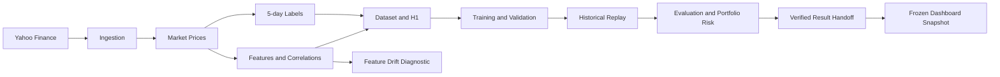

<div align="center">
  <h1>DSDN Portfolio Volatility Pipeline</h1>
  <p>ระบบข้อมูลและการทดลองพยากรณ์ความผันผวนรายสินทรัพย์และความเสี่ยงพอร์ต ETF</p>

  [ภาพรวม Pipeline](docs/pipeline.md) · [คู่มือรันครบลำดับ](docs/RUN_GUIDE.md) · [ผลการทดลอง](docs/ml-results/README.md) · [คู่มือ Dashboard](web/DASHBOARD_GUIDE.md)
</div>

## Table of Contents
- [About](#about)
- [Features](#features)
- [Getting Started](#getting-started)
- [Usage](#usage)
- [Configuration](#configuration)
- [Roadmap](#roadmap)
- [Contributing](#contributing)
- [License](#license)
- [Acknowledgments](#acknowledgments)

## About

โปรเจกต์นี้สร้าง Daily Batch Pipeline สำหรับข้อมูล ETF สามสินทรัพย์ ได้แก่ `SPY`, `IEF` และ `GLD` ตั้งแต่ดึงราคาและตรวจคุณภาพ ไปจนถึงสร้าง Features และ Target เตรียมชุดข้อมูล ฝึกโมเดล จำลอง Historical Replay ประเมินผล และคำนวณความเสี่ยงพอร์ต

ส่วน Dashboard เป็นเว็บแบบ static ที่อ่าน snapshot ซึ่งตรึงไว้ใน repository สำหรับทบทวนหลักฐาน ไม่ได้เชื่อมต่อ Pipeline เพื่อฝึกหรือพยากรณ์แบบสด ดูขอบเขตและข้อจำกัดของ snapshot ได้ใน [คู่มือ Dashboard](web/DASHBOARD_GUIDE.md) และ [รายงานผลปัจจุบัน](docs/ml-results/06_champion_adwin_only.md)

## Features

- **Ingestion:** ดึงราคาจาก Yahoo Finance ด้วย `yfinance`, ใช้ปฏิทิน XNYS, บันทึก raw snapshot, ตรวจ Data Contract, แยกข้อมูลที่ไม่ผ่านไว้ตรวจสอบ และเผยแพร่ curated data พร้อม Audit
- **Features และ Targets:** สร้าง point-in-time volatility features, rolling correlations และ realized volatility ล่วงหน้า 5 วัน พร้อมสถานะ readiness, Pending/Mature, lineage และการกู้คืนการเผยแพร่ ([Features](src/features/README.md), [Targets](src/targets/README.md))
- **Dataset และ Training:** สร้าง Prediction/Supervised views และ H1 analysis จาก Train; ฝึก B0–B4 และเลือกค่า SGD จาก Validation โดยแยก B4 HAR-X OLS ([Dataset](src/ml_dataset/README.md), [Training](src/ml_training/README.md))
- **Historical Replay:** สร้าง forecasts ตามลำดับเวลาและอัปเดต B3 เฉพาะเมื่อ Label mature; รองรับ checkpoint, resume และ Champion ADWIN policy ที่กำหนดแยกจากผล baseline ([Replay](src/ml_replay/README.md))
- **Evaluation:** ประเมิน B0–B4 บน Test ที่ตรึงไว้, H1–H3, coverage, high-volatility metrics และ forecast-based portfolio risk ([Evaluation](src/ml_evaluation/README.md))
- **Feature Drift:** สร้าง diagnostic ที่ตรวจ source lineage และ checksum ก่อนวิเคราะห์ distribution drift (`src/ml_diagnostics/run.py`)
- **Review Dashboard:** สำรวจ forecast, portfolio, model comparison, monitoring และ evidence จาก handoff snapshot ที่ตรวจ checksum แล้ว



## Getting Started

### Prerequisites

- Python `>=3.10,<3.11` (the lockfile targets Python 3.10)
- [uv](https://docs.astral.sh/uv/) for the locked project environment, or Python `venv` and `pip`
- Node.js for building and previewing the optional web dashboard

### Installation

From the repository root, install the locked Python dependencies:

```bash
uv sync --locked
```

For notebooks and the full development/test tools, install both optional groups:

```bash
uv sync --locked --group eda --group dev
```

With `pip`, create and activate a virtual environment, then install the exported runtime and EDA requirements:

```powershell
python -m venv .venv
.venv\Scripts\Activate.ps1
python -m pip install -r requirements.txt
```

On macOS/Linux, activate with `source .venv/bin/activate`. The pip requirements do not include the `dev` group. To run pytest in the pip environment, install it separately:

```bash
python -m pip install "pytest>=8.0.0,<8.4.0"
```

For notebook execution tools as well, install the development group with `uv sync --locked --group dev` instead.

### Quick Start

The first pipeline stage fetches data and writes generated artifacts under the ignored `data/` directory. Run it from the repository root:

```bash
uv run python -m src.ingestion.run --config config/ingestion.yaml
```

The feature and target stages consume the curated price table:

```bash
uv run python -m src.features.run --config config/features.yaml
uv run python -m src.targets.run --config config/target.yaml
```

The later ML stages also need Stage 03–05 artifacts. Their configs contain paths tied to particular local runs, so regenerate or supply those artifacts and refresh run-specific paths when inputs change. Follow [the end-to-end run guide](docs/RUN_GUIDE.md) for the full sequence, API-only stages, and artifact handoffs.

## Usage

### Pipeline stages

Run the market-close scheduler when ingestion should start only after the XNYS close and configured buffer:

```bash
uv run python -m src.ingestion.scheduler --config config/ingestion.yaml --buffer-minutes 30
```

Ingestion, Features, and Targets have command-line entry points. Stage 03 dataset preparation/H1, Stage 04 model training/selection, and Stage 05 replay are Python APIs documented in their module guides. Stage 06 evaluation and Feature Drift provide CLIs. The [run guide](docs/RUN_GUIDE.md) documents the supported order and invocation for each stage.

### Dashboard

The dashboard build uses the project Python environment and Node.js. Activate `.venv` so the `python` command used by npm resolves to the project interpreter, then run:

```powershell
cd web
npm ci
npm test
npm run dev
```

Open `http://localhost:4173`. `npm test` prepares the pinned snapshot, typechecks and builds the site, then runs the browser-data and replay tests. See [the Dashboard Guide](web/DASHBOARD_GUIDE.md) for snapshot identity and hosting details.

### Notebooks and tests

Install the EDA and development groups before launching Jupyter or running the Python test suite:

```bash
uv sync --locked --group eda --group dev
uv run --locked --group eda --group dev jupyter lab
uv run --locked pytest
```

The notebooks are:

1. `notebooks/00_data_quality.ipynb` — source, calendar, price, return, and raw snapshot checks.
2. `notebooks/01_eda_market_prices.ipynb` — price and rolling-volatility exploration.
3. `notebooks/02_eda_features.ipynb` — feature pipeline exploration; requires generated curated feature data.
4. `notebooks/03_ml_results_review.ipynb` — read-only review of a frozen ML result bundle.

### Generated outputs

Pipeline outputs are local artifacts under `data/` and are ignored by Git:

| Path | Contents |
|---|---|
| `data/raw/<source_batch_id>/raw_prices.csv` and `manifest.json` | Raw price snapshot and SHA-256/source metadata |
| `data/curated/market_prices_daily.parquet` | Validated daily prices and returns |
| `data/curated/asset_volatility_features.parquet` | Daily model features and readiness/lineage fields |
| `data/curated/asset_rolling_correlations.parquet` | Historical 20-session ETF correlations |
| `data/curated/asset_volatility_labels.parquet` | Five-session forward volatility labels |
| `data/audit/` | Run reports, quality evidence, manifests, and publish transactions |
| `data/processed/` | Training, replay, evaluation, and drift artifacts |

The exact run-specific paths are recorded in each run manifest. A clean clone has no generated source tables or Stage 03–05 artifacts, so create or provide those before running dependent stages.

## Configuration

Configurations live in `config/`. Review date ranges, source paths, and artifact run IDs before each run.

| File | Purpose |
|---|---|
| `ingestion.yaml` | Data source, tickers, date range, XNYS calendar, and validation rules |
| `features.yaml` | Feature period, warm-up, input/output tables, and publish behavior |
| `target.yaml` | Label period, target version, and publish behavior |
| `ml_dataset.yaml` | Study cutoff, Train/Validation/Test splits, and label availability rules |
| `models.yaml`, `ml_training.yaml` | Model identities, fit rules, and Validation selection settings |
| `ml_replay.yaml` | Replay window, update order, checkpoint rules, and optional Champion policy |
| `ml_evaluation.yaml` | Evaluation protocol and run-specific Stage 03–05 artifact paths |
| `hypothesis_tests.yaml` | Statistical inference settings for H1–H3 |
| `feature_drift.yaml` | Drift windows, thresholds, snapshot identity, and run-specific source paths |

`data/` is generated locally and ignored by Git, apart from placeholder files. A fresh checkout therefore needs the upstream artifacts generated or provided before ML evaluation and diagnostics can use the configured source paths. See the [contracts](docs/contract/README.md) for schema and lifecycle rules.

## Roadmap

The ingestion, feature, target, dataset preparation, training, replay, evaluation, feature-drift, and static review dashboard stages are implemented. The repository includes frozen experiment and dashboard snapshots for review.

The historical replay simulates label availability from maturity and target dates. Its later-downloaded source snapshot does not verify that each source value was available on the historical replay date. The dashboard is a read-only snapshot; live inference, a serving API, automated scheduling/hosting, and prospective evaluation are outside the implemented workflow. Current handoff status and experiment limitations are recorded in [the results index](docs/ml-results/README.md) and [the latest policy report](docs/ml-results/06_champion_adwin_only.md).

## Contributing

When changing schemas, calculations, or lifecycle rules, update the related contract and module guide alongside the implementation. Run the focused checks for the affected stage and the Python or web suite when the change crosses stage boundaries.

## License

This project is available under the [MIT License](LICENSE).

## Acknowledgments

Market data is retrieved through Yahoo Finance's `yfinance` client. Trading sessions use the XNYS calendar from `pandas-market-calendars`.
