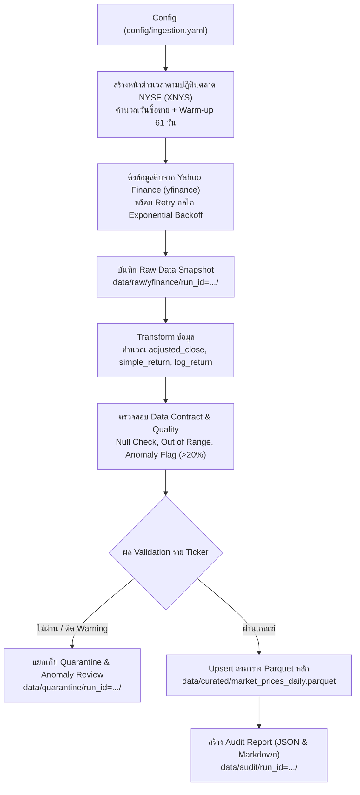

# DSDN Portfolio Volatility Pipeline

ระบบ Data Ingestion และเตรียมข้อมูลทางการเงิน (Daily Batch Pipeline) สำหรับประมาณการความผันผวนของพอร์ตโฟลิโอ ETF 3 สินทรัพย์ ได้แก่:
- **`SPY`** (SPDR S&P 500 ETF Trust)
- **`IEF`** (iShares 7-10 Year Treasury Bond ETF)
- **`GLD`** (SPDR Gold Shares)

ระบบรองรับการดึงข้อมูลจาก Yahoo Finance (`yfinance`), การคำนวณผลตอบแทน (Simple & Log Return), การตรวจสอบคุณภาพข้อมูลตาม Data Contract, การกักกันข้อมูลผิดปกติ (Quarantine), การบันทึก Audit Report และ Feature Engineering แบบ point-in-time สำหรับความผันผวนรายสินทรัพย์กับ Correlation ของพอร์ต

---

## สารบัญ
1. [โครงสร้าง Pipeline การไหลของข้อมูล](#โครงสร้าง-pipeline-การไหลของข้อมูล)
2. [ข้อกำหนดเบื้องต้น (Prerequisites)](#ข้อกำหนดเบื้องต้น-prerequisites)
3. [การติดตั้งและตั้งค่า Environment](#การติดตั้งและตั้งค่า-environment)
4. [การกำหนดค่าใน Config (config/ingestion.yaml)](#การกำหนดค่าใน-config-configingestionyaml)
5. [วิธีรันคำสั่ง (How to Run)](#วิธีรันคำสั่ง-how-to-run)
   - [5.1 รัน Ingestion Pipeline หลัก](#51-รัน-ingestion-pipeline-หลัก)
   - [5.2 รันผ่าน Market Scheduler (ตรวจสอบเวลาตลาดปิด)](#52-รันผ่าน-market-scheduler-ตรวจสอบเวลาตลาดปิด)
   - [5.3 รัน Unit Tests](#53-รัน-unit-tests)
   - [5.4 รัน Feature Engineering Pipeline](#54-รัน-feature-engineering-pipeline)
6. [โครงสร้างข้อมูลผลลัพธ์ (Data Output Structure)](#โครงสร้างข้อมูลผลลัพธ์-data-output-structure)

---

## โครงสร้าง Pipeline การไหลของข้อมูล



---

## ข้อกำหนดเบื้องต้น (Prerequisites)

- **Python Version**: `>= 3.10, < 3.11` (แนะนำ Python 3.10.x)
- **Package Manager**: แนะนำใช้ [uv](https://docs.astral.sh/uv/) หรือ `pip` มาตรฐาน

---

## การติดตั้งและตั้งค่า Environment

### วิธีที่ 1: ติดตั้งด้วย `uv` (แนะนำ - เร็วและล็อก dependency แน่นอน)

```bash
# ซิงค์ dependencies จาก uv.lock
uv sync
```

### วิธีที่ 2: ติดตั้งด้วย Python `venv` มาตรฐาน

**บน Windows (PowerShell):**
```powershell
# สร้าง virtual environment
python -m venv .venv

# Activate venv
.venv\Scripts\Activate.ps1

# ติดตั้ง dependencies
pip install -r requirements.txt
```

**บน macOS / Linux:**
```bash
# สร้าง virtual environment
python3 -m venv .venv

# Activate venv
source .venv/bin/activate

# ติดตั้ง dependencies
pip install -r requirements.txt
```

### Environment สำหรับ EDA / Jupyter

ติดตั้ง dependencies ของ notebook (รวม NumPy, Matplotlib, IPython kernel,
JupyterLab) จาก lockfile:

```bash
uv sync --locked --no-dev --group eda
uv run --locked --no-dev --group eda jupyter lab
```

เลือก kernel ที่ใช้ Python ใน `.venv` ของโปรเจกต์ หากใช้ VS Code ให้เลือก
`.venv/Scripts/python.exe` บน Windows หรือ `.venv/bin/python` บน macOS/Linux
ส่วน `requirements.txt` export รวมกลุ่ม EDA แล้วสำหรับผู้ใช้ pip

อ่าน notebook ตามลำดับ:

1. `notebooks/00_data_quality.ipynb` — ตรวจโครงสร้าง วันซื้อขาย ค่าว่าง ราคา
   สูตร return/RV และเทียบวันสุดขั้วกับ raw snapshot
2. `notebooks/01_eda_market_prices.ipynb` — วิเคราะห์การกระจาย RV20
   ความผันผวนรายปี ความสัมพันธ์ sensitivity ของ distribution และ ACF แบบย่อ

ทั้งสองเล่มอ่าน curated Parquet เดิมและรันแยก kernel กันได้ ไม่ต้องส่งตัวแปร
ระหว่าง notebook และไม่แก้ราคาหรือเขียนทับ curated ใช้ config ให้ตรงกับช่วงข้อมูล
และ warm-up ใน `config/ingestion.yaml` หากยังไม่มี Parquet ให้รัน ingestion ก่อน
ข้อมูลถูกสร้างในเครื่องและไม่ได้รวมใน Git Schema ปัจจุบันต้องมี `open` จาก `Open`
ในโหมด `auto_adjust=True`; หาก Parquet เดิมไม่มีคอลัมน์นี้ ให้สร้างใหม่ผ่าน ingestion
ก่อนเปิด notebook ห้ามใช้ราคาปิดแทนราคาเปิด ส่วนการเทียบ raw ใน `00` ต้องมี snapshot
กับ manifest ของ batch ที่เกี่ยวข้อง แต่ไม่ต้องอ่าน audit report ของ pipeline

เครื่องมือรัน notebook อัตโนมัติ (`nbclient`, `nbformat`) ประกาศไว้ในกลุ่ม `dev`
สำหรับงานพัฒนาและตรวจสอบ ติดตั้งพร้อม EDA ด้วย `uv sync --locked --group eda --group dev`
ทั้งนี้ JupyterLab อาจติดตั้งเครื่องมือบางตัวทางอ้อมตาม dependencies ของตัวเอง

เมื่อปรับ dependencies ให้สร้างไฟล์สำหรับ pip ใหม่ด้วย:

```bash
uv export --frozen --no-dev --group eda --format requirements-txt -o requirements.txt
```

---

## การกำหนดค่าใน Config (`config/ingestion.yaml`)

ไฟล์ตั้งค่าหลักอยู่ที่ `config/ingestion.yaml` ตัวอย่างการตั้งค่า:

```yaml
project:
  name: "DSDN Portfolio Volatility"

source:
  provider: "Yahoo Finance"
  client: "yfinance"
  interval: "1d"
  tickers:
    - "SPY"
    - "IEF"
    - "GLD"

date_range:
  start_date: "2021-09-27"
  end_date: "2026-09-25"
  warmup_trading_days: 61       # ดึงเผื่อวันทำการล่วงหน้าสำหรับคำนวณ Rolling Return/Volatility

price:
  auto_adjust: true
  canonical_price: "adjusted_close"

calendar:
  market: "XNYS"                # ปฏิทินตลาด NYSE
  market_timezone: "America/New_York"

validation:
  simple_return_anomaly_threshold: 0.20  # เกณฑ์ Return ผิดปกติ ±20%
  allow_missing_trading_days: false

execution:
  mode: "historical"
  max_attempts: 3
  timeout_seconds: 15
```

---

## วิธีรันคำสั่ง (How to Run)

> **ข้อควรระวัง**: ตรวจสอบให้แน่ใจว่าได้ **Activate Virtual Environment (`.venv`)** ก่อนรันคำสั่งเสมอ หรือชี้ตัวรันไปที่ Python ของ `.venv`

### 5.1 รัน Ingestion Pipeline หลัก

คำสั่งนี้จะรันกระบวนการดึงข้อมูล, ทำความสะอาด, ตรวจสอบ Contract, บันทึกข้อมูล Curated และสร้าง Audit Report ทันที:

**หาก Activate `.venv` แล้ว:**
```bash
python -m src.ingestion.run --config config/ingestion.yaml
```

**หากรันผ่าน `uv` (โดยไม่ต้อง activate venv):**
```bash
uv run python -m src.ingestion.run --config config/ingestion.yaml
```

**หากระบุ path Python ของ `.venv` โดยตรง (Windows PowerShell):**
```powershell
.venv\Scripts\python -m src.ingestion.run --config config/ingestion.yaml
```

---

### 5.2 รันผ่าน Market Scheduler (ตรวจสอบเวลาตลาดปิด)

โมดูล `scheduler.py` จะตรวจสอบปฏิทินตลาด NYSE ของวันปัจจุบัน หากตลาดปิดหรือยังไม่ถึงเวลาปิดทำการ (รวม Buffer) ระบบจะ Skip และลงบันทึก Audit ไว้ โดยไม่ดึงข้อมูลก่อนเวลา:

```bash
# รัน scheduler (ค่าเริ่มต้น buffer_minutes = 30 นาทีหลังตลาดปิด)
python -m src.ingestion.scheduler --config config/ingestion.yaml --buffer-minutes 30
```

- หากยังไม่ถึงเวลาปิดตลาด: ระบบจะ Log แจ้งเตือนเวลาที่ต้องรอ และไม่เริ่ม Pipeline
- หากถึงเวลาแล้ว: ระบบจะเรียก `src.ingestion.run` ให้โดยอัตโนมัติ และบันทึก Log ลง `data/audit/scheduler/<YYYY-MM-DD>.json`

---

### 5.3 รัน Unit Tests

รันชุดทดสอบเพื่อตรวจความถูกต้องของ Calendar Window, Fetching, Transformations, Contract Validation และ Feature Engineering:

```bash
# รันผ่าน python -m pytest เพื่อให้โหลด root path (src) ได้อย่างถูกต้อง
python -m pytest
```

หรือระบุไฟล์เจาะจง:
```bash
python -m pytest src/ingestion/test_ingestion.py -v
```

---

### 5.4 รัน Feature Engineering Pipeline

Feature Pipeline อ่าน `market_prices_daily.parquet` ที่ผ่าน Data Contract แล้วสร้าง Features ตาม
[Feature Contract](docs/contract/feature_contract.md) และ [Data Dictionary](docs/contract/datadict.md)
โดยใช้ข้อมูลถึงวันอ้างอิงเท่านั้น

ตรวจค่าใน `config/features.yaml` ให้ตรงกับช่วงข้อมูลจริงก่อนรัน:

```bash
python -m src.features.run --config config/features.yaml
```

ค่าเริ่มต้นอ่าน `data/curated/market_prices_daily.parquet`, ใช้ปฏิทิน XNYS ตรวจวันซื้อขายและช่วง Warm-up
61 วันก่อน `feature.start_date`, แล้วเผยแพร่ Parquet สองตารางพร้อม Manifest ที่เก็บ SHA-256 ของ Input
และ Config รวมถึง `source_batch_id` ที่ใช้ในแต่ละ Ticker

- `asset_volatility_features` มี 18 คอลัมน์: 8 Core Features, `rsi_14d` และ `bb_width_20d` ซึ่งเป็น Experimental Features และคอลัมน์สถานะ/Lineage
- `asset_rolling_correlations` มี 8 คอลัมน์ โดย Correlation ทั้ง 3 คู่คำนวณจากผลตอบแทน 20 วันชุดเดียวกันและตรวจ PSD ก่อนตั้ง `is_corr_ready=True`
- ใช้เฉพาะแถว `is_model_ready=True` และ `is_warmup_buffer=False` สำหรับ Train/Evaluation; `is_model_ready` ไม่ขึ้นกับ Target หรือ Experimental Features
- `bb_width_20d` ใช้ส่วนเบี่ยงเบนมาตรฐานแบบ Population จากราคาปิด 20 จุด; Correlation เป็น Historical Proxy จากอดีต ไม่ใช่การพยากรณ์ Correlation อนาคต
- การรันซ้ำจะ Upsert ตาม Primary Key โดยไม่สร้างแถวซ้ำ หากค่าธุรกิจของ Key เดิมเปลี่ยน Pipeline จะหยุดก่อนเผยแพร่; ให้ตรวจ Input ก่อน แล้วจึงใช้ `--overwrite-conflicts` เมื่อตั้งใจแทนค่าจริง

ทดสอบ Feature Pipeline:

```bash
python -m pytest src/features/test_feature_pipeline.py -v
```


---

## โครงสร้างข้อมูลผลลัพธ์ (Data Output Structure)

เมื่อ Pipeline ทำงานเสร็จสมบูรณ์ ข้อมูลจะถูกจัดเก็บตามโครงสร้างดังนี้:

| โฟลเดอร์ / ไฟล์ | รายละเอียด |
| :--- | :--- |
| `data/curated/market_prices_daily.parquet` | ข้อมูลราคาและผลตอบแทนมาตรฐานที่ผ่านการ Validate แล้ว (พร้อมใช้งานในขั้นตอน Feature Engineering) |
| `data/curated/asset_volatility_features.parquet` | Feature รายวันของ SPY, IEF และ GLD ตาม Schema 18 คอลัมน์ |
| `data/curated/asset_rolling_correlations.parquet` | Correlation ย้อนหลัง 20 วันของ ETF ทั้งสามตาม Schema 8 คอลัมน์ |
| `data/raw/yfinance/run_id=<run_id>/` | Snapshot ข้อมูลดิบที่ดาวน์โหลดจาก Yahoo Finance แยกตามราย Ticker ในรูปแบบ Parquet และ `metadata.json` |
| `data/quarantine/run_id=<run_id>/` | ข้อมูลแถวหรือ Ticker ที่ไม่ผ่านการตรวจสอบ Contract พร้อม `records.json` และ `anomaly_review.json` |
| `data/audit/run_id=<run_id>/` | รายงานสรุปผลการรันประจำรอบ ได้แก่ `run_report.json`, `run_report.md` และ `run_metadata.json` |
| `data/audit/features/run_id=<run_id>/manifest.json` | Input/Config checksums, source batches, Feature Version และเส้นทาง Output ของ Feature Run |
| `data/audit/scheduler/<date>.json` | Log การตรวจสอบสถานะตลาดและการทำงานของ Scheduler ประจำวัน |

---
