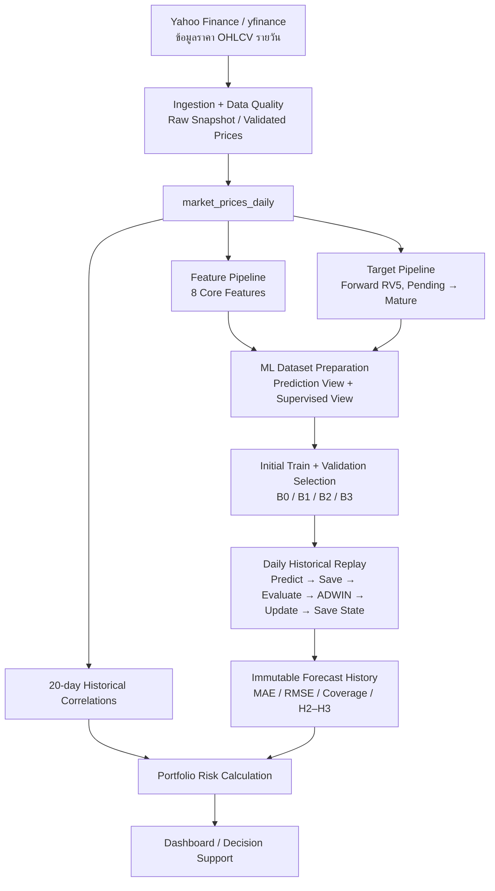

# DEDS — Adaptive Portfolio Risk Lab
## เอกสารภาพรวมโครงงานและข้อตกลงร่วมกันสำหรับทีม

**เวอร์ชันเอกสาร:** 1.0 — 20 พฤศจิกายน 2026  
**กลุ่มผู้อ่าน:** เพื่อนร่วมทีม DS/EDA/Research, ผู้เตรียมรายงาน/การนำเสนอ และผู้ที่ต้องเข้าใจภาพรวม  
**สถานะ:** **Design decisions agreed / Implementation pending** — เป็นสรุปข้อตกลง ไม่ใช่รายงานผลทดลอง ไม่ใช่คำสั่งให้แก้ GitHub และไม่ใช่ Action Plan สำหรับ AI

> **อ่านหน้านี้ก่อน:** เรากำลังสร้างระบบพยากรณ์ *ความผันผวนของสินทรัพย์* SPY, IEF, GLD ใน **5 วันซื้อขายถัดไป** แล้วนำผลไปคำนวณความเสี่ยงพอร์ตตามน้ำหนักที่ผู้ใช้เลือก เป้าหมายการทดลองหลักคือ **Online SGD ที่เรียนรู้ต่อเนื่อง (B3) ช่วยลดความผิดพลาดจาก Static SGD (B2) หรือไม่** โดยทดสอบอย่างยุติธรรม ไม่ใช้ข้อมูลอนาคตก่อนเวลา และไม่ใช้ Test ปรับโมเดล

---

## สำหรับการใช้ร่วมกันในทีม (สำคัญ)

**เจ้าของงานหลักจะพัฒนา Implementation ทั้ง 6 Stages ด้วยตนเอง** รวมถึง Data Engineering, Target Pipeline Integration, Dataset Preparation, Training B0–B3, Daily Replay/ADWIN/Checkpoint, Final Hypothesis Testing และ Portfolio Integration เพื่อนร่วมทีมใช้เอกสารนี้เป็น **ข้อกำหนดอ้างอิงกลางสำหรับ Data Science, EDA, Research, Figures และการเตรียมรายงาน** ไม่ต้องร่วมแก้โค้ดหรือแบ่ง Stage Implementation.

- คำว่า **LOCKED** หมายถึงข้อตกลงวิธีทำ ไม่ใช่ผลการทดลองสำเร็จแล้ว
- คำว่า **PENDING RESULTS** หมายถึงยังไม่มีผลจาก Pipeline/Validation/Test ที่ยืนยันจริง อย่าใส่ตัวเลขสมมติเป็นผลวิจัย
- เพื่อนสามารถศึกษาและออกแบบการวิเคราะห์จากสเปกนี้ล่วงหน้า แต่การรายงานค่า p-value, Error, Coverage, Drift และ Portfolio Output ต้องรอไฟล์ผลจริง
- ถ้าต้องการทำ EDA จากข้อมูลที่มี ให้ขอ **Snapshot + Split/Eligibility Manifest ที่ตกลงแล้ว**; อย่าคิดเองว่าไฟล์ย้อนหลังทั้งหมดใช้ฝึกหรือทดสอบได้
- งานเตรียม EDA/Research แนะนำใน [`02_DS_EDA_AND_RESEARCH_GUIDE.md`](./02_DS_EDA_AND_RESEARCH_GUIDE.md) ส่วนกรอบการบันทึกผลอยู่ใน [`03_REPORT_EVIDENCE_AND_TEMPLATES.md`](./03_REPORT_EVIDENCE_AND_TEMPLATES.md)

---

## 1. สรุปสำหรับสมาชิกทีม (Executive Summary)

| ประเด็น | ข้อตกลง |
|---|---|
| **โจทย์** | Asset-level 5-day forward realized volatility forecasting + downstream portfolio risk |
| **สินทรัพย์** | `SPY`, `IEF`, `GLD` |
| **สิ่งที่ทำนาย** | ความผันผวนที่เกิดขึ้นจริงใน 5 **วันซื้อขาย** ถัดไป แสดงเป็นค่า **annualized decimal** เช่น `0.18` = 18% annualized |
| **วิธีหลัก** | เปรียบเทียบ Baselines B0/B1 กับ SGD แบบ Static B2 และ Online B3 |
| **จุดเด่น** | Online learning ที่รู้จัก **Label Delay**, Historical Replay แบบ Predict-before-Update, Drift Monitoring ด้วย ADWIN, การทำซ้ำ/Resume ได้ |
| **ความถี่ Inference** | หลังปิดตลาดในทุก XNYS trading session เมื่อข้อมูลผ่าน Validation |
| **การประเมินหลัก** | Test แบบจับคู่ B3 เทียบ B2 ด้วย **Macro-Average MAE**; รายงาน RMSE, Coverage, High-Volatility และแยก ETF |
| **Hypothesis Testing** | มี **3 Research Hypotheses H1–H3** ที่ตกลงให้ทำจริง |
| **ขอบเขตข้อมูลปัจจุบัน** | คงราคาสิ้นสุด `2026-09-25`; Test forecasts ท้ายช่วงที่ยังไม่มี Mature Label ไม่ถูกนำไปคิด MAE |
| **สถานะงาน** | ตกลง Design และ Implementation Requirements แล้ว; **ยังไม่ยืนยันว่าโค้ดใหม่ทำงานหรือ Tests ผ่าน** |

### ทีมควรตอบได้ 4 คำถามนี้

1. **ทำไมต้องคาดการณ์แยกสินทรัพย์?** เพื่อให้ผู้ใช้ปรับสัดส่วนพอร์ตได้โดยไม่ต้องฝึกโมเดลใหม่
2. **ทำไมต้องมี B2 และ B3?** เพื่อแยกผลของนโยบาย *เรียนรู้ต่อเนื่อง* ออกจากโมเดล SGD ที่เริ่มจากจุดเดียวกันแต่ไม่เรียนรู้เพิ่ม
3. **ทำไมต้องรอ 5 วัน?** เพราะคำตอบจริงเป็น realized volatility จากผลตอบแทนของ `t+1..t+5` ซึ่งยังไม่รู้ในวันที่ทำนาย `t`
4. **จะรู้ว่าดีกว่าจริงได้อย่างไร?** วัดจากคำทำนายที่บันทึกไว้ก่อนรู้ผล จับคู่วันเดียวกัน แสดง Error/Coverage และใช้ Hypothesis Testing ที่คำนึงถึงอนุกรมเวลา

---

## 2. ภาพรวมระบบตั้งแต่ข้อมูลถึงผลลัพธ์



### ข้อมูลหลัก 5 Logical Tables (คงเดิม)

| ตาราง | บทบาท |
|---|---|
| `market_prices_daily` | ราคาและผลตอบแทนรายวันหลังตรวจคุณภาพ |
| `asset_volatility_features` | Features สำหรับโมเดลและสถานะความพร้อม |
| `asset_rolling_correlations` | ความสัมพันธ์ย้อนหลัง 20 วันระหว่างคู่ ETF สำหรับ Portfolio Risk |
| `asset_volatility_labels` | คำตอบจริง Forward RV5 พร้อมสถานะ Pending/Mature |
| `asset_volatility_predictions` | คำทำนายที่สร้างแล้ว และเชื่อมกลับถึงโมเดล/ข้อมูล/รันที่ใช้ |

**กฎสำคัญ:** ไม่เพิ่ม Logical Table ที่ 6; `asset_volatility_predictions` ยังคง **16 คอลัมน์**, `asset_volatility_labels` ยังคง **12 คอลัมน์** ตาม Contract ที่ล็อกไว้ ส่วนผล Evaluation, Logs, Checkpoints และ Manifest จัดเก็บเป็นไฟล์/Artifacts ตามหน้าที่

---

## 3. สิ่งที่เราทำนายจริง ๆ และการคำนวณความเสี่ยงพอร์ต

### 3.1 Target: Forward RV5

ณ วันซื้อขาย `t` เราใช้ Log Returns ใน **5 วันซื้อขายถัดไป** เพื่อสร้างคำตอบจริง

\[
RV_{i,t,5} = \sqrt{\frac{252}{5}\sum_{k=1}^{5}r_{i,t+k}^{2}}
\]

- `i` คือ SPY, IEF หรือ GLD
- `r` คือ **log return** รายวัน
- `252` เป็นค่ามาตรฐานสำหรับ annualization ในการทดลองนี้
- ค่า `0.18` หมายถึง **18% annualized volatility บน horizon 5 วัน** ไม่ใช่การคาดการณ์ผลตอบแทน 18% หรือคาดการณ์ล่วงหน้า 1 ปี
- **Prediction วัน t** ต้องสร้างจากข้อมูลที่ทราบได้ไม่เกินวัน `t` เท่านั้น

### 3.2 Core Features ที่ใช้ใน B2/B3 (ทั้งหมด 8 ตัว)

| กลุ่ม | ฟีเจอร์ |
|---|---|
| ผลตอบแทนปัจจุบันและย้อนหลัง | `ret_1d_t`, `ret_lag_1d`, `ret_lag_2d` |
| ผลตอบแทนสะสม | `ret_trailing_5d`, `ret_trailing_20d` |
| ความผันผวนย้อนหลัง | `rv_5d`, `rv_20d`, `rv_60d` |

`rsi_14d` และ `bb_width_20d` ยังอยู่ใน Schema เป็น **Experimental Features** แต่ **ไม่ใช่ Core 8** และไม่บังคับทำ Ablation ใน MVP

### 3.3 Portfolio Risk (ส่วน downstream)

โมเดลทั้งสามสินทรัพย์ให้ค่าพยากรณ์ \(\hat\sigma_\mathrm{SPY},\hat\sigma_\mathrm{IEF},\hat\sigma_\mathrm{GLD}\) แยกกัน จากนั้นนำไปประกอบกับ **20-day historical correlation proxy** เพื่อประมาณ covariance และความผันผวนของพอร์ต:

\[
\Sigma_t = D_t R_t D_t,\qquad
\hat\sigma_{p,t} = \sqrt{w^\top\Sigma_t w}
\]

โดย `D` มาจาก Volatility Forecasts, `R` มาจากความสัมพันธ์ย้อนหลัง และ `w` คือน้ำหนักพอร์ต

**Default Portfolio Weights:** SPY/IEF/GLD = **50/30/20**; ผู้ใช้ปรับได้โดย **ไม่ Retrain** Asset Models ทั้งนี้ต้องมี Forecast ครบ 3 ETF ในวัน/ชุดโมเดลเดียวกัน และ Correlation Matrix ผ่านการตรวจคุณภาพก่อนคำนวณ

---

## 4. ข้อตกลงหัวข้อใหญ่ 1 — Initial Training

**คำถาม:** เริ่มฝึกโมเดลอย่างไรให้เปรียบเทียบ Static/Online ได้ยุติธรรม?

- ใช้ข้อมูล **Train เต็มช่วงที่ผ่าน Eligibility/Purge** และ Mature Labels ตามกฎเวลา
- ฝึก **SGDRegressor แยก SPY / IEF / GLD**
- สร้าง **Clean Initial State** แล้วให้ B2 และ B3 ของ ETF เดียวกันเริ่มจาก **Model State และ RobustScaler State เดียวกันจริง ๆ** รวมถึง optimizer state/counters ที่เกี่ยวข้อง
- B0 Historical Mean คำนวณค่าเฉลี่ย Target จาก Train ที่ใช้ได้เท่านั้น
- B1 Rolling RV20 ไม่ต้อง Fit โมเดล ใช้ `rv_20d` ณ วันทำนายโดยตรง
- ต้องตรวจว่าไม่มี Validation/Test Label เข้า Initial Training

**เหตุผล:** ถ้า B2/B3 เริ่มคนละสถานะ เราจะไม่รู้ว่าผลต่างเกิดจาก Online Update หรือเกิดจากการเริ่มต้นไม่เท่ากัน

---

## 5. ข้อตกลงหัวข้อใหญ่ 2 — Training Window

**คำถาม:** เมื่อมีข้อมูลใหม่ B3 จะเรียนรู้อย่างไร?

- **B2 = Static:** ตรึงโมเดลหลัง Initial Training ไม่อัปเดตอีก
- **B3 = Online:** เก็บสถานะการเรียนรู้แบบ **สะสมต่อเนื่อง (cumulative incremental state)**
- เมื่อ Label ใหม่ Mature และผ่านเงื่อนไข จึงใช้ `partial_fit()` กับชุดตัวอย่างใหม่ **หนึ่งครั้งต่อ Batch ที่มีสิทธิ์**
- **ไม่** Rolling Refit ทั้ง Train ทุกวัน และ **ไม่** ฝึกใหม่บนหน้าต่างย้อนหลัง 20/60 วันเป็นประจำ
- RobustScaler ของแต่ละ ETF **Fit บน Train เท่านั้น และตรึงไว้ตลอด Validation/Test**

**เหตุผล:** ต้องการศึกษาว่าการเรียนรู้จากข้อมูลใหม่ช่วยให้ปรับตัวดีขึ้นหรือไม่ โดยไม่ปะปนกับวิธี Refit ใหม่ทั้งหมด

---

## 6. ข้อตกลงหัวข้อใหญ่ 3 — Online Update และ ADWIN

### 6.1 ลำดับงานรายวัน (ล็อกแล้ว)

ทุกวันซื้อขาย XNYS หลังปิดตลาดและตรวจข้อมูลเสร็จ:

**Predict → Save Forecast → Evaluate Mature Predictions → ADWIN → Online Update B3 → Save State**

ตัวอย่าง ณ D10:
- ทำนาย Forward RV5 ของ D10 และบันทึกก่อน
- หากคำตอบของ D5 เพิ่ง Mature ที่ D10 ให้ตรวจคำทำนายเดิมของ D5
- ส่ง **Absolute Error ของ B3 ที่บันทึกไว้เดิม** เข้า ADWIN ประจำ ETF
- ใช้ Label D5 อัปเดต B3 หลัง Predict ของ D10 แล้ว
- State ใหม่ใช้ตั้งแต่การทำนาย D11 เป็นต้นไป

### 6.2 Label Delay และการป้องกัน Leakage

- การมี `is_label_mature=True` ในไฟล์ที่คำนวณย้อนหลัง **ไม่ได้แปลว่าโมเดลใช้ Label นั้นได้ตั้งแต่วันในอดีต**
- ณ Replay Day `s` ต้องตรวจ `target_end_date <= s` และข้อมูลที่จำเป็นผ่าน Quality/Availability แล้วจริงตามเวลา
- ไม่อัปเดต Label `(anchor_date,ticker)` เดิมซ้ำใน Replay เดียวกัน
- รายการที่เคยถูก Purge ออกจาก Fixed Split **สามารถใช้ Online Update ภายหลังได้เมื่อ Mature จริง** แต่ห้ามย้อนกลับไปใช้เลือก Hyperparameters ที่ไม่ควรเห็นข้อมูลนั้น

### 6.3 ADWIN ทำหน้าที่อะไร?

- แยก **ADWIN หนึ่ง Detector ต่อ ETF** โดยดู **Absolute Prediction Error ของ B3**
- ใช้ตรวจการเปลี่ยนแปลงและบันทึก **Alert/Drift Monitoring**
- **ไม่** Auto Reset, Auto Retrain หรือเปลี่ยน Hyperparameters เมื่อมี Alert
- ค่าเริ่มต้นตามแผน `delta=0.002` พร้อมบันทึก Version/Config; การตีความ Alert เป็นเพียงหลักฐานการเปลี่ยนแปลงของ Error ไม่ใช่ข้อพิสูจน์ว่าเกิด Concept Drift เสมอไป

---

## 7. ข้อตกลงหัวข้อใหญ่ 4 — Preprocessing & Hyperparameters

### 7.1 นโยบายที่เลือก

| ส่วน | ข้อตกลง |
|---|---|
| Scaler | **RobustScaler**, Fit Train-only แยก ETF, Frozen หลัง Fit |
| Regressor | `SGDRegressor` |
| Loss | `squared_error` |
| Penalty | `l2` |
| Learning Rate Policy | `constant` |
| Initial Fit | `shuffle=True`, `random_state=42`, `tol=None`, `early_stopping=False` |
| Online Learning | `partial_fit` จาก Eligible Mature Labels, ไม่ทำ Initial Epochs ซ้ำทุกวัน |

### 7.2 Grid Search ที่ตกลง

| Parameter | ชุดค่าทดลอง |
|---|---|
| `eta0` | `0.0001`, `0.001`, `0.01` |
| `alpha` | `1e-5`, `1e-4`, `1e-3` |
| Initial `max_iter` | `20`, `50`, `100` |

เท่ากับ **27 Parameter Sets ต่อ ETF = 81 configurations ทั้งหมด** แต่ละ Configuration เปรียบเทียบ B2 และ B3 ภายใต้เงื่อนไขเดียวกัน

**การเลือกค่า:** เลือกแยก ETF จากคะแนนบน Validation โดยเฉลี่ย MAE ของ B2 และ B3:

\[
J_i(h)=\frac{\mathrm{MAE}_{B2,i,\mathrm{Val}}(h)+\mathrm{MAE}_{B3,i,\mathrm{Val}}(h)}{2}
\]

เลือกชุดที่ `J` ต่ำสุดโดยต้องตรวจ Validity/Coverage, และใช้ Hyperparameters ที่เลือก **เหมือนกันระหว่าง B2/B3 ของ ETF เดียวกัน** ส่วน Tie-break และ Coverage Admissibility ต้องกำหนดก่อนดู Test ตามเกณฑ์โปร่งใส

`StandardScaler` และ `Huber loss` เป็น **Optional Comparisons** ไม่ใช่งานบังคับของ MVP

---

## 8. ข้อตกลงหัวข้อใหญ่ 5 — Validation & Test Protocol

### 8.1 แบ่งเวลาแบบ Chronological (ไม่สุ่ม)

| ชุด | ช่วง Anchor Date | จุดประสงค์ |
|---|---|---|
| **Train** | `2021-09-27` ถึง `2024-09-30` | Initial Training, Train-only Scaler, B0 และ H1 |
| **Validation** | `2024-10-01` ถึง `2025-09-30` | เลือก Hyperparameters และกำหนดเกณฑ์ก่อน Test |
| **Test** | `2025-10-01` ถึง `2026-09-25` | ประเมิน Final โดยห้าม Test-based Tuning |

### 8.2 Purge คืออะไร?

เพราะ Label ณ `t` ใช้ข้อมูลจาก `t+1..t+5` แถวใกล้รอยต่อระหว่าง Split อาจใช้คำตอบจากช่วงถัดไป เราจึง **กันแถวดังกล่าวออกจากการฝึก/การให้คะแนน Fixed Split ที่ไม่ควรใช้**

กฎของแถวในช่วงก่อนหน้า:

```text
ถ้า target_end_date >= วันแรกของ split ถัดไป
→ กันแถวนั้นออกจาก fixed training/selection/scoring membership
```

ใช้ทั้ง Train→Validation และ Validation→Test ตาม Contract เดิม

**Purge ไม่ได้ลบราคาหรือ Labels ทิ้ง** และไม่ได้ห้าม B3 เรียนรู้จากแถวเหล่านี้ตลอดไป หากภายหลัง Mature จริงตาม Replay Time ก็อัปเดตแบบ Online ได้

### 8.3 Continuous Replay + Strict Fair Comparison

- หลังเลือก Hyperparameters จาก Validation แล้ว ให้สร้าง Initial State ใหม่อย่างสะอาดและ Replay **Validation → Test ต่อเนื่อง**
- **B2** ตรึง State; **B3** นำความรู้ที่สะสมจาก Mature Labels ระหว่าง Validation เข้าสู่ Test ด้วย
- B2/B3 มี Same Initial State, Features, Scaler, Hyperparameters, Target/Eligibility และใช้ **Paired Test Dates เดียวกัน**
- **ไม่มี Test-based Tuning** และห้ามแก้คำทำนายย้อนหลัง
- คำว่า *B3 เริ่ม Test ด้วย State เดียวกับ B2* **ไม่ถูกต้อง**; ทั้งคู่เริ่ม **ก่อน Replay Validation** ด้วย State เดียวกัน แต่ B3 เปลี่ยนไปตามกฎ Online Update ก่อนถึง Test โดยตั้งใจ
- Historical Replay แสดงการทดลองตามลำดับเวลา แต่ Snapshot ราคาที่ถูกปรับย้อนหลังไม่รับประกันว่าเป็น Point-in-Time Data Vintage จริง

### 8.4 Strict Data Cutoff ที่เลือกไว้

- **ราคาต้นทาง/Test Anchor End:** `2026-09-25` คงไว้ตามเดิม
- ไม่ขยายดึงข้อมูลถึง `2026-10-02` ใน MVP นี้
- Forecast ของช่วงท้ายที่ยังไม่มีครบ 5 Future Returns ให้สถานะ **Pending Evaluation**
- Pending Labels **ไม่** นับเป็น Forecast Failure; ไม่คิด MAE/RMSE จาก Target ที่ยังไม่ Mature
- การขยายข้อมูลเพื่อทำให้ Label Mature ภายหลังเป็น **ทางเลือกอนาคต** ไม่ใช่งานปัจจุบัน และไม่จำเป็นต้องเปลี่ยนสูตร Target หรือฝึกโมเดลใหม่เพียงเพื่อให้คะแนน Forecast เดิม

---

## 9. ข้อตกลงหัวข้อใหญ่ 6 — Evaluation & Model Selection

### 9.1 โมเดลที่เปรียบเทียบ

| ID | ชื่อ Contract | หน้าที่ |
|---|---|---|
| **B0** | `CONSTANT_BASELINE` | ใช้ค่าเฉลี่ย Label จาก Train แบบคงที่ |
| **B1** | `ROLLING_20D_BASELINE` | ใช้ `rv_20d` ของวันทำนายโดยตรง |
| **B2** | `STATIC_SGD` | SGD ฝึกครั้งแรกแล้ว Freeze |
| **B3** | `ONLINE_SGD` | SGD ที่เรียนรู้เพิ่มเมื่อ Label Mature |

### 9.2 คะแนนและเกณฑ์สำคัญ

- **Primary:** B3 vs B2 ด้วย **Paired Macro-Average MAE** บน Final Test  
  \(\mathrm{MacroMAE}=(\mathrm{MAE}_{SPY}+\mathrm{MAE}_{IEF}+\mathrm{MAE}_{GLD})/3\) — ETF เท่ากัน ไม่ใช่น้ำหนักพอร์ต `50/30/20`
- **Secondary:** RMSE, MAE แยก ETF, B0–B3 Fair Comparison และ **Coverage** (จำนวนที่ควรทำนาย / ทำนายสำเร็จ / ประเมินได้)
- **High-Volatility:** ใช้ Threshold = **Train 80th Percentile ของ Forward RV5 แยก ETF**; รายงาน MAE + N/Coverage กลุ่มนั้น
- **Temporal Evaluation:** ผลรายเดือน/ปีแยก **Validation และ Test**, Rolling MAE **20 XNYS sessions**, เทียบ ADWIN Alerts กับ Error Timeline
- วันของแต่ละโมเดลต้องจับคู่กันก่อนเปรียบเทียบ; ถ้าทำนายติดลบ/NaN/Inf ให้ Reject และบันทึก Failed Forecast ใน Coverage/Audit ไม่แอบ clip เป็นศูนย์หรือเอาแถวออกแล้วทำให้คะแนนสวย
- **ไม่มีข้อบังคับว่า B3 ต้องชนะ** หากชนะ B2 แต่แพ้ B1 ต้องระบุตามจริง

**การเทียบรายปี:** ในขอบเขตปัจจุบันใช้ 2024–2026 บางช่วงของปี ไม่ใช่ครบทุกปี 2022–2026 และไม่ใช้คะแนน Train อ้างเป็น Out-of-Sample Test

### 9.3 Hypothesis Testing — ล็อก 3 Research Hypotheses

> คำว่า **H1, H2, H3** ด้านล่างเป็น *ลำดับคำถามวิจัย* ไม่ใช่สัญลักษณ์ Null/Alternative ที่แต่ละข้อจะมี H₀/Hₐ ของตัวเอง

| Research Hypothesis | คำถาม | ข้อมูล | วิธีวิเคราะห์ที่ตกลง |
|---|---|---|---|
| **H1: Volatility Persistence** | `rv_5d` สูงสัมพันธ์เชิงบวกกับ Forward RV5 หรือไม่? | **Purge-clean Train**, แยก ETF | OLS slope + HAC/Newey–West SE (`maxlags=5`, sensitivity 10/20); Holm correction ของ 3 ETF |
| **H2: Online Learning Benefit** | B3 ลด Paired Absolute Error จาก B2 หรือไม่? | **Frozen Final Test** | Synchronized Moving-Block Bootstrap ของ paired error difference |
| **H3: Added Value over Baseline** | B3 ลด Paired Absolute Error จาก B1 หรือไม่? | **Frozen Final Test** | วิธีเดียวกับ H2 |

**ค่าและรูปแบบรายงานที่ล็อก:**
- `alpha=0.05`, Alternative แบบ **ทิศทางบวก (one-sided)** กำหนดก่อนเห็นผล
- H1: \(H_0:\beta_i\le0\), \(H_a:\beta_i>0\)
- H2: \(H_0:E[|e_{B2}|-|e_{B3}|]\le0\), \(H_a:>0\) ในความหมายของ **Macro Effect** ที่ให้น้ำหนัก ETF เท่ากัน
- H3: เปลี่ยนตัวเปรียบเทียบจาก B2 เป็น **B1 Rolling RV20**
- H2/H3 Bootstrap ใช้ **blocks 10 XNYS sessions**, `2,000` replicates, seed `42`, sensitivity ที่ blocks 5/20; สุ่มช่วงวันพร้อมกันสำหรับทุก ETF เพื่อลดปัญหาความสัมพันธ์ตามเวลา/ข้าม ETF
- ปรับ **Holm** ของ H2/H3 Macro Tests ทั้ง 2 ข้อ; H1 แยก family 3 ETF
- รายงาน **Test Statistic/Effect Size, p-value ดิบและหลัง Holm, 95% CI, N, Coverage, ข้อจำกัด และคำแปลผล** ตามกรอบสไลด์ Hypothesis Testing
- **ห้ามเลือกผลทดสอบที่ Significant** ด้วยการปรับ Method/Lag/Block Size หลังเห็น Test
- H1 ไม่ Significant ก็ยังพัฒนา B0–B3 ได้; H2/H3 ไม่ Significant เป็นผลวิจัยที่รายงานได้ ไม่ใช่ Software Failure

RSI/Bollinger Ablation เป็น **Optional Extension** ไม่ใช่ H3 ที่ต้องทำตอนนี้

---

## 10. ข้อตกลงหัวข้อใหญ่ 7 — Contracts, Architecture, Reproducibility และ Testing

### 10.1 Contracts และการเก็บข้อมูล

- แก้ **Model IDs** ในเอกสาร/Config/Tests ให้ตรงกัน: B0 `CONSTANT_BASELINE`, B1 `ROLLING_20D_BASELINE`, B2 `STATIC_SGD`, B3 `ONLINE_SGD`
- Contract ปัจจุบันบางไฟล์อาจยังเรียก `ONLINE_SGD` ว่า B2; **ถือเป็นงานที่ต้อง Align** ไม่ใช่ Design ใหม่
- Prediction Logical Table **16 columns**, Label Table **12 columns**, Logical Tables ทั้งหมด **5**
- เก็บ State/Version/Lineage/Run/Feature/Target/Source References ให้ตรวจสอบย้อนหลังได้
- `outputs/evaluation.csv` เป็นไฟล์ Evaluation ไม่ใช่ Table ใหม่

### 10.2 Dataset Preparation

ใช้ **Two In-memory Views**:
- **Prediction View:** Features ที่พร้อมสำหรับวัน `t` แม้ Label ของ `t` ยัง Pending
- **Supervised View:** Join Features กับ Labels แบบ **1:1 `(date,ticker)`**, แยก `X` 8 Features, `y` Forward RV5 และ Metadata/Eligibility/Split/Purge

เก็บ Preparation Report (จำนวนก่อน/หลัง Join, Missing/Duplicate/Invalid/Purged/Pending ต่อ ETF/Split) ไม่เพิ่ม Derived Dataset Parquet เป็นข้อบังคับ

### 10.3 State & Checkpoint

- **Daily Checkpoint** หลังจบแต่ละ XNYS session สำหรับ Final Replay
- เก็บ Model/RobustScaler State, ADWIN State, `Updated Label Ledger`, `Processed Error Ledger`, Last Processed Day และ Manifest/Version
- **Strict Daily Atomic Commit:** วันหนึ่งถือว่าสมบูรณ์เมื่อ Forecast, Evaluation/Alerts, Model State และ Ledger ถูกบันทึกครบและ Commit Manifest ผ่าน
- หากหยุดกลางทาง ให้ Resume เฉพาะ **Checkpoint ล่าสุดที่ Commit สมบูรณ์**; ต้องไม่ Update Label ซ้ำ, ส่ง Error ให้ ADWIN ซ้ำ หรือสร้าง Forecast ซ้ำ
- Checkpoint ไม่ Compatible กับ Input/Config/Code Version ใหม่ → ห้าม Resume ปะปนโดยไม่มีหลักฐานการเข้ากัน
- **Test สำคัญ:** Continuous Run กับ Interrupted+Resume ต้องให้ผลธุรกิจ/State เทียบเท่ากัน

### 10.4 Experiment Identity และ Artifacts

- แยก **Experiment ID** (เงื่อนไขการทดลอง), **Run ID** (การรัน/Resume จริง), **Stable Prediction ID** (คำทำนายเชิงธุรกิจเดิมมี ID คงเดิม)
- มี Central Replay Configuration และ Experiment Manifest ระบุ Dates, Feature/Target/Model Versions, Input Snapshot, Git SHA, Library Versions, Seed, Selected Params, Ledgers/State Hash และ Metrics
- เก็บ **Validation Trial Results ทุก Candidate**, Selected Config, Immutable Clean Initial Model/Scaler, Daily Final Replay Checkpoints, Final Predictions/Metrics/ADWIN/Hypothesis Outputs
- **ไม่จำเป็น** ต้องเก็บ Daily Checkpoints ของ Grid Search ทุก Candidate และไม่สร้าง Model Registry ขนาดใหญ่

### 10.5 Three-Level Testing + Strict Acceptance Gates

- **Unit Tests → Integration Tests → End-to-End Tests**, ใช้ทั้ง Synthetic Fixtures และข้อมูล Historical จริง
- Critical Tests: **No Future Leakage**, **Same Initial B2/B3 State**, **No Duplicate Update/ADWIN Event**, **Restart Equivalence**, **Strict Paired Evaluation**, **Hypothesis Statistical Integrity**
- ขั้นต่อไปจะผ่านได้ต่อเมื่อ Acceptance Gate ของขั้นนั้นผ่าน; ไม่มี Critical Failures
- **Software Correctness ≠ Model Performance:** ระบบอาจถูกต้องแม้ B3 จะมี MAE แย่กว่า B1/B2

---

## 11. งานถัดไป 6 Stages — สำหรับเข้าใจลำดับ ไม่ใช่ Action Plan ราย Task

| Stage | ชื่องาน | เนื้อหา | สิ่งที่ต้องยืนยันเมื่อทำจริง |
|---|---|---|---|
| **01** | Contracts & Environment | Align B0–B3, Schema, Versions, Libraries | Dependencies ติดตั้งได้, Regression Tests เดิมผ่าน |
| **02** | Target Pipeline Reuse & Cutoff | ตรวจ Branch `feature/target-label-pipeline` ที่มีอยู่และรวมเมื่อผ่าน | สูตร/วัน XNYS/Pending→Mature/Manifest/No New Table |
| **03** | ML Dataset + H1 | Two Views, Join, Split/Purge, Train-only H1 | Leakage/Counts/OLS-HAC-Holm ถูกต้อง |
| **04** | B0–B3 Training & Selection | Initial State, RobustScaler, 27/ETF Grid | B2/B3 Same Initial State, Val-only Selection |
| **05** | Daily Replay & Online Learning | Predict/Save/Evaluate/ADWIN/Update, Checkpoint | No Duplicate, Resume/State Equivalence |
| **06** | Final Evaluation & H2/H3 | Macro MAE, Coverage, Temporal/High-Vol, Portfolio | Frozen Test, Statistical Tests + Full Acceptance Gates |

**เหตุผลที่เรียงแบบนี้:** งานโมเดลต้องพึ่ง Target และ Dataset ที่ถูกต้อง; ถ้า Label/Timing ผิด ต่อให้ได้ค่า MAE ออกมาก็เชื่อถือไม่ได้

**รายละเอียดเชิงปฏิบัติของแต่ละ Stage:** อยู่ในชุด `DEDS_Next_Implementation_6_Stages_H1-H3_2026-11-20` ซึ่งเป็น Requirements สำหรับการสร้าง Action Plan และลงมือทำในภายหลัง

---

## 12. Environment และสถานะ Repository ที่ทีมต้องรู้

### เทคโนโลยีที่ตกลงในแผน

- Python **3.10** (รักษา Environment เดิม)
- `scikit-learn 1.7.2` สำหรับ SGDRegressor / RobustScaler
- `river 0.22.0` สำหรับ ADWIN
- `statsmodels` และ `scipy` สำหรับ H1 / Statistical Testing ตามความเข้ากันที่ตรวจจริง
- `pandas`, `numpy`, `pytest`, `joblib`, `uv` และไลบรารี Data Pipeline เดิม
- **ต้องทดลองติดตั้งและล็อก `uv.lock` จริง** ก่อนสรุปว่า Environment พร้อม; อย่านับ Version ที่เขียนในเอกสารว่าได้รับการติดตั้ง/ทดสอบแล้ว

### สิ่งที่เคยตรวจพบจาก GitHub (Read-only Snapshot)

- `main` มี Ingestion และ Feature Pipelines พร้อมชุด Tests ใน Repository
- Branch `feature/target-label-pipeline` มีโค้ดและ Tests สำหรับ Target/Label Pipeline แต่ **ต้อง Verify ก่อน Merge**
- ในการตรวจโครงสร้างครั้งล่าสุด ยังไม่มีหลักฐานยืนยันว่า ML Training/Replay/Final Evaluation ถูก Implement และผ่าน Tests แล้ว
- **ยังไม่ได้รัน Tests ของระบบใหม่หรือ Commit/Merge/Deploy อะไรจากชุดเอกสารนี้**

Repository: <https://github.com/01aptx01/datasci-and-dataen-project>

---

## 13. ขอบเขตที่ไม่ทำใน MVP เพื่อควบคุมงาน

- ไม่เพิ่ม B4 Random Forest/Tree Model เป็นโมเดลบังคับ
- ไม่เพิ่ม RSI/Bollinger Ablation เป็น H3 บังคับ
- ไม่ทำ Multi-origin Backtest ครบทุกปี 2022–2026 เป็นข้อบังคับ
- ไม่ขยาย Data End Date เกิน `2026-09-25` ในรอบนี้
- ไม่ใช้ ADWIN สั่ง Auto Reset/Auto Retrain
- ไม่เพิ่ม Logical Table, Pipeline ใหม่ หรือระบบ Experiment Tracking ขนาดใหญ่โดยไม่จำเป็น
- ไม่ใช้ Test เพื่อปรับ Features/Parameters/Thresholds หรือเลือกวิธีทดสอบสถิติที่ได้ผลถูกใจ
- ไม่ตีความผล Historical Replay ว่าเป็นการยืนยันกำไรหรือให้คำแนะนำซื้อขาย

---

## 14. สิ่งที่ทีมควรระวังในการสื่อสารผล

1. **Forecast 5 วันในสเกล Annualized** ไม่ใช่ Forecast 1 ปีและไม่ใช่ผลตอบแทน
2. **Volatility สูงไม่ได้แปลว่าราคาจะลง** — คือขนาดของการแกว่งโดยไม่ระบุทิศทาง
3. **Significant ไม่แปลว่าสำคัญทางปฏิบัติเสมอไป** ต้องดู Effect Size, CI และบริบทการใช้งาน
4. **Fail to reject H₀ ไม่ใช่พิสูจน์ว่า H₀ เป็นจริง**
5. **Purge ไม่ใช่การลบทิ้งถาวร**; Online Update ยังใช้ได้เมื่อ Mature และถึงเวลา
6. **B3 ไม่จำเป็นต้องชนะ B2/B1** หากแพ้ต้องรายงานตามข้อมูลจริง
7. **ปี 2024–2026 ในตาราง Evaluation เป็น Partial-Year Windows** และต้องแยก Split
8. **Prediction Coverage กับ Mature Label Coverage คนละเรื่อง**: คำทำนายสำเร็จแล้วอาจยังรอคำตอบจริงได้
9. **Backfilled adjusted prices ไม่ใช่หลักฐานว่ามี historical vintage เดิมจริง** จึงต้องเปิดเผยข้อจำกัด Replay

---

## 15. คำศัพท์สั้น ๆ สำหรับสมาชิกที่ยังไม่คุ้น

| คำศัพท์ | ความหมายแบบสั้น |
|---|---|
| **Feature (X)** | ข้อมูลที่โมเดลเห็นเพื่อใช้ทำนาย ณ วันนั้น |
| **Target/Label (y)** | คำตอบจริงในอนาคตที่ต้องรอจนผลครบ |
| **Inference** | ให้โมเดลสร้างคำทำนายจากข้อมูลที่มี |
| **Initial Training** | ฝึกโมเดลครั้งแรกจาก Train |
| **Static SGD** | ฝึกครั้งแรกแล้วไม่เรียนรู้เพิ่ม |
| **Online SGD** | ฝึกครั้งแรกแล้วอัปเดตจาก Label ใหม่เมื่อรู้ผล |
| **Purge** | กันตัวอย่างที่ Target Window ข้ามรอยต่อ Split ออกจากการใช้ผิดช่วง |
| **Data Leakage** | ใช้ข้อมูลที่ในเวลาทำนาย/ฝึกจริงยังไม่ควรรู้ |
| **Prequential** | ทำนายก่อน แล้วประเมิน/เรียนรู้เมื่อคำตอบมาถึง |
| **MAE / RMSE** | ตัวเลขวัดความผิดพลาดของการทำนาย ยิ่งต่ำยิ่งดี |
| **Coverage** | สัดส่วน/จำนวนวันที่ระบบสร้างคำทำนายและประเมินได้ |
| **ADWIN** | ตัวตรวจจับการเปลี่ยนแปลงของสตรีม Error |
| **Checkpoint** | ไฟล์สถานะที่ใช้ Resume การทดลองได้ |
| **H₀ / Hₐ** | สมมติฐานหลัก / สมมติฐานทางเลือกในงานสถิติ |
| **p-value / CI** | หลักฐานจากการทดสอบสมมติฐาน / ช่วงความไม่แน่นอนของค่าประมาณ |

---

## 16. สถานะการอนุมัติและเอกสารอ้างอิง

### สิ่งที่ **ล็อกแล้ว**
แนวทาง ML, B0–B3, Features/Target, Dates/Split/Purge, Daily Online Update, ADWIN Monitor-only, Validation Selection, Final Metrics, H1–H3, Contracts/5 Tables, Architecture/Checkpoint, Testing Gates และแผน 6 Stages

### สิ่งที่ **ยังต้อง Verify ระหว่างพัฒนา**
การรวม Target Branch, การติดตั้ง Environment จริง, การรัน Tests, Data Quality/Counts จริง, ตัวเลขผล ML และ p-values/CI จริง, การทดสอบ Crash/Resume และการเชื่อม Portfolio Risk จริง

### อ้างอิงเอกสาร
- **เอกสาร Requirements สำหรับงานถัดไป:** ชุด 6 ไฟล์ `DEDS_Next_Implementation_6_Stages_H1-H3_2026-11-20`
- **Contract ใน Repository:** `docs/contract/` — ต้อง Align ให้ตรงกับ Decisions ล่าสุดก่อน Implement
- **สไลด์แนวทางเรียน:** `C342 Ch8 Hypothesis Testing_2.pdf` และสไลด์ DEDS เรื่อง Online ML/Drift
- **Report Template ของอาจารย์:** `DSDN Report Template.pdf` ใช้เตรียมหลักฐานที่ต้องรายงานภายหลัง ไม่ใช่เป้าหมายหลักของการพัฒนาในตอนนี้

> **ข้อความส่งต่อทีม:** เอกสารนี้ใช้สร้างความเข้าใจร่วมกันสำหรับงาน DS/EDA/Research/Report ส่วนเอกสาร 6 Stage เป็นข้อกำหนดให้ **เจ้าของงานพัฒนาระบบเอง** หากพบข้อขัดแย้งกับโค้ด/Contract เดิม ให้แจ้งเจ้าของงาน ไม่แก้ข้อตกลงสำคัญเอง เพื่อนร่วมทีมไม่จำเป็นต้องทำ PR/Merge หรือแก้ Pipeline ตามเอกสารนี้
