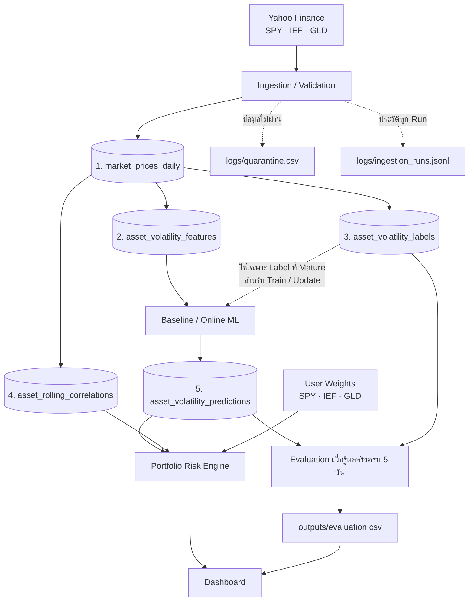

# Data Contracts — Adaptive Portfolio Risk Lab

> **ขอบเขตที่ตกลงร่วมกัน:** 5 ตารางข้อมูลหลัก (Logical Tables) + 2 ไฟล์ตรวจสอบระบบ (Quarantine CSV และ Ingestion Audit JSONL)  

## 1. โครงงานทำอะไร?

**Adaptive Portfolio Risk Lab** เป็นระบบเพื่อการเรียนรู้และเปรียบเทียบวิธีพยากรณ์ความผันผวนของ ETF 3 สินทรัพย์ ได้แก่ **SPY, IEF, GLD** จากข้อมูลราคาปิดรายวัน โดย:

1. ดึงและตรวจสอบข้อมูลตลาดจาก Yahoo Finance ผ่าน `yfinance` แบบ Batch
2. สร้าง Returns, Historical Features และ Target จากข้อมูลราคาที่ผ่านการตรวจสอบ
3. ทำนาย **Annualized Realized Volatility ของแต่ละสินทรัพย์ใน 5 วันซื้อขายถัดไป** และเปรียบเทียบ Baseline กับ Online ML ด้วยการประเมินตามเวลา
4. ใช้ผลพยากรณ์รายสินทรัพย์ร่วมกับ Correlation ที่คำนวณจากข้อมูลย้อนหลัง และน้ำหนักพอร์ตที่ผู้ใช้เลือก เพื่อประมาณความเสี่ยงพอร์ต
5. เมื่อผู้ใช้เปลี่ยนน้ำหนักพอร์ต ระบบ **คำนวณความเสี่ยงพอร์ตใหม่โดยไม่ฝึกโมเดลใหม่**

## 2. Data Contract คืออะไร?

- **Data Contract:** กติกาว่าข้อมูลที่แต่ละขั้นตอนรับ/ส่งต้องมีอะไร ตรวจสอบอย่างไร และจัดการเมื่อผิดกฎอย่างไร
- **Data Dictionary:** พจนานุกรมกลางสำหรับชื่อคอลัมน์ ความหมาย ชนิดข้อมูล หน่วย Grain/Key และ Nullable
- **Validation:** โค้ดที่ตรวจข้อมูลตาม Contract
- **Quarantine:** ไฟล์เก็บรายการที่ไม่ผ่านกฎบังคับเพื่อให้ตรวจสอบได้ โดยไม่ส่งข้อมูลเสียไปประมวลผลต่อ
- **Audit Log:** ไฟล์เก็บประวัติการรัน เช่น เวลา สถานะ จำนวนแถว และสาเหตุผิดพลาด

## 3. เอกสารในโฟลเดอร์ `contracts/`

| ไฟล์ | หน้าที่ |
|---|---|
| **`README.md`** | ภาพรวม ขอบเขตข้อมูล และข้อสรุปทางสถาปัตยกรรมที่ทีมใช้ร่วมกัน |
| [`datadict.md`](./datadict.md) | นิยามกลางของตารางและคอลัมน์ทั้งหมด |
| [`data_contract.md`](./data_contract.md) | แหล่งข้อมูล ข้อตกลงการดึงข้อมูลราคา รูปแบบราคา Ingestion, Data Quality, Missing/Duplicate/Anomaly และ Failure Policy |
| [`feature_contract.md`](./feature_contract.md) | วิธีคำนวณ Features, Warm-up, Historical Correlation และ Point-in-Time Correctness |
| [`target_contract.md`](./target_contract.md) | นิยาม Target 5 วันในอนาคต, Label Maturity และสูตร Portfolio Risk |
| [`prediction_contract.md`](./prediction_contract.md) | รูปแบบผลทำนาย การตรวจ Forecast, Model Version, การเก็บผล และการประเมินเมื่อรู้ผลจริง |

**ลำดับอ่านที่แนะนำสำหรับผู้เริ่มต้น:** `README.md` → `datadict.md` → `data_contract.md` → `feature_contract.md` → `target_contract.md` → `prediction_contract.md`

## 4. ขอบเขตข้อมูลที่เลือกใช้: 5 ตารางหลัก

คำว่า **ตาราง (Logical Table)** ในที่นี้หมายถึง *ชุดข้อมูลที่มี Schema และ Key ชัดเจน* ยังไม่บังคับว่าต้องเป็นตารางใน Database Server; สามารถจัดเก็บทางกายภาพในรูปแบบที่เหมาะสมได้เมื่อพัฒนาแต่ละขั้นตอน

| # | Logical Table | Grain (1 แถวหมายถึง) | Key | บทบาท |
|---|---|---|---|---|
| 1 | `market_prices_daily` | 1 ETF × 1 วันซื้อขาย | `(date, ticker)` | ราคา `adjusted_close` พร้อม Simple/Log Returns ที่ผ่าน Validation |
| 2 | `asset_volatility_features` | Features ของ 1 ETF ณ วัน `t` | `(date, ticker)` | ตัวแปรต้นของโมเดลที่ใช้เฉพาะข้อมูลถึงวัน `t` |
| 3 | `asset_volatility_labels` | Target 5 วันข้างหน้าของ 1 ETF ณ วัน `t` | `(date, ticker)` | คำตอบจริงสำหรับ Train/Evaluate เมื่อผลจริงครบแล้ว |
| 4 | `asset_rolling_correlations` | Correlations ของ 3 ETF ณ วัน `t` | `date` | ค่า Correlation ย้อนหลัง 20 วันสำหรับ Portfolio Risk |
| 5 | `asset_volatility_predictions` | 1 คำทำนาย × ETF × วันอ้างอิง × วิธีพยากรณ์ (แยกเวอร์ชัน/รอบตามสเปก) | `prediction_id` และกฎ Unique Logical Key ใน Prediction Contract | ผล Forecast ที่ Dashboard/Portfolio Risk Engine โหลดไปใช้ |

**ไม่มีตาราง `prediction_evaluations`, `market_prices_quarantine` หรือ `ingestion_run_audit_log` เพิ่มในขอบเขตหลัก** เพราะเลือกเก็บผลประเมินและข้อมูลสำหรับตรวจสอบเป็นไฟล์แทน

## 5. ภาพรวมการไหลของข้อมูล



**ข้อควรจำ:** ตาราง Label เป็นทางเดินของ *ผลจริง* สำหรับฝึกและประเมินเมื่อครบ 5 วัน ไม่ใช่สิ่งที่ต้องรอสำหรับสร้าง Forecast ของวันปัจจุบัน; ส่วน Correlation ใช้เพื่อคำนวณความเสี่ยงพอร์ต ไม่ใช่ Target ที่โมเดลทำนาย

## 6. ไฟล์ประกอบที่ไม่ใช่ตารางหลัก

| ไฟล์ / โฟลเดอร์ | รูปแบบ | ใช้ทำอะไร |
|---|---|---|
| `data/raw/` | เก็บ Raw Snapshots ของข้อมูลต้นทาง | ตรวจสอบและสร้างข้อมูลใหม่จากต้นฉบับ; ไม่เขียนทับ Snapshot เดิมโดยไม่มีประวัติ |
| `logs/quarantine.csv` | **CSV** | รายการข้อมูล/เหตุการณ์ที่ไม่ผ่าน Data Quality Gate พร้อมเหตุผล |
| `logs/ingestion_runs.jsonl` | **JSON Lines** | หนึ่ง JSON Record ต่อหนึ่ง Ingestion Run; เก็บสถานะและจำนวนแถว |
| `outputs/evaluation.csv` | **CSV** | บันทึกผลจริง/ผลทำนายและ Error สำหรับสรุป MAE/RMSE; ไม่ใช่ตาราง Database |

### 6.1 ข้อมูลขั้นต่ำใน `logs/quarantine.csv`

`run_id`, `source_batch_id`, `date`, `ticker`, `raw_value`, `reason`, `detected_at_utc`

- `reason` ใช้รหัสมาตรฐาน เช่น `NON_POSITIVE_PRICE`, `NULL_REQUIRED_FIELD`, `DUPLICATE_PRIMARY_KEY`, `MISSING_EXPECTED_TRADING_DAY`
- กรณี *ขาดทั้งวันซื้อขาย* อาจไม่มีแถวข้อมูลต้นทาง ให้ `raw_value` ว่างและระบุวัน/Ticker ที่ขาด
- ค่าผลตอบแทนแกว่งผิดปกติ (`abs(simple_return) > 0.20`) เป็น **Warning/Flag ก่อน** ไม่ถือว่าเป็นข้อมูลเสียที่ต้อง Quarantine โดยอัตโนมัติ
- เก็บ `run_id` ของแต่ละการตรวจพบ แม้พบข้อมูลเดิมในการรันคนละรอบ เพื่อให้ตรวจสอบประวัติได้

### 6.2 ข้อมูลขั้นต่ำใน `logs/ingestion_runs.jsonl`

หนึ่งรายการต่อหนึ่ง Ingestion Run ควรมี:

- `run_id`, `source_batch_id`, `started_at_utc`, `finished_at_utc`, `status`
- ช่วงข้อมูลที่ขอ (`config_start_date`, `config_end_date`) และจุดอ้างอิง Raw Snapshot ที่ใช้
- จำนวนแถวที่ดึงมา, ผ่านการตรวจ, เผยแพร่จริง, Quarantine และ Warning **แยกตาม Ticker**
- สถานะราย Ticker และ `error_message` เมื่อเกิดปัญหา

สถานะภาพรวมใช้ `SUCCESS`, `PARTIAL_SUCCESS` หรือ `FAILED` โดยจำนวนแถวที่ **ตรวจผ่าน** อาจไม่เท่ากับจำนวนแถวที่ **เผยแพร่จริง** หากนโยบาย Fail-fast ทำให้ต้องระงับทั้ง Ticker ในรอบนั้น

**นโยบายการเก็บ:** ทั้งสองไฟล์เป็นบันทึกย้อนหลังแบบ Append-only; ใช้ `run_id` เชื่อมโยง และใช้เวลารูปแบบ UTC (`...Z`) ทั้งหมด ไม่จำเป็นต้องมี Dashboard สำหรับ Log โดยเฉพาะ

## 7. กติกาที่ต้องรักษาตลอดระบบ

1. **ราคาและวันซื้อขาย** — รับข้อมูลรายวันผ่าน `yfinance` โดยใช้ `auto_adjust=True`; แมป `Close` ที่ปรับแล้วเป็น `adjusted_close`; ราคาต้องเป็นตัวเลข Finite และมากกว่า `0`; วันขาดหายต้องเทียบ Trading Calendar ไม่ใช่นับวันหยุดเป็น Missing
2. **Data Quality** — ห้ามคีย์ `(date, ticker)` ซ้ำ; ไม่เติมราคาข้ามวันแบบเดาสุ่ม; แยกข้อมูลที่ผิดกฎบังคับไว้ตรวจสอบ; ถ้า Ticker หนึ่งไม่ผ่าน ให้ระงับข้อมูลของ Ticker นั้นในรอบนั้น แต่ Ticker อื่นที่ถูกต้องยังทำงานต่อได้
3. **Point-in-Time** — Feature ของวัน `t` ใช้ข้อมูลไม่เกินวัน `t`; Rolling คำนวณแยก Ticker; ต้องมี Warm-up เพียงพอสำหรับ `rv_60d`; ไม่ให้ Train/Validation/Test รั่วข้อมูลอนาคตถึงกัน
4. **Label Maturity** — Target เป็น Annualized Realized Volatility จาก `t+1` ถึง `t+5`; ค่า `is_label_mature` จะเป็น `True` เมื่อผลจริงครบ 5 วันซื้อขายเท่านั้น; ใช้ Label ที่ครบแล้วสำหรับ Train/Evaluate/Online Update
5. **Prediction** — แยกคำทำนายตามวัน, Ticker, วิธีพยากรณ์ และ Model Version; ค่า Forecast ต้องเป็น Finite และไม่ติดลบ; ไม่เขียนทับคำทำนายเดิมหลังเห็นผลจริง; รันซ้ำด้วย Input/Model/Config เดิมต้องไม่สร้างคำทำนายซ้ำ
6. **Portfolio** — คำนวณเมื่อมี Forecast ครบ SPY, IEF, GLD และ Correlation พร้อมในวันเดียวกันเท่านั้น; หากไม่ครบ ให้แสดง `INCOMPLETE_INPUTS` ไม่ปรับน้ำหนักสินทรัพย์ที่เหลือเอง
7. **Reproducibility** — เก็บ Raw Snapshot, `run_id`, เวอร์ชันของ Feature/Target/Model และข้อมูลอ้างอิงที่เพียงพอให้ตรวจสอบย้อนกลับได้; Log ไม่ใช่สิ่งทดแทน Test

### หน่วยและสูตรหลัก

- **Target ที่โมเดลทำนาย:** Annualized Realized Volatility จาก 5 วันซื้อขายถัดไป (บนฐาน 252 วันซื้อขายต่อปี)

  $$RV_{i,t,5}=\sqrt{\frac{252}{5}\sum_{k=1}^{5}r_{i,t+k}^{2}}$$

- **Portfolio Volatility:** ใช้ผลพยากรณ์รายสินทรัพย์ในสเกล Annualized ร่วมกับ Correlation ย้อนหลัง 20 วัน (Historical Proxy)

  $$\hat\Sigma_t=D_tR_tD_t,\qquad\hat\sigma_{p,t}=\sqrt{\mathbf{w}^{\mathsf T}\hat\Sigma_t\mathbf{w}}$$

- น้ำหนักเริ่มต้นสำหรับสาธิตคือ **SPY 50%, IEF 30%, GLD 20%**; กำหนดให้ `w_i >= 0` และผลรวมเท่ากับ `1` ผู้ใช้ปรับน้ำหนักแล้วคำนวณใหม่ได้โดยไม่ Retrain
- Dashboard ต้องติดป้ายให้ถูกว่า Output เป็น **Annualized Volatility ที่ประมาณจากกรอบ 5 วัน** ไม่ใช่ความผันผวนสะสม 5 วันโดยตรง และต้องแจ้งว่า Correlation เป็น Historical Proxy ไม่ใช่ค่าที่โมเดลพยากรณ์

## 8. โครงสร้างโฟลเดอร์อ้างอิง

```text
project/
├── contracts/
│   ├── README.md
│   ├── data_contract.md
│   ├── datadict.md
│   ├── feature_contract.md
│   ├── target_contract.md
│   └── prediction_contract.md
├── data/
│   ├── raw/
│   └── processed/               # ชุดข้อมูลหลัก 5 ชุด; รูปแบบเก็บจริงเลือกตอน Implement
├── logs/
│   ├── quarantine.csv
│   └── ingestion_runs.jsonl
├── outputs/
│   └── evaluation.csv
└── src/
```

## 9. การบังคับใช้ Contract และการอัปเดตเอกสาร

เอกสารกำหนดกฎ ส่วนโค้ดและ Automated Tests ต้องพิสูจน์ผลจริง โดยขั้นต่ำควรทดสอบ:

- ราคาติดลบ/ค่าว่าง/คีย์ซ้ำ ถูกตรวจพบและไม่ถูกส่งต่อ
- วันหยุดตลาดไม่ถูกนับเป็น Missing และวันซื้อขายที่ขาดจริงถูกตรวจพบ
- Feature ของวัน `t` ไม่เปลี่ยนเมื่อมีการแก้ข้อมูลหลังวัน `t` ในสภาพแวดล้อมทดสอบเดียวกัน
- Pending Label ไม่หลุดเข้า Train/Evaluation; Walk-forward Update ไม่ใช้ Label ก่อนครบ 5 วัน
- รันข้อมูลเดิมซ้ำไม่ทำให้ตารางหลักเกิดแถวซ้ำ
- Portfolio ปฏิเสธการคำนวณเมื่อ Forecast หรือ Correlation ไม่ครบ

หากมีการแก้นิยาม Schema/สูตร ให้ปรับ **Data Dictionary → Contract ที่เกี่ยวข้อง → Validation/Tests** ให้สอดคล้องกัน และเก็บหลักฐานการเปลี่ยนแปลงผ่าน Git

### การปรับเอกสารย่อยให้ตรงกับขอบเขตนี้

README นี้บันทึก **ข้อสรุปที่ทีมตกลงแล้ว** เรื่อง 5 Logical Tables และ 2 ไฟล์ตรวจสอบระบบ ทั้งนี้เอกสารย่อยบางฉบับเดิมยังอ้างถึง `market_prices_quarantine` / `ingestion_run_audit_log` ในฐานะตาราง และ `prediction_evaluations` ในฐานะตารางเสริม: **ให้ยึดขอบเขตใน README นี้** แล้วปรับชื่อปลายทางเป็น `logs/quarantine.csv`, `logs/ingestion_runs.jsonl` และ `outputs/evaluation.csv` ตามลำดับเมื่อไล่ตรวจแต่ละไฟล์

การแก้ README เพียงไฟล์เดียว **ยังไม่ได้แก้เนื้อหาของ Contract ย่อยหรือยืนยันว่า Implementation เสร็จแล้ว**

---

**ขอบเขตสุดท้าย:** 5 ตารางหลัก + Raw Snapshot + `quarantine.csv` + `ingestion_runs.jsonl` + `evaluation.csv` — เน้นให้ Data Pipeline ถูกต้อง ตรวจสอบได้ และทำซ้ำได้ โดยไม่เพิ่มตารางหรือเครื่องมือเกินความจำเป็น
