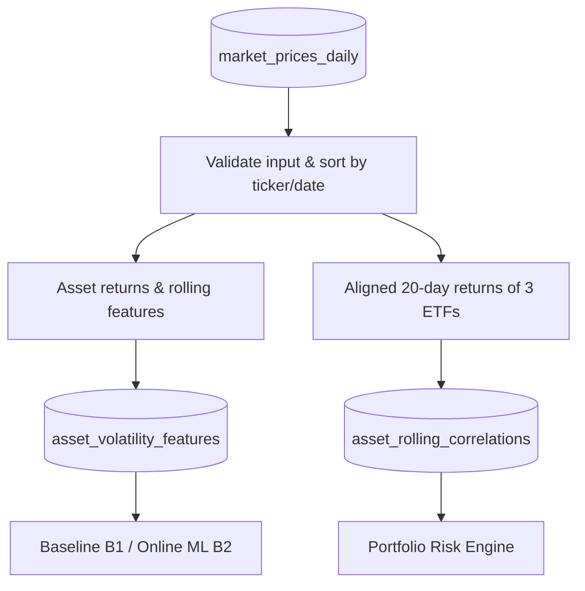

# Feature Contract — Adaptive Portfolio Risk Lab

**Document:** `contracts/feature_contract.md`  
**Scope:** Feature Engineering สำหรับ ETF **SPY, IEF, GLD** และ Historical Correlation สำหรับ Portfolio Risk

> **Feature Contract** กำหนดวิธีนำข้อมูลราคาที่ผ่านการตรวจสอบแล้วมาสร้าง Features ณ วันซื้อขาย `t` โดยใช้เฉพาะข้อมูลถึงวัน `t` รวมถึงกฎเรื่องสูตรคำนวณ, Lookback, Warm-up, Null, Data Quality, การป้องกัน Data Leakage และข้อมูลต้นทางที่ตรวจสอบย้อนหลังได้

## 0. เอกสารที่ต้องอ่านร่วมกัน

- [README.md](./README.md) — ภาพรวมระบบและขอบเขตที่ตกลงกัน
- [data_contract.md](./data_contract.md) — ที่มาและการตรวจสอบ `market_prices_daily` (12 คอลัมน์ รวม `high`, `low`, `is_warmup_buffer`)
- [datadict.md](./datadict.md) — **แหล่งอ้างอิงกลาง** ของชื่อคอลัมน์, Data Type, Grain, Key, Unit และ Nullable
- [target_contract.md](./target_contract.md) — Forward 5-day Realized Volatility และ Label Maturity
- [prediction_contract.md](./prediction_contract.md) — การนำ Features ไปสร้าง/บันทึก Forecast และการประเมินเมื่อรู้ผลจริง

---

## 1. ขอบเขต Input / Output

| รายการ | ข้อตกลง |
|---|---|
| **Input** | ตาราง `market_prices_daily` ที่ผ่าน Data Contract; ใช้ `date`, `ticker`, `adjusted_close`, `log_return`, `simple_return`, `is_warmup_buffer` และ Metadata ที่จำเป็น |
| **Source of truth สำหรับ Returns** | ใช้ `adjusted_close` เป็นราคาต้นทาง; ตรวจสอบว่าค่า `log_return` ใน Price Table สอดคล้องกับสูตรก่อนนำไปคำนวณต่อ |
| **`high` และ `low`** | รับไว้ใน `market_prices_daily` เพื่อการตรวจสอบคุณภาพราคา แต่ **ไม่ใช่ Core Features** ในสเปกนี้ และไม่เพิ่มลง Model Matrix อัตโนมัติ |
| **Output 1** | `asset_volatility_features`: **1 แถว / `(date, ticker)`** (18 คอลัมน์ตาม `datadict.md`) |
| **Output 2** | `asset_rolling_correlations`: **1 แถว / `date`** (8 คอลัมน์ตาม `datadict.md`) |
| **Assets** | `SPY`, `IEF`, `GLD` เท่านั้น |
| **Trading date / Timezone** | `date` เป็นวันซื้อขายตลาดสหรัฐฯ ใน `America/New_York`; Audit Timestamp ใช้ UTC |
| **Data availability** | ผลของวัน `t` สร้างได้เมื่อข้อมูลราคาปิดของวัน `t` ผ่าน Validation และพร้อมใช้งานแล้วเท่านั้น |
| **ไม่อยู่ในขอบเขต** | การสร้าง Target 5 วัน, ฝึกโมเดล, คำนวณ MAE/RMSE, ผลพยากรณ์, และการรับน้ำหนักพอร์ตจากผู้ใช้ |

### ลำดับข้อมูล

---

## 2. Schema และกฎการเลือก Features เข้า Model

> **ยึดคอลัมน์และ Nullable รายช่องตาม [datadict.md](./datadict.md)**; ห้ามแก้ชื่อหรือเพิ่มคอลัมน์เองโดยไม่อัปเดต Dictionary และ Tests

### 2.1 `asset_volatility_features` — 18 คอลัมน์

| กลุ่ม | คอลัมน์ | ใช้งาน |
|---|---|---|
| Primary Key (2) | `date`, `ticker` | เรียงลำดับ/เชื่อมข้อมูล ไม่เข้า Model Matrix `X` |
| Core Return Features (5) | `ret_1d_t`, `ret_lag_1d`, `ret_lag_2d`, `ret_trailing_5d`, `ret_trailing_20d` | ใช้เป็นตัวแปรต้นของ Online ML |
| Core Volatility Features (3) | `rv_5d`, `rv_20d`, `rv_60d` | ใช้เป็นตัวแปรต้น Online ML; `rv_20d` ใช้เดี่ยวใน Baseline B1 |
| Experimental Features (2) | `rsi_14d`, `bb_width_20d` | เก็บใน Schema เดิม แต่ **ไม่บังคับ** ใช้ในรอบทดลองหลัก |
| Status / Metadata (6) | `is_model_ready`, `is_warmup_buffer`, `feature_set_version`, `run_id`, `source_batch_id`, `feature_as_of_utc` | กรองแถวและตรวจ Lineage ไม่เข้า `X` |

**การใช้ Feature ตามโมเดล**

1. **B0 — Constant Baseline:** ใช้ค่าคงที่จากข้อมูล Training ที่รู้ผลแล้ว ไม่ต้องใช้ Feature Matrix 8 ตัว
2. **B1 — Rolling 20-Day Baseline:** ใช้ `rv_20d` ของสินทรัพย์ ณ วัน `t` โดยตรงเป็นค่าพยากรณ์ Annualized Volatility ของ 5 วันถัดไป **ไม่มีการ Train ด้วย 8 Features**
3. **B2 — Online SGDRegressor:** ใช้ **Core Features ทั้ง 8 ตัว** เพื่อสร้างโมเดลรายสินทรัพย์; การ Fit/Update ต้องทำตามกฎข้อมูลตามเวลาในหัวข้อ 5
4. **Experimental:** เปิดใช้ `rsi_14d` หรือ `bb_width_20d` เฉพาะการทดลองที่กำหนดไว้และเปรียบเทียบบน Validation ก่อน ไม่ใช่ข้อบังคับของ MVP

### 2.2 `asset_rolling_correlations` — 8 คอลัมน์

| กลุ่ม | คอลัมน์ |
|---|---|
| Primary Key (1) | `date` |
| Historical Correlation (3) | `corr_spy_ief_20d`, `corr_spy_gld_20d`, `corr_ief_gld_20d` |
| Readiness (1) | `is_corr_ready` |
| Metadata (3) | `run_id`, `source_batch_id`, `computed_at_utc` |

Correlation เป็น **Historical Proxy** สำหรับ Portfolio Risk ไม่ใช่ Features ที่ป้อนเข้า Online ML ในการทดลองหลัก

---

## 3. สูตร Core Features (คำนวณแยก `ticker`)

ให้ `P(i,t)` แทน `adjusted_close` ของสินทรัพย์ `i` ณ วันซื้อขาย `t`; ทุก `t-1`, `t-5` ฯลฯ หมายถึง **วันซื้อขายย้อนหลัง** ไม่ใช่วันปฏิทิน

$$R_{i,t}=\frac{P(i,t)}{P(i,t-1)}-1,\qquad
r_{i,t}=\ln\left(\frac{P(i,t)}{P(i,t-1)}\right)$$

| Feature | สูตร/กฎ ณ วัน `t` | ข้อมูลขั้นต่ำ |
|---|---|---|
| `ret_1d_t` | $r_{i,t}$ | 1 Return (= 2 Prices) |
| `ret_lag_1d` | $r_{i,t-1}$ | 2 Returns |
| `ret_lag_2d` | $r_{i,t-2}$ | 3 Returns |
| `ret_trailing_5d` | $P(i,t)/P(i,t-5)-1$ | 5 Returns (= 6 Prices) |
| `ret_trailing_20d` | $P(i,t)/P(i,t-20)-1$ | 20 Returns |
| `rv_5d` | $\sqrt{\frac{252}{5}\sum_{j=0}^{4}r_{i,t-j}^{2}}$ | 5 Returns |
| `rv_20d` | $\sqrt{\frac{252}{20}\sum_{j=0}^{19}r_{i,t-j}^{2}}$ | 20 Returns |
| `rv_60d` | $\sqrt{\frac{252}{60}\sum_{j=0}^{59}r_{i,t-j}^{2}}$ | 60 Returns (= 61 Prices) |

**หน่วย:** Returns เป็นอัตราส่วนทศนิยมหรือ Log Ratio; `rv_*` เป็น **Annualized Decimal** เช่น `0.15` = 15% ต่อปี (คำนวณจากหน้าต่างข้อมูลย้อนหลังขนาดนั้น) ใช้สูตร Root Mean Square ของ Log Returns แบบ **ไม่หักค่าเฉลี่ย** ตรงกับ `target_realized_vol_5d` ใน Target Contract; **อย่าสลับ** กับ Sample Standard Deviation ในคอลัมน์อื่น

**กฎคำนวณ:**

- เรียงข้อมูลตาม `(ticker, date)` และคำนวณ `shift(k)`, Rolling Functions **ภายในแต่ละ `ticker` เท่านั้น**; Window สิ้นสุดที่ `t` (รวมวัน `t`) และมี `min_periods=n`
- คำนวณเฉพาะจากราคาที่ผ่าน Validation; หากวันซื้อขายที่ควรมีขาดหาย ไม่เลื่อนหน้าต่างย้อนข้ามวันนั้นเงียบ ๆ เพื่อให้ได้จำนวนแถวครบ
- ห้ามใช้ `shift(-k)`, Centered Rolling, `bfill` หรือฟังก์ชันใดที่นำค่าจากอนาคตเข้ามาสร้าง Features
- ไม่ใช้ `high`/`low` เพื่อสร้าง Feature เพิ่มเองใน MVP; หากจะใช้ ต้องปรับ Contract, Dictionary และ Test ก่อน

---

## 4. Experimental Features (มีใน Schema แต่ไม่บังคับใช้ใน Model หลัก)

| Feature | วิธีคำนวณ | เงื่อนไข |
|---|---|---|
| `rsi_14d` | Relative Strength Index 14 วัน ตาม Wilder's Smoothing จากการเปลี่ยนแปลงของ `adjusted_close` | ช่วงทฤษฎี `[0,100]`; ต้องไม่มีข้อมูลอนาคต; Allow Null ในช่วง Warm-up |
| `bb_width_20d` | Bollinger Band Width = $(Upper_{20}-Lower_{20})/SMA_{20}=4s_{price,20}/SMA_{20}$ จากราคา `adjusted_close` | ใช้ราคา 20 จุด, $s_{price,20}$ ตามสูตรเดียวกันทุกสินทรัพย์; ต้อง `>=0`; Allow Null ในช่วง Warm-up |

- คำนวณด้วยนิยามเดียวกันสำหรับทั้ง 3 ETFs และแยกตาม `ticker`; ไม่เพิ่มตาราง/คอลัมน์ใหม่
- หากไม่เปิดใช้ Experimental Features ในการฝึก โมเดลยังใช้ Core 8 ตัวตามปกติ; `is_model_ready` **ไม่ขึ้นกับสองคอลัมน์นี้**
- ค่าเกินช่วงเตือนเชิงสถิติเป็น **Warning** ให้ตรวจสอบ ไม่ใช่เหตุผลให้ลบทิ้งอัตโนมัติ

---

## 5. Point-in-Time, Target และการแบ่งข้อมูลตามเวลา

### 5.1 ไม่มี Future Leakage ใน Features

- ณ วัน `t` ใช้ข้อมูลราคา/ผลตอบแทนที่ **เปิดเผยและผ่านการตรวจสอบแล้วถึงวัน `t`** เท่านั้น; ไม่ใช้ `t+1` ถึง `t+5` ทำ Feature
- Features ของ `(date=t, ticker=i)` ต้องอ้างอิงเฉพาะราคาของ ticker `i` ตามนิยามในหัวข้อ 3; ข้อมูลอีก 2 ticker ใช้ใน Correlation (หัวข้อ 6) ไม่ใช่ Core Features ของ `i`
- `feature_as_of_utc` คือ **เวลาที่ Pipeline คำนวณและบันทึก Feature จริง** ไม่ใช่ข้ออ้างว่ามีข้อมูลทั้งหมด ณ วันในอดีต (โดยเฉพาะ Historical Replay)

### 5.2 Label แยกจาก Features

- `asset_volatility_labels` เป็นตาราง Target แยกต่างหาก Join ได้ด้วย `(date, ticker)` **เฉพาะขั้น Train/Evaluation**
- โหมดสร้างคำทำนายวัน `t` ใช้ `is_model_ready=True`, `is_warmup_buffer=False` โดย **ไม่ต้องรอ `is_label_mature=True` ของวัน `t`**
- โหมด Train / Validation / Test ใช้ `is_model_ready=True`, `is_warmup_buffer=False` และ `is_label_mature=True` แต่ต้องเพิ่มเงื่อนไขว่า ณ วันจำลองนั้น **Label ถูกเปิดเผยแล้วจริง** (`target_end_date` ไม่เกินวันข้อมูลที่ทราบและผ่าน Validation)

### 5.3 Chronological Split และ Purge

- แบ่ง Train/Validation/Test ตามเวลาเท่านั้น; ห้าม Random Split และ K-Fold แบบสุ่มลำดับวัน
- ที่ขอบ Train → Validation หรือ Train/Validation → Test ให้ตัดแถวชุดก่อนหน้าซึ่งมีหน้าต่าง Label ล้ำไปถึงวันเริ่มชุดถัดไป: **`target_end_date >= next_split_start_date` ต้องไม่เข้า Train**; ใช้เป็นกฎ Purge สำหรับ Target Horizon 5 วันซื้อขาย
- Fit Scaler/Preprocessor/การเลือก Feature เฉพาะข้อมูล Train ของ `ticker` และ Fold นั้น ๆ; นำค่าที่เรียนรู้ได้มา `transform` Validation/Test โดยไม่ Fit ซ้ำด้วยข้อมูลชุดนั้น
- ใน Walk-forward Replay: **Predict ก่อน → รอ Label Mature → Evaluate/Update**; Online Model อัปเดตด้วยเฉพาะตัวอย่างที่มี `target_end_date <= replay_date` และผลจริงพร้อมแล้ว **ไม่อัปเดตจาก Label อนาคต**

> **ข้อจำกัดที่ต้องรายงาน:** การใช้ Historical Adjusted Prices ที่ Yahoo Finance อาจแก้ย้อนหลังได้ ทำให้การสร้าง Features ย้อนหลังจาก Snapshot ที่ดาวน์โหลดภายหลัง *ไม่ได้ยืนยันโดยอัตโนมัติ* ว่าราคาที่ปรับแล้วตรงกับข้อมูลที่เผยแพร่ ณ วันอดีตจริง ๆ เราจึงต้องบันทึก Raw Snapshot/Manifest และอธิบายข้อจำกัดของ Historical Replay ตามจริง ไม่กล่าวอ้างว่าเป็น Point-in-Time Market Data Archive

---

## 6. Historical Correlation สำหรับ Portfolio Risk

- คำนวณ **Pearson Correlation 20 วันซื้อขายย้อนหลังถึงวัน `t`** จาก `log_return` ของ `SPY`, `IEF`, `GLD`
- ใช้ **20 วันเดียวกันพอดี** และผลตอบแทนต้องครบทั้งสาม ETF ทุกวัน (เมทริกซ์ $20\times3$); หากวันใดขาด ห้ามคำนวณคู่ใดคู่หนึ่งจากวันที่ต่างชุด หรือยืด Window ย้อนหลังเพื่อเติมข้อมูลเงียบ ๆ
- มี Correlation 3 คู่: `SPY–IEF`, `SPY–GLD`, `IEF–GLD` และเมทริกซ์ $3\times3$ มีเส้นทแยงมุมเป็น `1`
- กำหนด `is_corr_ready=True` ก็ต่อเมื่อ: ครบ 20 วัน, ทุกค่ามีจำนวนจำกัดและอยู่ใน `[-1,1]`, เมทริกซ์สมมาตร และค่า Eigenvalue ต่ำสุด $\lambda_{min}\ge -10^{-10}$ (Floating-point tolerance)
- ถ้าคำนวณ Correlation ไม่ได้ เช่น แถวไม่ครบหรือคอลัมน์มีความแปรปรวนเป็นศูนย์ ให้ `is_corr_ready=False`, Correlation ที่คำนวณไม่ได้เป็น `NULL` ตาม Dictionary และไม่อนุญาตให้ Portfolio Risk Engine ใช้วันที่ไม่พร้อม
- Correlation ใช้แทน **ความสัมพันธ์ในอนาคตโดยสมมติจากอดีต** ไม่ใช่ค่าที่ ML ทำนาย; Dashboard/รายงานต้องระบุข้อจำกัดนี้

---

## 7. Warm-up, Readiness และ Missing Values

1. **Warm-up:** Lookback ยาวสุดคือ `rv_60d` ต้องใช้ **60 Log Returns = 61 ราคาที่ต่อเนื่องกันตามวันซื้อขาย** จึงกำหนดให้ดึงราคาเผื่อก่อน `config.start_date` อย่างน้อย **61 วันซื้อขาย** (อ้างอิง Data Contract) เพื่อให้วันเริ่มวิเคราะห์มี Features พร้อมใช้งาน
2. **Warm-up flag:** `asset_volatility_features.is_warmup_buffer = (date < config.start_date)` และ **ต้องเท่ากับ** `market_prices_daily.is_warmup_buffer` ของ `(date,ticker)` เดียวกัน; ไม่คำนวณสถานะจากจำนวนข้อมูล Rolling ที่มี/ไม่มี
3. **Warm-up Null:** แถวต้นทางก่อนมีประวัติครบตาม Lookback อนุญาตให้ Core/Experimental Feature บางค่าหายได้ตาม Nullable ใน Dictionary; **ห้ามเติม `0`, Forward-fill, Backward-fill หรือ Interpolation** เพื่อให้ดูพร้อมใช้งาน
4. **`is_model_ready`:** เป็น `True` ก็ต่อเมื่อ **Core Features ทั้ง 8 ตัว** มีค่าเป็น Finite และไม่เป็น NULL (`is_model_ready` ไม่ขึ้นกับ Target, Correlation หรือ Experimental Features); แม้บางแถว Warm-up จะพร้อม ก็ยังไม่ส่งเข้า Train/Evaluate หาก `is_warmup_buffer=True`
5. **Corrupted Null:** ถ้าเคยมี Core 8 ตัวครบแล้ว แต่ภายหลังพบ `NULL`, `NaN` หรือ `Inf` ในช่วงที่ควรพร้อม ให้หยุดส่งต่อข้อมูลของ `ticker` ที่มีปัญหาสำหรับรอบนั้น และบันทึกการตรวจพบด้วยรหัส `CORRUPTED_FEATURE_NULL` ใน `logs/quarantine.csv` ตาม Schema 7 คอลัมน์ที่เคาะไว้ (`run_id` เป็น Feature Run, `raw_value` อาจว่างได้) **ไม่ต้องสร้างตาราง Quarantine**
6. **Partial Results:** Ticker อื่นที่ผ่านอาจยังสร้าง Forecast รายตัวได้ แต่ Portfolio Risk ต้องมี Forecast ครบทั้ง 3 ETF **และ** Correlation พร้อมในวันเดียวกัน มิฉะนั้นไม่คำนวณพอร์ตบางส่วนและให้สถานะ `INCOMPLETE_INPUTS`

---

## 8. Lineage, Reprocessing และ Quality Gates

### 8.1 Source Lineage

- `run_id` เป็นรหัสรอบ Feature Pipeline, `feature_as_of_utc` เป็นเวลาที่คำนวณจริง
- `source_batch_id` ในแถว Feature **อ้างอิง Raw Snapshot ของแถวราคา ณ `date=t`** ตามนิยาม Data Dictionary แต่ Features ย้อนหลัง 60 วันอาจอ่านหลาย Raw Batches
- เพื่ออธิบายแหล่งข้อมูลครบทุกวันที่ใช้ใน Rolling Window ให้มี **Input Manifest/Run Metadata File** ของ Feature Run (เช่น `run_id`, วันเริ่ม/สิ้นสุด, source snapshots ที่อ่าน, config, feature version และ checksum/paths); ไฟล์นี้ **ไม่ใช่ตารางข้อมูลหลักเพิ่ม**
- `source_batch_id` ในตาราง Correlation ก็เป็นอ้างอิงชุดข้อมูลหลัก ณ วัน `t`; การติดตาม Input ครบ 3 ETFs และ 20 วันทำผ่าน Input Manifest ของ Correlation Run เช่นเดียวกัน

### 8.2 Reproducibility / Idempotency

- เมื่อใช้ Input Snapshots เดิม, Config เดิม และ Feature Version เดิม ต้องได้ค่า Features/Correlation เชิงธุรกิจเดิม (ภายใต้ Floating-point tolerance) แม้เวลารัน/`run_id` เปลี่ยน
- ห้ามมี `(date,ticker)` ซ้ำใน `asset_volatility_features` หรือ `date` ซ้ำใน `asset_rolling_correlations`
- เผยแพร่ผลหลัง Schema + Quality Gate ผ่านเท่านั้น; ไม่เขียนข้อมูลผิดทับผลที่ผ่านแล้วของ `ticker` โดยเงียบ ๆ

### 8.3 Quality Gate ที่ต้องทดสอบ

| Test | เงื่อนไขผ่าน | หากไม่ผ่าน |
|---|---|---|
| Input source | `market_prices_daily` ผ่าน Validation และเรียงวันได้; วันที่ใช้คำนวณครบ | หยุดสร้าง Output ที่ได้รับผลกระทบ |
| Schema & Keys | คอลัมน์/ชนิดตาม Dictionary; `(date,ticker)` ไม่ซ้ำ และ `date` เพิ่มตาม `ticker` | Fail Output ที่ได้รับผลกระทบ |
| Formula | ค่า Lag, Trailing Return, `rv_5d/20d/60d` ตรงกับสูตรบนชุดข้อมูลทดสอบ | Fail Output |
| Numeric validity | Core ที่ไม่ใช่ Warm-up Null ต้องเป็น Finite; `rv_* >= 0` | Fail Ticker; บันทึก `CORRUPTED_FEATURE_NULL` หากเข้าเงื่อนไข |
| Warm-up consistency | `is_warmup_buffer` ตรงกับ Price Table และ `date < config.start_date` | Fail Output |
| Readiness | `is_model_ready` เท่ากับผลตรวจ Core 8 ตัว (ไม่ขึ้นกับ Target) | Fail Output |
| Point-in-time | เพิ่มข้อมูลหลัง `t` แล้ว Features ของ `t` จาก Input Version เดิมต้องไม่เปลี่ยน | Fail Test |
| Correlation | ใช้ช่วง 20 วันเดียวกันครบ 3 ETF, `[-1,1]`, Symmetric, PSD | `is_corr_ready=False`, ไม่คำนวณพอร์ต |
| Idempotency | รัน Input/Config เดิมซ้ำแล้วไม่มีคีย์ซ้ำและค่าธุรกิจเท่าเดิม | Fail Pipeline |

**Warning (ไม่ใช่ Hard Fail อัตโนมัติ):** ค่าที่เกินช่วงความผันผวนหรือผลตอบแทนซึ่งกำหนดแบบ Heuristic ต้อง Flag เพื่อตรวจสอบก่อน ไม่ลบค่าจริงของตลาดทิ้งโดยไม่ทราบสาเหตุ ค่า Warning เบื้องต้นจาก Contract เดิมแสดงไว้ด้านล่างเพื่ออ้างอิง (ไม่ใช่เกณฑ์ตัดข้อมูล):

| Feature | SPY | IEF / GLD |
|---|---|---|
| `ret_1d_t`, `ret_lag_1d`, `ret_lag_2d` | `[-0.15, 0.15]` | `[-0.10, 0.10]` |
| `ret_trailing_5d` | `[-0.25, 0.25]` | `[-0.18, 0.18]` |
| `ret_trailing_20d` | `[-0.40, 0.40]` | `[-0.30, 0.30]` |
| `rv_5d` | `[0.02, 1.50]` | `[0.01, 1.00]` |
| `rv_20d` | `[0.02, 1.20]` | `[0.01, 0.80]` |
| `rv_60d` | `[0.03, 1.00]` | `[0.02, 0.70]` |

ค่าขอบเขตเหล่านี้เป็น **Initial Heuristic Alerts** ต้องปรับเทียบด้วย **ข้อมูล Train เท่านั้น** หากจะใช้เป็นกฎการเฝ้าระวังเชิงสถิติอย่างเป็นทางการ ไม่อนุญาตให้ใช้ข้อมูล Test เพื่อปรับเกณฑ์

---

## 9. Acceptance Criteria — Feature Pipeline

- [ ] รับข้อมูล `market_prices_daily` ตาม Data Contract รวม `high`, `low`, `is_warmup_buffer` ได้ แต่ไม่เพิ่ม `high/low` เป็น Core Features
- [ ] สร้าง `asset_volatility_features` **18 คอลัมน์** และ `asset_rolling_correlations` **8 คอลัมน์** ตาม Dictionary โดยไม่เพิ่มตาราง
- [ ] Core Features **8 ตัว** ถูกต้องตามสูตร/Lookback/หน่วย และแยกคำนวณ SPY, IEF, GLD
- [ ] B1 ใช้ `rv_20d` โดยตรง; B2 ใช้ Core 8 ตัว; Experimental Features เป็นตัวเลือก
- [ ] Warm-up และ `is_model_ready` ถูกต้อง; ไม่มีข้อมูลอนาคตใน Features
- [ ] Correlation ใช้ผลตอบแทน 20 วันเดียวกันครบ 3 ETF และผ่าน Matrix Validation ก่อนใช้กับพอร์ต
- [ ] มีการทดสอบ Missing/Null/Duplicate, Point-in-Time, No Cross-Ticker Mixing และรันซ้ำแล้วไม่เกิดข้อมูลซ้ำ
- [ ] Metadata/Run Manifest ชี้กลับไปยัง Input Snapshot และ Config ที่ใช้จริงได้

> **การใช้งานเอกสาร:** ฉบับนี้เป็นข้อกำหนดที่ตกลงแล้วสำหรับการนำไปพัฒนาและทดสอบจริง เมื่อปรับ Formula หรือ Schema ให้แก้ [datadict.md](./datadict.md), Contract ที่เกี่ยวข้อง และ Tests ให้ตรงกัน ไม่ถือว่าผ่าน Acceptance Criteria จนกว่าจะมีหลักฐานการรันจริง
