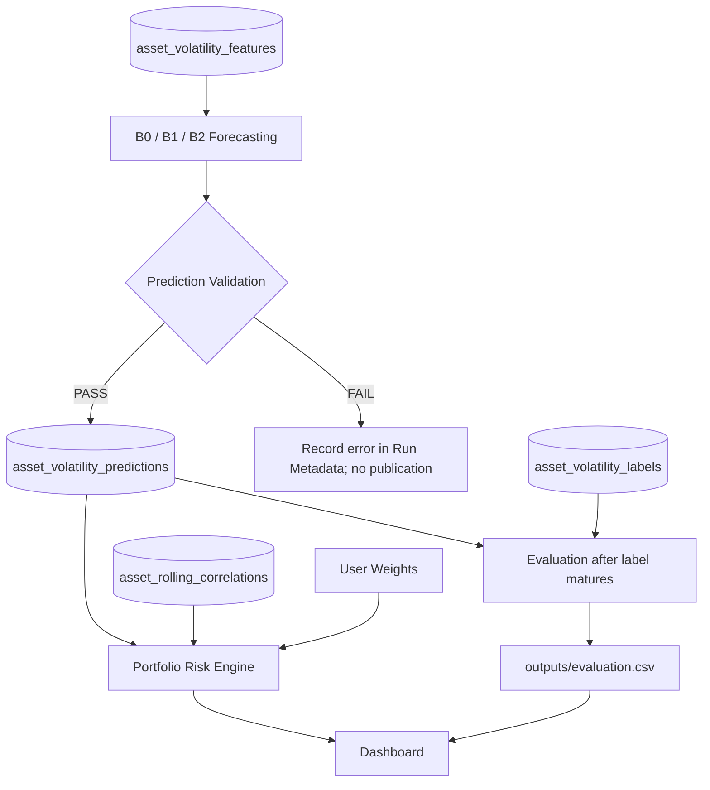

# Prediction Contract — Adaptive Portfolio Risk Lab

**Document:** `contracts/prediction_contract.md`  
**Scope:** Prediction ของ ETF `SPY`, `IEF`, `GLD` สำหรับ **5 วันซื้อขายถัดไป** และการส่งต่อผลให้ Portfolio Risk / Dashboard  
**Output หลัก:** `asset_volatility_predictions` เพียง **1 ตาราง** (16 คอลัมน์)  
**Evaluation Output:** `outputs/evaluation.csv` เป็นไฟล์ประกอบ ไม่เพิ่มตารางใหม่

> **Prediction Contract คืออะไร?**  
> เป็นข้อตกลงระหว่างขั้นตอน Forecasting กับส่วนที่นำผลไปใช้ โดยกำหนดว่าระบบต้องรับ Features และ Model State ที่ถูกต้อง ณ เวลาทำนาย ส่งออก Forecast รูปแบบใด ตรวจความถูกต้องอย่างไร เก็บเวอร์ชันและข้อมูลอ้างอิงอะไร และเมื่อไรจึงนำ Forecast ไปประเมินกับผลจริงได้

**หลักการสำคัญของโครงการ:** โมเดลทำนาย **Volatility ของแต่ละ ETF แยกกัน** แล้วจึงใช้ Forecast ทั้งสามและ Historical Correlation ในขั้น Portfolio Risk; การเปลี่ยนน้ำหนักพอร์ต **ไม่ทำให้ต้องฝึกโมเดลใหม่**

## 0. เอกสารที่ใช้ร่วมกันและขอบเขตที่ตกลงแล้ว

| เอกสาร | หน้าที่ |
|---|---|
| [README.md](./README.md) | ภาพรวมระบบและขอบเขต **5 Logical Tables** |
| [datadict.md](./datadict.md) | **Single Source of Truth** ของชื่อคอลัมน์ ชนิดข้อมูล หน่วย Nullable และ Key; **Schema Prediction 16 คอลัมน์ในหัวข้อ 5** |
| [data_contract.md](./data_contract.md) | ราคาและ Returns ที่ผ่าน Validation, Raw Snapshot, Quarantine, Ingestion Audit |
| [feature_contract.md](./feature_contract.md) | Core Features 8 ตัว, Warm-up, Correlation, Point-in-Time และ Splitting |
| [target_contract.md](./target_contract.md) | นิยาม Annualized 5-Day Forward Realized Volatility, Label Maturity และสูตร Portfolio Risk |



---

## 1. Input Contract — ก่อนสร้าง Forecast ต้องมีอะไรพร้อม

| Input | แหล่งข้อมูล | ข้อกำหนด |
|---|---|---|
| Feature ณ วัน `t` | `asset_volatility_features` | Join `(date=t, ticker)` ได้แถวเดียว, `is_model_ready=True`, `is_warmup_buffer=False`, Core Features 8 ตัวเป็น Finite |
| วิธีทำนาย / Horizon | Run Configuration | `model_name` อยู่ในรายการที่รองรับ; `forecast_horizon_trading_days=5` |
| Model State / Baseline Config | Model Artifact หรือ Config | มี `model_version` ชัดเจน; สำหรับโมเดลที่เรียนรู้ สถานะต้องสร้างจาก Labels ที่ Mature แล้ว ณ Cut-off |
| Input Lineage | Feature Run และ Input Manifest | ระบุ `feature_set_version`, `feature_run_id`, `input_snapshot_id` ได้ โดย Manifest ชี้กลับไปยังข้อมูล/Config ที่ใช้จริง |
| Trading Calendar | ปฏิทินตลาดสหรัฐฯ ที่โครงการกำหนด | หา `t+1` และ `t+5` เป็น **วันซื้อขาย** ไม่ใช่วันปฏิทิน |

**จุดเวลาของคำทำนาย:** `prediction_date=t` หมายถึงการทำนาย **หลังปิดตลาดวัน `t` และหลังข้อมูลของวันนั้นผ่าน Validation** ตาม `data_contract.md`; ไม่อนุญาตให้สร้าง Forecast โดยแอบอ่านราคาของวัน `t+1` เป็นต้นไป

### 1.1 วิธีพยากรณ์ที่กำหนดสำหรับโครงการ

| `model_name` | บทบาท | Input / กติกา |
|---|---|---|
| `CONSTANT_BASELINE` (**B0**) | Sanity-check baseline | ค่าคงที่คำนวณจาก **Training Labels ที่รู้ผลแล้วเท่านั้น**; บันทึกค่าคงที่ ช่วงฝึก และเวอร์ชันใน Config/Model Metadata |
| `ROLLING_20D_BASELINE` (**B1**) | Baseline หลัก | ใช้ `rv_20d` ของ ETF ณ วัน `t` เป็น Forecast โดยตรง; **ไม่ต้อง Train ด้วย Features 8 ตัว** |
| `ONLINE_SGD` (**B2**) | วิธีเปรียบเทียบ Online ML | `SGDRegressor` แยกตาม ETF ใช้ Core Features **8 ตัว** และ Scaler/Model State ที่ฝึกจากข้อมูลที่ใช้ได้ ณ เวลา Forecast เท่านั้น |

- ชื่อทั้งสามข้างต้นเป็น **ค่า `model_name` มาตรฐานที่ยึดใช้ใน Contract นี้**; เปลี่ยนชื่อหรือเพิ่มโมเดลต้องอัปเดต Config/Tests และเอกสารที่เกี่ยวข้อง
- `model_version` ต้องบ่งบอก **สถานะโมเดลและการเตรียมข้อมูลที่มีผลต่อคำทำนาย** ให้ตรวจสอบย้อนกลับได้ (B0/B1 ใช้ Config Version; B2 ใช้ Model/Scaler State Version)
- `last_training_target_end_date`: B1 ซึ่งไม่ฝึกจาก Labels ให้เป็น `NULL`; B0 และ B2 ถ้าใช้ Labels ฝึก/ตั้งค่าต้องระบุวันสิ้นสุด Target ล่าสุดที่ใช้จริง

---

## 2. Output Contract — `asset_volatility_predictions`

- **Grain:** หนึ่งคำทำนายของ **1 `ticker` × 1 `prediction_date` × 1 `model_name` × 1 ชุด Model/Input จริง** ภายใต้ Horizon 5 วันซื้อขาย
- **Primary Key:** `prediction_id` (รหัสไม่ซ้ำและคงเดิมเมื่อสร้างคำทำนายเชิงธุรกิจเดิมซ้ำ)
- **Logical Deduplication Key:** `(prediction_date, ticker, model_name, prediction_mode, model_version, feature_set_version, input_snapshot_id)`
- **รูปแบบจัดเก็บทางกายภาพ:** ใช้ CSV/Parquet/Database ได้ตามการ Implement; **ไม่เพิ่ม Logical Table ใหม่**

### 2.1 Schema ที่ต้องมี — 16 คอลัมน์ตรงตาม `datadict.md`

| # | Column | Logical Type | Nullable | ความหมาย / กฎสำคัญ |
|---:|---|---|:---:|---|
| 1 | `prediction_id` | `VARCHAR(64)` | No | Primary Key ที่ระบุ Record ได้ไม่ซ้ำ; รัน Logical Key เดิมต้องได้ ID เดิม |
| 2 | `prediction_date` | `DATE` | No | วันซื้อขายอ้างอิง `t` (America/New_York) และต้องตรงกับวัน Feature |
| 3 | `ticker` | `VARCHAR(16)` | No | `SPY`, `IEF`, `GLD` เท่านั้น |
| 4 | `model_name` | `VARCHAR(64)` | No | `CONSTANT_BASELINE`, `ROLLING_20D_BASELINE`, `ONLINE_SGD` |
| 5 | `model_version` | `VARCHAR(64)` | No | เวอร์ชัน Model State หรือ Baseline Config ที่ใช้จริง |
| 6 | `prediction_mode` | `VARCHAR(32)` | No | `HISTORICAL_REPLAY` หรือ `LATEST_BATCH` |
| 7 | `forecast_horizon_trading_days` | `INTEGER` | No | เท่ากับ **5** เสมอ |
| 8 | `target_start_date` | `DATE` | No | วันซื้อขาย `t+1` ตาม Trading Calendar |
| 9 | `target_end_date` | `DATE` | No | วันซื้อขาย `t+5` ตาม Trading Calendar |
| 10 | `predicted_vol_annualized` | `FLOAT` | No | Forecast ในหน่วย **annualized decimal**, Finite และ `>=0` |
| 11 | `feature_set_version` | `VARCHAR(16)` | No | เวอร์ชัน Feature Spec ที่ใช้ เช่น `2.0.0` |
| 12 | `feature_run_id` | `VARCHAR(64)` | No | Run ที่สร้าง Feature ณ `prediction_date` |
| 13 | `input_snapshot_id` | `VARCHAR(64)` | No | ID ของ Manifest/Snapshot ชุด Input ที่ใช้จริง; ชี้กลับไปยัง Source Versions ได้ |
| 14 | `last_training_target_end_date` | `DATE` | Yes | วัน `target_end_date` ล่าสุดของ Label ที่ใช้ฝึก/ตั้งค่า; `NULL` เมื่อไม่มีการฝึกด้วย Labels เช่น B1 |
| 15 | `run_id` | `VARCHAR(64)` | No | รหัส Prediction Run ที่สร้าง Record นี้ |
| 16 | `prediction_created_at_utc` | `TIMESTAMPTZ` | No | เวลา UTC **ที่สร้าง Record จริง** แม้เป็น Historical Replay |

**ข้อกำหนดด้านเวลา:** `DATE` เก็บวันตลาดตาม `America/New_York`; Timestamp ลงท้าย `_utc` ต้องมี Timezone เป็น UTC (`YYYY-MM-DDTHH:MM:SSZ`); ไม่ใช้เวลา UTC ที่รัน Replay มาปลอมเป็นเวลาที่สร้างคำทำนายในอดีต

### 2.2 นิยามหน่วย Forecast ให้ตรง Target

ใน `target_contract.md` นิยามคำตอบจริงของ ETF `i` ณ วัน `t` ว่า

$$
RV_{i,t,5}=\sqrt{\frac{252}{5}\sum_{k=1}^{5}r_{i,t+k}^{2}}
$$

ดังนั้น `predicted_vol_annualized` ต้องประมาณ **Annualized Realized Volatility จากผลตอบแทนใน 5 วันซื้อขายถัดไป** ไม่ใช่คาดการณ์ราคา, ผลตอบแทน, โอกาสขาดทุน หรือความผันผวนสะสม 5 วันโดยตรง

- `0.18` หมายถึง **18% annualized volatility** ไม่ใช่ 18% ตลอดช่วง 5 วัน
- สำหรับแสดงสเกลความผันผวน 5 วันโดยประมาณ: `predicted_vol_annualized × sqrt(5/252)` และแสดงหน่วยให้ถูกต้อง
- ห้ามบันทึกเปอร์เซ็นต์แบบ `18` แทนค่า decimal `0.18`

### 2.3 Non-negative & Invalid Prediction Policy (เคาะสำหรับ MVP)

เนื่องจากโมเดล Regression อาจส่งค่าติดลบได้ แม้ Target ไม่ติดลบ **นโยบายสำหรับ MVP นี้คือ Reject ค่าที่ไม่ถูกต้อง ไม่แอบแก้เป็นศูนย์:**

1. Predictor ให้ค่า **Finite และ `>=0`** → ผ่าน Numeric Gate และพิจารณา Validation อื่นต่อ
2. Predictor ให้ค่าติดลบ, `NaN`, `Inf` หรือไม่ใช่ตัวเลข → **Reject Record ของ ETF/Model นั้น** ไม่เขียนลง `asset_volatility_predictions`; บันทึก Reason เช่น `INVALID_PREDICTION_VALUE` ลง Run Metadata/Execution Error Record
3. **ไม่ใช้ `abs()`, `max(0, ...)` หรือ `fillna(0)` แบบเงียบ ๆ**; หากทีมเปลี่ยนนโยบายในอนาคต ต้องแก้ Contract/Tests อย่างเปิดเผยก่อน
4. ETF/Model อื่นที่ผ่านยังใช้ Forecast รายสินทรัพย์ได้ แต่ Portfolio Risk ไม่คำนวณหากชุด Forecast ที่เลือกขาดแม้หนึ่ง ETF

ข้อดีของนโยบายนี้คือไม่ต้องเพิ่มคอลัมน์ Raw Prediction หรือระบบ Revision เพื่อซ่อนการปรับแก้ผลทำนาย; ความล้มเหลวของโมเดลถูกแสดงตามจริง

---

## 3. Validation Rules & Failure Handling

| Check | Pass Criteria | Failure Action / Error Code |
|---|---|---|
| Schema | มี 16 คอลัมน์ตรง Dictionary; Type และ Nullable ถูกต้อง | Reject / `PREDICTION_SCHEMA_INVALID` |
| Asset | `ticker` อยู่ใน `{SPY, IEF, GLD}` | Reject / `UNKNOWN_TICKER` |
| Model / Mode | `model_name` และ `prediction_mode` อยู่ในรายการที่กำหนด | Reject / `INVALID_MODEL_OR_MODE` |
| Feature readiness | `asset_volatility_features.date=prediction_date`, `is_model_ready=True`, `is_warmup_buffer=False` | Reject / `FEATURE_NOT_READY` |
| Horizon & calendar | `forecast_horizon_trading_days=5`, Start/End ตรงวันซื้อขาย `t+1`/`t+5` | Reject / `INVALID_FORECAST_WINDOW` |
| Prediction value | `predicted_vol_annualized` เป็น Finite และ `>=0` | Reject / `INVALID_PREDICTION_VALUE` |
| Training cutoff | สำหรับ B0/B2 ข้อมูล Labels ที่ใช้จริงต้อง Mature ณ Cut-off; `last_training_target_end_date<=prediction_date` และสอดคล้องกับ Run/Model State | Reject / `TRAINING_LABEL_LEAKAGE` |
| Lineage | Model/Feature Version, `feature_run_id`, `input_snapshot_id`, `run_id` อ้างกลับได้ | Reject / `MISSING_LINEAGE` |
| Keys / Repeat | `prediction_id` และ Logical Key ไม่ขัดแย้งกับ Record เดิม | No-op หากซ้ำเหมือนเดิม; Reject / `PREDICTION_CONFLICT` หากเนื้อหาแตกต่าง |
| Portfolio set | Forecast 3 ETF ในวัน/Mode/วิธี/ชุด Input เดียวกัน; Correlation วันที่เดียวกันพร้อม | `INCOMPLETE_INPUTS`; ไม่คำนวณพอร์ต |

**กฎความสมบูรณ์ราย Ticker:** ถ้า SPY ไม่ผ่าน Validation ไม่จำเป็นต้องหยุด Forecast ของ IEF/GLD แต่ห้ามสร้างพอร์ตจากเพียงส่วนที่เหลือและห้าม Normalize น้ำหนักใหม่โดยอัตโนมัติ

**บันทึก Error ที่ไหน?** เก็บรายการ Prediction Fail/Warnings ใน **Run Metadata/Manifest File ของ Prediction Run** ที่อ้างได้ด้วย `run_id` (อาจใช้ JSON) ไม่จำเป็นต้องสร้างตาราง Quarantine หรือ Audit เพิ่ม; `logs/ingestion_runs.jsonl` ยังคงมีหน้าที่บันทึก **Ingestion Runs** ตาม Data Contract เดิม

---

## 4. Point-in-Time & Historical Replay

### 4.1 กฎที่ต้องรักษา

1. Forecast วัน `t` ต้องอ่าน Features ของวัน `t` ที่เกิดจากข้อมูลไม่เกินวันนั้น และเป็นชุดที่ตรวจคุณภาพแล้ว
2. Forecast วัน `t` **ไม่ต้องรอ Label ของวัน `t`**; Label นี้ต้องรอผลตอบแทนของ `t+1` ถึง `t+5`
3. Training/Scaler/Selection สำหรับ Online Model ต้อง Fit จากข้อมูล Train ที่รู้ผลจริงแล้วเท่านั้น ตาม `feature_contract.md`; ห้าม Fit ด้วย Validation/Test ก่อนการทำนาย
4. แบ่งชุด Train/Validation/Test แบบ Chronological และใช้ Purge ขอบช่วงตาม `feature_contract.md` (`target_end_date >= next_split_start_date` ของตัวอย่างชุดก่อนหน้าไม่เข้า Train)
5. ใน Historical Replay ที่วันจำลอง `s` ใช้ลำดับ **Predict → Save Forecast → ตรวจ Labels ที่ Mature แล้ว ณ `s` → Evaluate → Update**; อัปเดต B2 ด้วยตัวอย่างซึ่งครบ 5 วันและผ่าน Data Cut-off เท่านั้น และไม่ Update ตัวอย่างเดิมซ้ำ
6. `last_training_target_end_date` ต้องเป็นวัน Target จริงที่ใหม่ที่สุดซึ่งเคยใช้ฝึก Model State ณ คำทำนายนั้น สำหรับ B1 เป็น `NULL`; B0/B2 ต้องมีค่าและต้องไม่เกินข้อมูลที่รู้ผล ณ Cut-off
7. `prediction_created_at_utc` เป็นเวลาที่คำนวณจริง และ **ไม่ใช่** หลักฐานว่าสามารถเข้าถึง Yahoo Finance Snapshot เดียวกัน ณ วันในอดีต; รายงาน Historical Replay ต้องระบุข้อจำกัดเรื่องการปรับราคาย้อนหลังอย่างตรงไปตรงมา

### 4.2 เก็บคำทำนายก่อนดูคำตอบจริง

- หลังคำนวณ Forecast ของวัน `t` ให้ Validate และบันทึก Prediction Record โดย **ไม่เติม Target จริง/MAE/RMSE ลงใน 16 คอลัมน์นี้**
- เมื่อทราบผลจริงแล้ว ห้ามแก้ `predicted_vol_annualized` ย้อนหลังเพียงเพื่อให้ Metric ดีขึ้น
- Replay สามารถรันจาก Historical Snapshot ที่มีอยู่ แต่ต้องจำลองลำดับการเข้าถึง Labels ให้ถูกต้อง; การใช้ข้อมูลราคาที่แก้ย้อนหลังได้ไม่เท่ากับมี Historical Data Vintage ณ วันนั้นจริง

---

## 5. Storage, Idempotency & Lineage (แบบไม่เพิ่มระบบเกินจำเป็น)

1. **Storage:** ใช้ `asset_volatility_predictions` เป็น Logical Table ลำดับ 5; ยังไม่กำหนดว่าต้องใช้ CSV, Parquet หรือ SQL และไม่เพิ่ม Prediction Revision/Publication Table
2. **Stable Prediction ID:** สร้าง `prediction_id` แบบคงที่จาก Canonical Logical Deduplication Key (เช่น Hash ของ Tuple ที่เรียงฟิลด์ตามข้อ 2); อย่าใช้ `run_id` หรือเวลารันเป็นส่วนหนึ่งของ ID ที่ต้องคงที่เมื่อรันซ้ำ
3. **Idempotency:** เมื่อ Input Snapshot, Model Version, Feature Spec, Mode และ Business Key เดิมถูกประมวลผลซ้ำ ให้ **ไม่เพิ่ม Record ซ้ำ** และไม่เปลี่ยน Timestamp/Run ID ของ Record ต้นฉบับ; บันทึกการรันซ้ำใน Prediction Run Metadata
4. **Conflict:** หากพบ Logical Key เดิมแต่ Forecast Value ไม่ตรงเดิม ให้ไม่เขียนทับโดยอัตโนมัติ; ถือเป็นความขัดแย้งที่ต้องตรวจ Model State/Config/Input Manifest ก่อน
5. **New version:** ถ้าข้อมูลต้นทางเปลี่ยน, Feature Version เปลี่ยน หรือ Model State/Version เปลี่ยน ให้ใช้ Key ใหม่และสร้าง Prediction Record ใหม่ โดยไม่ลบค่าที่เคยเผยแพร่
6. **Input Manifest:** `input_snapshot_id` อ้างถึง Manifest/Metadata ที่ระบุ Snapshot Sources, Feature/Model Config, Versions และ Code/Run Identifier ที่ใช้; **ไม่มีการสมมติว่า Rolling Window ทั้ง 60 วันมาจาก Batch เดียว**
7. **Run Group:** สำหรับการสร้าง Forecast ของ SPY/IEF/GLD ในรอบเดียว ให้ใช้ `prediction_date`, `prediction_mode`, `model_name`, `input_snapshot_id` และ `run_id` ของรอบนั้นให้สอดคล้องกัน; `model_version` **ต่างกันตาม Ticker ได้** เพราะโมเดลเรียนรู้แยกกัน

**การเลือกผลสำหรับ Dashboard แบบ MVP:** ผู้ใช้เลือกวันและวิธีพยากรณ์; ระบบเลือก **หนึ่งชุด Run ที่ครบทั้ง 3 ETF** ซึ่งผ่าน Validation ภายใต้ `prediction_mode` และ `input_snapshot_id` เดียวกัน (หากมีหลายชุดจากต่าง Version ให้เลือกตาม Config/รายการที่ผู้ใช้ระบุอย่างชัดเจน ไม่ผสมชุดหรือเลือกแบบสุ่ม); ไม่ต้องสร้างตาราง Active Publication เพิ่ม

---

## 6. Evaluation Contract — `outputs/evaluation.csv`

**มีเพียงไฟล์ CSV สำหรับผลประเมิน** ไม่สร้างตาราง `prediction_evaluations` หรือคอลัมน์ Evaluation เพิ่มใน Prediction Table

### 6.1 เงื่อนไขก่อนประเมิน

- จับคู่ `asset_volatility_predictions.prediction_date` ↔ `asset_volatility_labels.date` **และ** `ticker` โดยต้องตรวจว่า `target_start_date` และ `target_end_date` ตรงกัน
- Label ต้อง `is_label_mature=True`, `target_obs_count=5` และ `target_realized_vol_5d` เป็น Finite, `>=0`; ใช้เฉพาะ Labels ที่ **รู้ผลจริง ณ เวลา Evaluation/Replay Date**
- คำทำนายที่ยังไม่มี Label ครบให้สถานะ **Pending Evaluation** ในการแสดงผล ไม่เติมค่า Error เป็น `0` และไม่เขียนเข้า Evaluation CSV

### 6.2 CSV Schema ขั้นต่ำและ Metric

| Column | ความหมาย |
|---|---|
| `prediction_id` | อ้างอิงคำทำนายที่ล็อกไว้ |
| `prediction_date` | วันที่อ้างอิง `t` |
| `ticker` | ETF ที่ถูกประเมิน |
| `model_name` | วิธีพยากรณ์ |
| `model_version` | เวอร์ชันโมเดลที่ใช้สร้างคำทำนายนั้น |
| `prediction_mode` | `HISTORICAL_REPLAY` / `LATEST_BATCH` |
| `target_version` | เวอร์ชันนิยาม Target ที่ใช้ประเมิน |
| `predicted_vol_annualized` | ค่า Forecast เดิม (annualized decimal) |
| `target_realized_vol_5d` | ค่าจริงที่ Mature แล้ว (annualized decimal) |
| `absolute_error` | $|\hat y-y|$ |
| `squared_error` | $(\hat y-y)^2$ |
| `evaluation_run_id` | รหัสรอบประเมิน |
| `evaluated_at_utc` | เวลา UTC ที่คำนวณผลประเมินจริง |

- MAE = ค่าเฉลี่ยของ `absolute_error`; RMSE = รากที่สองของค่าเฉลี่ย `squared_error`
- เปรียบเทียบ B1 กับ B2 (และ B0 ถ้าต้องการ) บน **ชุดวัน/Ticker/Split เดียวกัน** ไม่เอาคนละช่วงมาเทียบ และรายงานจำนวนตัวอย่างเสมอ
- Split ของการทดลอง (Train/Validation/Test) อ่านจาก Split Config/Run Manifest ที่ตรึงไว้; ไม่ใช้ผล Test เพื่อเลือก Hyperparameters แล้วรายงานเหมือนไม่เคยเห็น Test
- **Idempotency ของไฟล์ Evaluation:** หากสร้างผลประเมินชุด Input/Target/Config เดิมซ้ำ ให้ได้แถวเชิงธุรกิจเดิม (ตาม `prediction_id` + `target_version`) ไม่ Append Record ซ้ำ; ถ้าเปลี่ยนชุด Label/Version ให้บันทึกเหตุผลและสำรอง/สร้างไฟล์ผลประเมินใหม่อย่างตรวจสอบได้

---

## 7. Portfolio Risk Engine & Dashboard Consumer Contract

### 7.1 เงื่อนไขก่อนคำนวณพอร์ต

1. โหลด Forecast ใน **วัน `t` เดียวกัน**, Horizon = 5, Model/Mode และ Run Group ที่เลือกตรงกัน **ครบ SPY, IEF, GLD** โดยค่า Forecast ทุกตัวเป็น Finite และไม่ติดลบ
2. โหลด `asset_rolling_correlations` ณ **วัน `t` เดียวกัน** ที่ `is_corr_ready=True` และผ่าน Matrix Validation ตาม `feature_contract.md`/`target_contract.md`
3. รับน้ำหนักผู้ใช้ `w_SPY,w_IEF,w_GLD >=0` และผลรวม `=1` (Floating-point tolerance เช่น `1e-8`); ค่าเริ่มต้น `50%/30%/20%`
4. หาก Forecast ใดขาด หรือ Correlation/Weights ไม่ผ่าน → **ไม่คำนวณ Portfolio Risk** และแสดง `INCOMPLETE_INPUTS` (หรือ Weight Validation Error ใน UI) พร้อมสาเหตุ ไม่ Normalize น้ำหนักหรือคำนวณจาก ETF บางส่วนเอง

### 7.2 สูตรและการแสดงผล

$$
\hat{\boldsymbol\Sigma}_t=\mathbf D_t\mathbf R_t\mathbf D_t,
\qquad \hat\sigma_{p,t}=\sqrt{\mathbf w^\mathsf T\hat{\boldsymbol\Sigma}_t\mathbf w}
$$

- `D_t = diag(predicted_vol_annualized ของ SPY, IEF, GLD)`; `R_t` เป็น Correlation ย้อนหลัง **20 วันซื้อขาย** และเป็นเพียง **Historical Proxy** ไม่ใช่ Correlation Forecast
- Portfolio Output เป็น **Annualized Portfolio Volatility Estimate จากกรอบพยากรณ์ 5 วัน**; หากต้องการสเกล 5 วันใช้ `sqrt(5/252)` ตาม `target_contract.md`
- Dashboard แสดงวันที่, Model/Version, Forecast 3 ETF, Correlation Proxy, Portfolio Volatility, MAE/RMSE (เมื่อ Label Mature) และคำเตือนว่าเป็นเครื่องมือศึกษา **ไม่ใช่คำแนะนำซื้อขาย**
- เมื่อผู้ใช้เปลี่ยนน้ำหนัก **คำนวณสูตรพอร์ตใหม่เท่านั้น** ไม่สร้าง Features/Predictions หรือ Train Model ใหม่

---

## 8. ตัวอย่าง Prediction Record (ข้อมูลสมมติ)

ตัวอย่างนี้มี **16 คอลัมน์ตรงตาม Data Dictionary** และใช้ค่าที่สมมติขึ้นเพื่ออธิบาย Schema เท่านั้น ไม่ใช่ผลพยากรณ์จริง:

```json
{
  "prediction_id": "pred_spy_20260925_online_sgd_demo",
  "prediction_date": "2026-09-25",
  "ticker": "SPY",
  "model_name": "ONLINE_SGD",
  "model_version": "spy_sgd_state_20260925_preupdate",
  "prediction_mode": "HISTORICAL_REPLAY",
  "forecast_horizon_trading_days": 5,
  "target_start_date": "2026-09-28",
  "target_end_date": "2026-10-02",
  "predicted_vol_annualized": 0.18,
  "feature_set_version": "2.0.0",
  "feature_run_id": "feat_run_demo_001",
  "input_snapshot_id": "snapshot_demo_001",
  "last_training_target_end_date": "2026-09-24",
  "run_id": "pred_run_demo_001",
  "prediction_created_at_utc": "2026-11-04T15:00:00Z"
}
```

ในระบบจริง `prediction_id` ต้องสร้างจาก Logical Deduplication Key อย่างคงที่ตามหัวข้อ 5 ไม่ใช่ตั้งเองจากชื่อที่อ่านง่ายเหมือนตัวอย่างนี้

---

## 9. Acceptance Criteria & Automated Tests (ยังต้อง Implement)

- [ ] สร้าง `asset_volatility_predictions` **16 คอลัมน์ตรงตาม `datadict.md`**; ไม่เพิ่ม Evaluation Table
- [ ] สร้าง B0/B1/B2 โดยแยกโมเดลราย ETF; B1 ใช้ `rv_20d` โดยตรงและ B2 ใช้ Core Features 8 ตัว
- [ ] ทุก Forecast มี Horizon 5 วันซื้อขายและ `target_start_date`/`target_end_date` ถูกต้องตาม Market Calendar
- [ ] Feature ณ `t` ไม่อ่านราคาอนาคต; Training State ไม่ใช้ Labels ที่ยังไม่ Mature ณ Cut-off
- [ ] Reject ค่าติดลบ, NaN, Inf โดยบันทึก Error; ไม่มีค่า Invalid เข้าตารางคำทำนาย
- [ ] รันซ้ำจาก Input/Model Version เดิมแล้วไม่เกิด Logical Key ซ้ำและไม่เขียนค่าเก่าทับ
- [ ] เลือก Prediction 1 รายการแล้วย้อนกลับไปยัง Model Version, Feature Run, Input Manifest, Source Snapshot ได้
- [ ] Historical Replay: Predict และ Save ก่อน Evaluate/Update; Online Update ไม่ซ้ำ Label เดิม
- [ ] `outputs/evaluation.csv` มีเฉพาะ Prediction ที่ Label Mature และสูตร Absolute/Squared Error ถูกต้อง; เทียบ B1/B2 บน Test Dates เดียวกัน
- [ ] Forecast ไม่ครบทั้ง 3 ETF หรือ Correlation ไม่พร้อม → `INCOMPLETE_INPUTS`, ไม่คำนวณพอร์ตบางส่วน
- [ ] เปลี่ยนน้ำหนักแล้ว Portfolio Risk เปลี่ยนตามสูตรโดย **ไม่ Retrain**

> **Definition of Done:** มีโค้ดที่บังคับใช้กฎตาม Contract, มี Tests ผ่านด้วยข้อมูลควบคุมและการรันจริง พร้อม Trace ไปยัง Raw Snapshot/Model Run; คำว่า **Final** ในหัวเอกสารหมายถึง *สเปกที่ตกลงใช้* ไม่ใช่การยืนยันว่าผลทดลองหรือระบบเสร็จสมบูรณ์แล้ว
