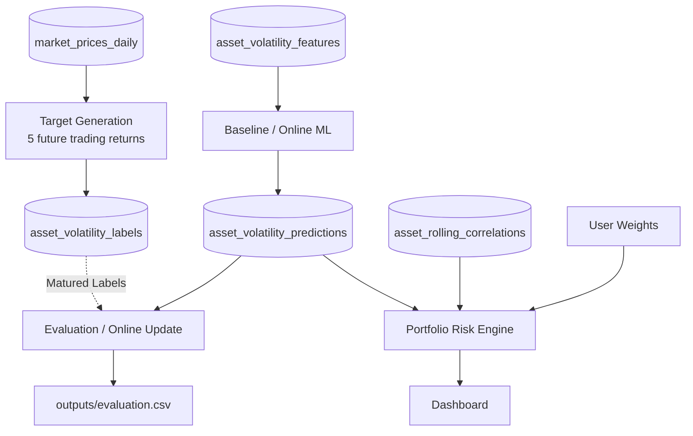

# Target Contract — Adaptive Portfolio Risk Lab

**Document:** `contracts/target_contract.md`  
**Scope:** Target / Label ของ ETF **SPY, IEF, GLD** และกติกา **Downstream Portfolio Risk Calculation**

> **Target Contract** กำหนดว่า “คำตอบจริง” ที่โมเดลต้องทำนายคืออะไร คำนวณอย่างไร รู้ผลจริงเมื่อใด และต้องผ่านกฎใดจึงนำไปฝึก/ประเมินโมเดลได้ พร้อมกำหนดวิธีนำค่าพยากรณ์รายสินทรัพย์ไปคำนวณความเสี่ยงพอร์ตโดย **ไม่ฝึกโมเดลใหม่เมื่อผู้ใช้เปลี่ยนน้ำหนัก**

## 0. เอกสารที่ต้องอ่านร่วมกัน

- [README.md](./README.md) — ภาพรวมระบบและ 5 ตารางหลัก
- [data_contract.md](./data_contract.md) — Canonical Price (`adjusted_close`), Returns, วันซื้อขาย และ Data Quality
- [datadict.md](./datadict.md) — **Single Source of Truth ของ Schema**, Type, Nullable และ Primary Key
- [feature_contract.md](./feature_contract.md) — Historical Features, Rolling Correlation และ Point-in-Time Rules
- [prediction_contract.md](./prediction_contract.md) — การบันทึก/ใช้คำทำนายและผล Evaluation (จะต้องปรับ Final ให้ตรงกับ 5 ตาราง)

---

## 1. ขอบเขตและ Input / Output

| รายการ | ข้อตกลง |
|---|---|
| **Input** | `market_prices_daily` ซึ่งผ่าน Validation แล้ว; ใช้ `date`, `ticker`, `adjusted_close` / `log_return` และ Source Metadata |
| **Canonical Price** | ใช้ `adjusted_close` ซึ่งมาจาก `yfinance` โหมด `auto_adjust=True` สำหรับคำนวณผลตอบแทน; `open` / `high` / `low` มีไว้เก็บข้อมูลราคาและตรวจคุณภาพ **ไม่ใช้คำนวณ Target** |
| **Output** | `asset_volatility_labels` (**12 คอลัมน์** ตาม `datadict.md`) |
| **Grain / Primary Key** | 1 แถวต่อ `(date, ticker)`; `date` คือวันทำนายอ้างอิง $t$ และ `ticker` เป็นหนึ่งใน `SPY`, `IEF`, `GLD` |
| **Target** | `target_realized_vol_5d` = Annualized Realized Volatility ที่คำนวณจากผลตอบแทนจริง **5 วันซื้อขายถัดไป** ($t+1$ ถึง $t+5$) |
| **Time Standard** | วันที่ซื้อขายใช้ `America/New_York`; คอลัมน์เวลา `_utc` เป็นเวลา UTC จริงชนิด `TIMESTAMPTZ` |
| **ไม่อยู่ในขอบเขต** | การสร้าง Features, การ Train โมเดล, ผล Prediction Records และการสร้างตาราง Evaluation/Portfolio เพิ่ม |

### Data Flow ที่เกี่ยวข้อง

**สำคัญ:** เส้นจาก Labels ไป Evaluation / Update ไม่ได้หมายความว่าใช้ Label ของวัน $t$ ในการทำนายวัน $t$; **คำทำนายต้องออกก่อนรู้ผลจริง** และ Label ใช้ได้หลังครบกำหนดเท่านั้น

---

## 2. นิยามและสูตร Target 5 วัน

กำหนดให้ $P^{\mathrm{adj}}_{i,s}$ คือราคาปิดปรับปรุงแล้ว (`adjusted_close`) ของสินทรัพย์ $i$ ในวันซื้อขาย $s$ และให้ผลตอบแทนลอการิทึมรายวันเป็น

$$
r_{i,s}=\ln\left(\frac{P^{\mathrm{adj}}_{i,s}}{P^{\mathrm{adj}}_{i,s-1}}\right)
$$

**Target รายสินทรัพย์ ณ วันอ้างอิง $t$:**

$$
y_{i,t}=\operatorname{RV}^{\mathrm{forward}}_{i,t,5}
=\sqrt{\frac{252}{5}\sum_{k=1}^{5}r_{i,t+k}^{2}}
$$

โดยมีข้อกำหนดดังนี้

1. ใช้ผลตอบแทน **วัน $t+1,t+2,t+3,t+4,t+5$ เท่านั้น**; **ไม่รวม**ผลตอบแทนวัน $t$ และห้ามใช้ข้อมูลวันอนาคตเป็น Features ณ วัน $t$
2. วันที่ $t+k$ หมายถึง **วันซื้อขายลำดับที่ $k$ หลัง $t$** ตาม Trading Calendar ของตลาดต้นทาง ไม่ใช่การบวกจำนวนวันปฏิทิน
3. สูตรใช้ **Root-Mean-Square ของ Log Returns แบบไม่หักค่าเฉลี่ย** (Zero-mean / non-demeaned convention) และ Annualize ด้วยฐาน **252 วันซื้อขาย/ปี** ให้ตรงกับ `rv_5d`, `rv_20d`, `rv_60d` ใน Feature Contract
4. หน่วยคือ **annualized decimal** เช่น `0.18` หมายถึง **18% ต่อปี ประมาณจากผลตอบแทนในหน้าต่าง 5 วัน** ไม่ใช่การเคลื่อนไหวสะสม 18% ภายใน 5 วัน
5. ค่า Target ที่สมบูรณ์ต้องเป็นตัวเลข **Finite และไม่ติดลบ**; ถ้าผลตอบแทนใดหาย/ไม่ผ่าน Validation ห้ามคำนวณจากจำนวนวันที่ไม่ครบ

> **การแสดงผล 5-day horizon:** Dashboard แสดง `target_realized_vol_5d` และ `predicted_vol_annualized` ด้วยป้าย **Annualized Volatility (5-day horizon)** เป็นค่าเริ่มต้น หากต้องการแสดงสเกลความผันผวน 5 วันแบบไม่ Annualize ให้แปลงด้วย $\sqrt{5/252}$ อย่างสอดคล้องกันและระบุหน่วยใหม่ ไม่เรียกค่ารายปีว่า “ความผันผวนสะสม 5 วัน” โดยตรง

---

## 3. Schema Contract: `asset_volatility_labels`

**Primary Key:** `(date, ticker)`; **12 คอลัมน์** ตาม [`datadict.md`](./datadict.md)

| # | Column | Type | Nullable | หน้าที่ / กติกา |
|---:|---|---|---|---|
| 1 | `date` | `DATE` | No | วันทำนายอ้างอิง $t$ |
| 2 | `ticker` | `VARCHAR(16)` | No | `SPY`, `IEF`, `GLD` |
| 3 | `target_start_date` | `DATE` | Yes (Pending) | วันซื้อขาย $t+1$; สามารถกำหนดล่วงหน้าจาก Calendar ได้ แม้ยังไม่มีราคาจริง |
| 4 | `target_end_date` | `DATE` | Yes (Pending) | วันซื้อขาย $t+5$; ใช้ตรวจช่วง Target/Purge; สามารถกำหนดล่วงหน้าจาก Calendar ได้ |
| 5 | `target_obs_count` | `INTEGER` | No | จำนวน **Validated Log Returns** ที่มีแล้วในหน้าต่าง 5 วัน ค่า `0..5` |
| 6 | `target_realized_vol_5d` | `FLOAT` | Yes (Pending) | ค่า $y_{i,t}$; เป็น `NULL` เมื่อยังไม่ Mature |
| 7 | `is_label_mature` | `BOOLEAN` | No | `True` เฉพาะเมื่อครบ 5 Returns ที่ถูกต้องและคำนวณ Target ได้ |
| 8 | `target_version` | `VARCHAR(16)` | No | เวอร์ชันนิยาม Target เช่น `2.0.0` |
| 9 | `run_id` | `VARCHAR(64)` | No | Run ที่สร้าง/ประมวลผลแถว Label ปัจจุบัน |
| 10 | `source_batch_id` | `VARCHAR(64)` | No | Raw Snapshot ของ **แถวราคาวัน $t$** สำหรับการอ้างอิงหลัก; Forward Window อาจมาจาก Batch อื่น |
| 11 | `record_created_at_utc` | `TIMESTAMPTZ` | No | เวลา UTC **ที่สร้างแถวนี้ครั้งแรก** แม้ยัง Pending |
| 12 | `label_matured_at_utc` | `TIMESTAMPTZ` | Yes (Pending) | เวลา UTC ที่คำนวณ Label สำเร็จจริง; ระหว่าง Pending ต้องเป็น `NULL` |

**กรณีวันที่อนาคต:** `target_start_date` / `target_end_date` อาจยังไม่ทราบหรือไม่ถูกกำหนดในข้อมูลบางบริบท จึงอนุญาต `NULL` ตาม Data Dictionary แต่ถ้าใช้ Trading Calendar คำนวณได้แล้วให้บันทึกวันที่ **ตามปฏิทิน** ได้เลยโดยไม่แปลว่ามีผลตอบแทนจริงครบ; ระหว่าง Pending ต้องตรวจ `is_label_mature` และ `target_obs_count` เสมอ

**กรณี Source Batch หลายชุด:** `source_batch_id` ใน Label ไม่ได้ยืนยันว่า Returns ทั้งช่วง $t+1$ ถึง $t+5$ มาจาก Raw Snapshot เดียวกัน; ให้เก็บ **Input Manifest ที่ผูกกับ `run_id`** (เช่น Source Paths/Checksums, ช่วงวัน, Config และ `target_version`) เป็นไฟล์ Metadata ไม่ใช่ตารางที่ 6

---

## 4. Label Lifecycle: Pending → Mature

**กฎสถานะที่ต้องถูกต้องเสมอ**

| สถานะ | `target_obs_count` | `target_realized_vol_5d` | `is_label_mature` | `label_matured_at_utc` |
|---|---:|---|---|---|
| **Pending** | `0..4` | `NULL` | `False` | `NULL` |
| **Mature** | `5` | Finite, `>= 0` | `True` | เวลา UTC จริง |

- ในวัน $t$ สามารถสร้าง **Pending Row** สำหรับสินทรัพย์ที่มีข้อมูลวัน $t$ ผ่าน Validation แล้ว โดย `target_obs_count=0`; `record_created_at_utc` ใช้เวลารันจริง ไม่ย้อนหลังจำลองให้เป็นวัน $t$
- เมื่อมีข้อมูล $t+1$ ถึง $t+5$ เพิ่มเข้ามา ให้ตรวจเฉพาะ **วันซื้อขายที่ควรมีในหน้าต่างเดิม** แล้วอัปเดต Count; เมื่อครบ 5 Valid Returns จึงเปลี่ยนเป็น Mature พร้อมคำนวณ Target และบันทึก `label_matured_at_utc`
- **ห้าม**ขยับหน้าต่างไปหลังวัน $t+5$ เพื่อชดเชยข้อมูลในวันใดที่ขาดหาย, ห้าม Forward-fill/Interpolation/ใส่ค่า `0` เพื่อเร่งให้ Mature และห้ามนำ Target ที่ยังไม่ Mature ไปประเมินหรือฝึกโมเดล
- ถ้าวันซื้อขายหนึ่งในหน้าต่างถูก Quarantine หรือข้อมูลไม่ผ่าน Validation ให้สถานะยังเป็น Pending/Unavailable และบันทึกข้อผิดพลาดที่ตรวจพบตามไฟล์ Log ที่ตกลงกัน; ไม่ปล่อย Target ผิดไป Downstream
- **บันทึกการเปลี่ยนสถานะอย่างไม่ทำให้ข้อมูลซ้ำ:** คีย์ `(date,ticker)` ต้องมีหนึ่งแถวใน Logical Table; จาก Pending เป็น Mature ให้ Update/Replace ตามคีย์ ไม่ Append เป็นแถวซ้ำ; รักษา `record_created_at_utc` เดิมไว้
- หากต้อง Reprocess/Backfill ด้วย Source Snapshot หรือ `target_version` ที่ต่างไป ให้บันทึก Run/Manifest และเหตุผลการแก้ค่า ไม่แก้ค่า Mature ในอดีตอย่างเงียบ ๆ; เมื่อใช้ Snapshot/Config/Version เดิม ค่าเชิงธุรกิจต้องคงเดิมแม้ `run_id` อาจเปลี่ยน

### ตัวอย่างสถานะ (สมมติ ไม่ใช่ข้อมูลตลาดจริง)

สมมติวันทำนายคือวันซื้อขาย $t$ และระบบทราบแล้วว่า 5 วันซื้อขายถัดไปคือ $d_1$ ถึง $d_5$:

- สิ้นวัน $t$: `target_start_date=d_1`, `target_end_date=d_5`, `target_obs_count=0`, `is_label_mature=False`, `target_realized_vol_5d=NULL`
- เมื่อผ่านถึง $d_3$ และข้อมูลผ่าน Validation: `target_obs_count=3`, `is_label_mature=False`, `target_realized_vol_5d=NULL`
- เมื่อปิดตลาดวัน $d_5$ และผลตอบแทนครบ 5 วันผ่าน Validation: `target_obs_count=5`, `is_label_mature=True`, `target_realized_vol_5d=<ค่าคำนวณจริง>`, `label_matured_at_utc=<เวลาที่คำนวณสำเร็จจริง>`

---

## 5. Point-in-Time, Training และ Evaluation

1. **Features ณ วัน $t$:** ใช้เฉพาะข้อมูลที่ทราบถึงวัน $t$ ตาม Feature Contract; Target จาก $t+1$ ถึง $t+5$ อยู่ในตารางแยกและ **ห้ามเข้า Model Matrix `$X$`**
2. **Batch Prediction:** สร้าง Forecast ณ วัน $t$ ได้จาก `asset_volatility_features` ที่ `is_model_ready=True` และ `is_warmup_buffer=False` โดย **ไม่ต้องรอ Label ของวัน $t$**
3. **Train / Validation / Test:** Join Feature กับ Label ผ่าน `(date,ticker)` เท่านั้น; ใช้ `is_model_ready=True`, `is_warmup_buffer=False`, `is_label_mature=True` และแบ่งตามเวลา ไม่มี Random Split
4. **Purge ที่จุดแบ่งเวลา:** ตัดตัวอย่างจากช่วงก่อนหน้าที่มี `target_end_date >= next_split_start_date` เพื่อไม่ให้ Forward Target ทับช่วงของชุดถัดไป; โดยทั่วไปสอดคล้องกับช่องว่างประมาณ 5 วันซื้อขาย
5. **Historical Replay / Online SGD:** ณ Replay Date $s$ ต้องสร้างคำทำนายก่อน แล้วจึง Evaluate/Update เฉพาะคำทำนายที่ Target ครบและผ่าน Data Cut-off แล้ว (`target_end_date <= s` และข้อมูลราคาวันสิ้นสุดผ่าน Ingestion/Validation); แม้ไฟล์ Label ของการทดลองย้อนหลังจะมีผล Mature ครบแล้ว ก็ **ห้าม**ใช้ค่า Label จากอนาคตของวัน Replay
6. **Timestamp จริงกับ Simulated Time:** `record_created_at_utc` และ `label_matured_at_utc` เป็นเวลาประมวลผลจริงของ Run ไม่ใช่เวลาที่ข้อมูลนั้น **เคย** พร้อมใช้ในโลกจริง; Replay ต้องอิง `target_end_date` + กฎ Data Availability และ Snapshot/Manifest ของ Run โดยเฉพาะ
7. **Evaluation:** หลังครบ 5 วัน จับคู่ `asset_volatility_predictions.prediction_date` กับ `asset_volatility_labels.date` และ `ticker`; ตรวจ `target_start_date`/`target_end_date` ให้ตรงกัน จากนั้นคำนวณ Absolute/Squared Error แล้วสรุป MAE/RMSE; **ผลเก็บ `outputs/evaluation.csv` เท่านั้น** ไม่สร้าง `prediction_evaluations` เป็นตาราง
8. **หน่วย:** Forecast, Target และ Baseline `rv_20d` เป็น Annualized Decimal เหมือนกันทั้งหมด; หาก Model ให้ผลติดลบ/ไม่เป็น Finite ให้ใช้กฎใน Prediction Contract เพื่อป้องกันการเผยแพร่ผลผิด ไม่แก้ Target จริงเพื่อให้เข้าเกณฑ์

---

## 6. Downstream Portfolio Risk Contract

ส่วนนี้เป็นกติกาการคำนวณพอร์ต **ไม่ได้สร้าง Target ของพอร์ตหรือเพิ่มตารางใหม่**

### 6.1 Input และเงื่อนไขก่อนคำนวณ

- **Forecasts:** ต้องมี `predicted_vol_annualized` ที่ Finite และ `>=0` **ครบ SPY, IEF, GLD** ณ `prediction_date=t` เดียวกัน และเป็นชุดคำทำนาย/Model Selection ที่เข้ากันตาม `prediction_contract.md`
- **Historical correlation:** ใช้ `asset_rolling_correlations` วันที่ $t$ เดียวกัน, `is_corr_ready=True`; ค่าสหสัมพันธ์ทั้ง 3 คู่คำนวณจาก **20 วันซื้อขายเดียวกันและมีผลตอบแทนครบทั้งสาม ETF** ถึงวัน $t$ เท่านั้น
- **น้ำหนักผู้ใช้:** $\mathbf w=[w_{SPY},w_{IEF},w_{GLD}]^{\mathsf T}$; MVP กำหนด **Long-only, Fully-invested**: ทุก $w_i\ge0$ และ $\sum_iw_i=1$ (ตรวจด้วย Floating-point tolerance เช่น `1e-8`); ค่าเริ่มต้น **50% / 30% / 20%**
- ห้ามปรับน้ำหนักที่ไม่ครบ 100% เป็น 100% โดยอัตโนมัติแบบเงียบ ๆ; ให้แจ้งผู้ใช้แก้ก่อนคำนวณ

### 6.2 สูตร Portfolio Volatility

กำหนดเวกเตอร์ค่าพยากรณ์ Annualized Volatility จาก 3 ETF และเมทริกซ์สหสัมพันธ์ย้อนหลัง 20 วันเป็น

$$
\hat{\boldsymbol\sigma}_{t}=
\begin{bmatrix}
\hat\sigma_{SPY,t} \\ \hat\sigma_{IEF,t} \\ \hat\sigma_{GLD,t}
\end{bmatrix},\quad
\mathbf D_t=\mathrm{diag}(\hat{\boldsymbol\sigma}_t),\quad
\mathbf R_t=\begin{bmatrix}
1&\rho_{SPY,IEF,t}&\rho_{SPY,GLD,t}\\
\rho_{SPY,IEF,t}&1&\rho_{IEF,GLD,t}\\
\rho_{SPY,GLD,t}&\rho_{IEF,GLD,t}&1
\end{bmatrix}
$$

**Annualized covariance proxy และความผันผวนพอร์ต:**

$$
\hat{\boldsymbol\Sigma}_t=\mathbf D_t\mathbf R_t\mathbf D_t,
\qquad
\hat\sigma_{p,t}=\sqrt{\mathbf w^{\mathsf T}\hat{\boldsymbol\Sigma}_t\mathbf w}
$$

เนื่องจาก $\hat\sigma_i$ เป็น Annualized ตัวเลข $\hat\sigma_{p,t}$ จึงเป็น **Annualized Portfolio Volatility สำหรับกรอบประมาณ 5 วันถัดไป**; หากแสดงค่าประมาณในสเกล 5 วัน ให้คูณ $\sqrt{5/252}$ และติดป้ายหน่วยให้ถูกต้อง

**Matrix Validation (บังคับ):** $\rho_{ij}\in[-1,1]$, diagonal = 1, Symmetry (เช่น tolerance `1e-12`) และ Positive Semidefinite $\lambda_{min}(\mathbf R_t)\ge -10^{-10}$; หลังสร้าง $\hat{\Sigma}$ ให้ตรวจ Symmetry และ $\mathbf w^T\hat{\Sigma}\mathbf w\ge0$ ภายใน Floating-point tolerance ก่อนถอดราก หากไม่ผ่านไม่คืนค่าพอร์ต

**ข้อจำกัด:** Correlation 20 วันที่ใช้เป็น **Historical Proxy** ไม่ใช่ Future Correlation Forecast; สูตร $\hat\Sigma$ เป็นการประมาณภายใต้สมมติฐานเรื่องโครงสร้างความสัมพันธ์ที่คงอยู่ ไม่ใช่การทำนาย Covariance โดย ML แยกต่างหาก

### 6.3 Failure Policy และ Dashboard

- หาก Forecast ของ `ticker` ใดไม่พร้อม/ไม่ผ่าน Validation หรือ `is_corr_ready=False` ให้คืน `portfolio_vol=NULL`, `status='INCOMPLETE_INPUTS'` และระบุรายการที่ขาด; ยังคงแสดง Forecast รายสินทรัพย์ที่ผ่านได้
- **ห้าม**ปรับน้ำหนักใหม่หรือคำนวณพอร์ตจากเพียง 1–2 ETF โดยเงียบ ๆ
- ผู้ใช้เปลี่ยน `w` → คำนวณ Portfolio Risk ใหม่จาก Forecasts/Correlation เดิม **ไม่ต้อง Train โมเดลใหม่**
- Dashboard ต้องแยกให้ชัดระหว่าง **ค่าพยากรณ์ความผันผวนรายสินทรัพย์**, **ค่าประมาณความเสี่ยงพอร์ต**, และ **ค่าความผันผวนจริงหลังรู้ผล** พร้อมระบุช่วงวัน/หน่วยให้ถูกต้อง

### 6.4 ถ้ามีการวิเคราะห์ Realized Portfolio Return ย้อนหลัง (Optional)

เพื่อประเมินพอร์ตตัวอย่างที่ **ปรับน้ำหนักกลับสู่สัดส่วนเป้าหมายทุกวัน** ใช้ Simple Returns จาก `market_prices_daily`:

$$
R_{p,s}=\sum_i w_i R_{i,s},
\qquad
r_{p,s}=\ln(1+R_{p,s})
$$

การบวก Log Returns รายสินทรัพย์แบบถ่วงน้ำหนักโดยตรง **ไม่ใช่** Log Return ของพอร์ต: $\sum_i w_i r_{i,s}\ne r_{p,s}$ โดยทั่วไป ส่วนนี้เป็นการวิเคราะห์ประกอบ ไม่ใช้แทน Label ของโมเดลรายสินทรัพย์ และ **ไม่ต้องสร้างตารางใหม่**

---

## 7. Lineage, Reprocessing และ Quality Gates

- `target_version='2.0.0'`, `run_id` เป็น Target Pipeline Run, `source_batch_id` อ้างอิง Raw Snapshot ของแถววัน $t$ และ **Input Manifest** ของ `run_id` ระบุแหล่งราคาที่อ่านจริงทั้งหน้าต่าง $[t,t+5]$ พร้อม Config/Code/Source Version ที่จำเป็น
- ระหว่าง Pending สามารถมี `record_created_at_utc` แม้ `label_matured_at_utc=NULL`; เมื่อ Mature ต้องบันทึกเวลากำหนดสถานะจริง ไม่สมมติเป็น Historical Timestamp
- หาก Ticker หนึ่งไม่ผ่าน Validation หรือ Label ของ Ticker นั้นมีข้อมูลขาด ให้หยุดส่ง Target ของ Ticker นั้นเข้าสู่ Training/Evaluation ในวันที่ได้รับผลกระทบ ไม่ต้องหยุดโมเดลของสินทรัพย์อื่นที่ผ่าน
- ทุกครั้งที่ Rebuild ด้วย Raw Snapshots + Config + Target Version เดิม ต้องได้ค่าธุรกิจเหมือนเดิมและไม่มี `(date,ticker)` ซ้ำ; Audit/Quarantine ใช้ไฟล์ประกอบตามที่ตกลง ไม่เพิ่ม Database Tables

| Test | เกณฑ์ผ่าน | หากไม่ผ่าน |
|---|---|---|
| Schema / PK | 12 คอลัมน์ตรง `datadict.md`; `(date,ticker)` ไม่ซ้ำ | ไม่เผยแพร่ Output |
| Target window | ใช้วันซื้อขาย $t+1$ ถึง $t+5$ ถูกต้อง, ไม่รวม $t$ | Fail Target |
| Target formula | ผลจากชุดข้อมูลทดสอบตรง $\sqrt{(252/5)\sum r^2}$ | Fail Target |
| Maturity | Count `0..4` → `NULL/False`; Count `5` → Finite/True | Fail Target |
| Pending timestamp | `record_created_at_utc` มีค่า; `label_matured_at_utc=NULL` | Fail Target |
| Mature timestamp | เมื่อ Mature ต้องมี `label_matured_at_utc` เป็น UTC จริง | Fail Target |
| Data gaps | วันซื้อขายขาด/ราคาเสีย → ไม่สร้าง Target เทียม/ไม่ขยับ Window | Hold/Fail Ticker |
| Point-in-time | Replay ไม่ใช้ Labels ที่ยังไม่ครบ ณ Replay Date | Fail Test |
| Purge | Train ไม่ใช้ตัวอย่างที่ Target Window ทับช่วง Validation/Test | Fail Test |
| Portfolio completeness | ขาด Forecast/Correlation แม้ 1 ตัว → `INCOMPLETE_INPUTS` | ไม่คำนวณ Portfolio |
| Matrix / Weights | PSD/Symmetric; น้ำหนักไม่ติดลบและรวม 1 | ไม่คำนวณ Portfolio |
| Idempotency | รันซ้ำไม่เพิ่ม PK และไม่เปลี่ยนค่า Target เชิงธุรกิจ | Fail Pipeline |

---

## 8. Acceptance Criteria — Target & Portfolio Risk

- [ ] สร้าง `asset_volatility_labels` ตาม **12 คอลัมน์ของ `datadict.md`** โดยไม่เพิ่มตาราง
- [ ] คำนวณ Target จาก **5 Validated Future Trading Returns** ครบ และให้หน่วย Annualized Decimal ตรงกับ Historical RV
- [ ] รองรับ Pending → Mature โดยไม่มีค่า Target แบบไม่ครบ 5 วัน, ไม่สร้างแถวซ้ำ และมี Timestamp สองความหมายชัดเจน
- [ ] Historical Replay สามารถทำนายก่อนรู้ Label และอัปเดต Online Model เมื่อ Label ครบจริงตาม Replay Date
- [ ] Evaluation แยกเก็บใน **`outputs/evaluation.csv`**, ไม่เพิ่ม Evaluation Table
- [ ] Portfolio Risk ใช้ Forecast 3 ETF และ Historical Correlation วันที่เดียวกันพร้อม Weight Validation; หากข้อมูลไม่ครบต้องไม่คำนวณพอร์ต
- [ ] ทดสอบ Unit/Window, Missing Data, Null, Leakage, PSD Matrix, Incomplete Inputs และ Idempotency ด้วยชุดข้อมูลควบคุม
- [ ] สามารถไล่ `run_id` / Input Manifest กลับไปยัง Raw Snapshot ที่ใช้สร้าง Target ได้
