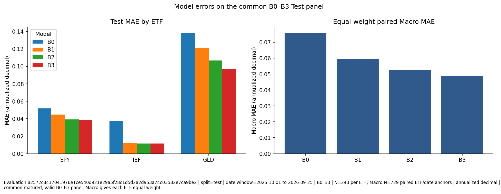
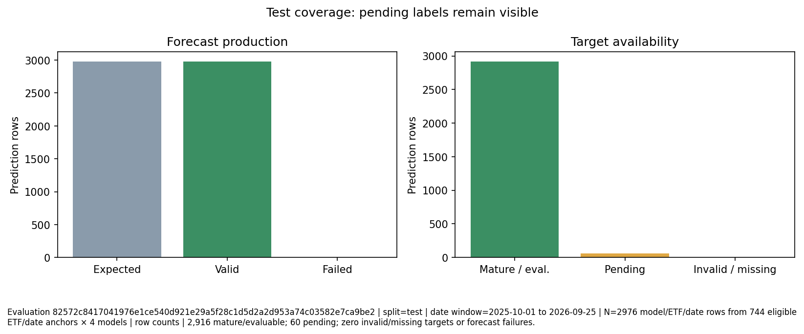

# 02 — Model Performance

## Test errors

The table reports Stage 06 metrics on the common panel where all four forecasts are valid and the target is mature. Each ETF has 243 paired Test observations. Macro uses 729 paired ETF/date observations and gives each ETF equal weight.

| Model | SPY MAE | SPY RMSE | IEF MAE | IEF RMSE | GLD MAE | GLD RMSE | Macro MAE | Macro RMSE |
|---|---:|---:|---:|---:|---:|---:|---:|---:|
| B0 `CONSTANT_BASELINE` | 0.051733 | 0.059999 | 0.037564 | 0.039898 | 0.138264 | 0.193562 | 0.075854 | 0.119245 |
| B1 `ROLLING_20D_BASELINE` | 0.044734 | 0.057443 | 0.012243 | 0.015497 | 0.121045 | 0.162580 | 0.059340 | 0.099953 |
| B2 `STATIC_SGD` | 0.039142 | 0.054414 | 0.011510 | 0.014623 | 0.106786 | 0.162022 | 0.052479 | 0.099039 |
| B3 `ONLINE_SGD` | 0.038557 | 0.053692 | 0.011503 | 0.014564 | 0.096618 | 0.151913 | 0.048892 | 0.093403 |

Lower error is better. In this frozen Test sample, B3 has the lowest Macro MAE among the four models. This is a description of the observed sample, not a forecast of future performance.

## Paired Macro DeltaMAE

DeltaMAE is baseline absolute error minus B3 absolute error. A positive value means B3 has lower paired absolute error. The estimates below come from `pair_comparisons.csv`; they use the common panel and equal ETF weights.

| Comparison | Macro DeltaMAE | Relative improvement | Paired N |
|---|---:|---:|---:|
| B3 vs B0 | 0.026961 | 35.54% | 729 |
| B3 vs B1 (H3) | 0.010448 | 17.61% | 729 |
| B3 vs B2 (H2) | 0.003587 | 6.83% | 729 |

These paired descriptive effects are separate from the hypothesis-test decisions in [H1–H3](03_hypotheses_h1_h3.md).

## Forecast and label coverage

| Test coverage state | Rows |
|---|---:|
| Expected model × ETF × date forecast rows | 2,976 |
| Valid forecasts | 2,976 |
| Mature and evaluable | 2,916 |
| Pending labels | 60 |
| Invalid/missing targets | 0 |
| Forecast exceptions | 0 |

There are 744 eligible ETF/date anchors across the three assets; each has four model forecasts. Pending labels are not forecast errors. Evaluation coverage is 2,916 / 2,976 = 97.98%; forecast coverage is 100%.

## High-volatility subset and time trends

The high-volatility threshold is the ETF-specific 80th percentile of eligible Train Forward RV5. The Test subset contains 15 SPY anchors per model, 189 GLD anchors per model, and no IEF anchors. IEF therefore has insufficient Test evidence for a high-volatility score. See [fig07_high_vol_metrics.png](figures/fig07_high_vol_metrics.png) and `high_volatility_metrics.csv`.

Monthly and yearly metrics, plus the rolling 20-session MAE series, are in the bundle. They are kept separate by split and model; Validation and Test are not combined into a single score.
