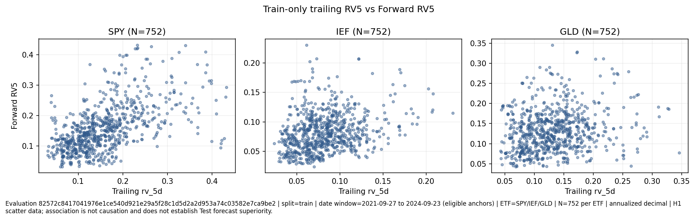
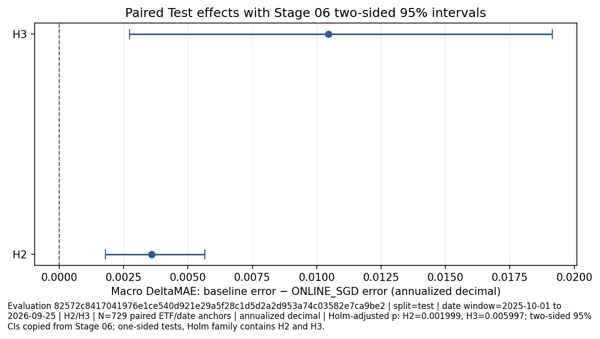

# 03 — Hypotheses H1–H3

All values below are copied from Stage 06 hypothesis artifacts. The notebook does not refit H1 or recompute p-values, intervals, or decisions.

## H1 — Train-only association

H1 tests whether trailing `rv_5d` is positively associated with Forward RV5. It uses Train-only OLS with Newey–West HAC lag 5, a one-sided alternative, and Holm adjustment across SPY, IEF, and GLD. The 95% intervals are two-sided. Association does not establish causality or Test forecast superiority.

| ETF | N | Beta | Raw one-sided p | Holm-adjusted p | Two-sided 95% CI | Decision |
|---|---:|---:|---:|---:|---:|---|
| SPY | 752 | 0.567075 | 4.996e-18 | 1.499e-17 | [0.437445, 0.696705] | Reject H₀ |
| IEF | 752 | 0.274968 | 1.470e-06 | 2.939e-06 | [0.159690, 0.390246] | Reject H₀ |
| GLD | 752 | 0.190001 | 0.002354 | 0.002354 | [0.058244, 0.321757] | Reject H₀ |

For example, the SPY coefficient means a 0.01 increase in annualized trailing `rv_5d` is associated with an estimated 0.005671 higher annualized Forward RV5 in the Train sample. This is an association, not a causal effect.

HAC lag sensitivities 10 and 20 are in `H1_sensitivity.csv`. All three estimated betas stay positive in those sensitivity runs; their raw p-values are not substitutes for the primary Holm-adjusted H1 result.

## H2 — ONLINE_SGD vs STATIC_SGD

## H3 — ONLINE_SGD vs ROLLING_20D_BASELINE

H2/H3 use paired Test outcomes on the same ETF/date anchors. The primary method is a synchronized moving-block bootstrap with 10 XNYS sessions and 2,000 replicates; Holm is applied across H2/H3. The test alternative is one-sided for positive DeltaMAE. The 95% intervals are two-sided.

| Hypothesis | Paired N | DeltaMAE | Raw p | Holm-adjusted p | Two-sided 95% CI | Decision |
|---|---:|---:|---:|---:|---:|---|
| H2: B3 vs B2 | 729 | 0.003587 | 0.0009995 | 0.001999 | [0.001789, 0.005652] | Reject H₀ |
| H3: B3 vs B1 | 729 | 0.010448 | 0.005997 | 0.005997 | [0.002738, 0.019148] | Reject H₀ |

Positive DeltaMAE means B3 has lower paired absolute error. The Test results support a positive paired improvement in this frozen sample under the contracted procedure. They do not prove prospective live performance or causality. A 95% confidence interval is not a 95% probability that H₀ is true.

Block-length 5 and 20 sensitivity diagnostics are available in `bootstrap_diagnostics.csv`. They are diagnostics; the primary H2/H3 values and decisions above remain the Stage 06 outputs.

