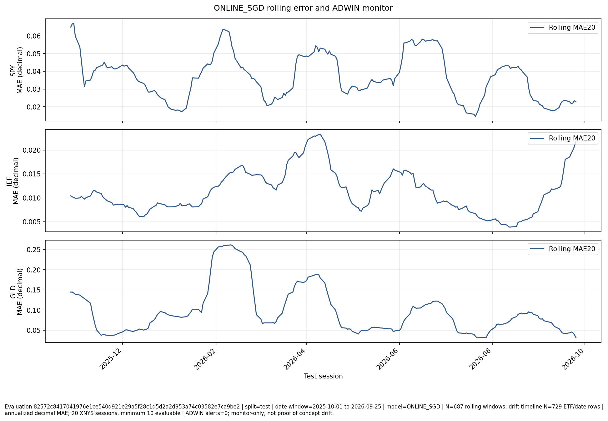
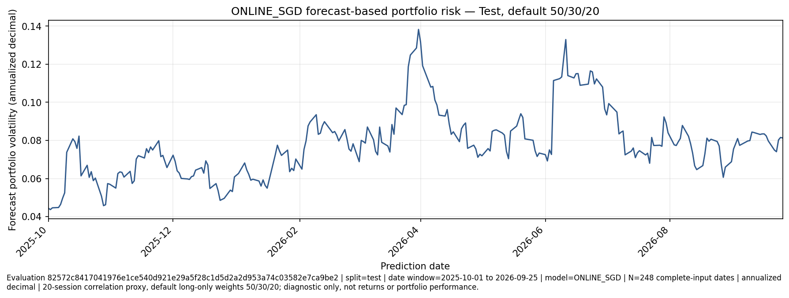

# 04 — Portfolio Risk and Drift Monitor

## ADWIN

ADWIN monitors ONLINE_SGD absolute error and is configured as monitor-only. Stage 06 recorded 729 Test common-panel ETF/date observations and **zero alerts**. The drift timeline's mature prediction dates run through 2026-09-18; labels at the end of the Test window can remain Pending until the five-session target matures.

The Test ONLINE_SGD rolling diagnostic has 687 rolling windows across the three ETFs. It uses the approved 20-XNYS-session window and the configured minimum of 10 evaluable rows. A detector alert, if present, would warrant inspection; it would not by itself prove a structural concept drift. Zero alerts in this run do not guarantee future stability.

## Forecast-based portfolio risk

Stage 06 calculates a portfolio-volatility diagnostic from the three model forecasts and the approved 20-session rolling correlations. The default long-only weights are SPY 50%, IEF 30%, GLD 20%. The Test ONLINE_SGD series has 248 complete-input dates, all with status `OK`.

This is not portfolio return, realized investment performance, or a recommendation. The correlations are a historical proxy and the volatility series is model-based. Changing weights in the consumer does not retrain B2/B3.

The notebook includes read-only what-if summaries for the default, equal-weight, and 60/20/20 allocations. Those scenarios apply the same stored covariance matrices and formula; they are derived diagnostics and are not Stage 06 model-comparison results.

