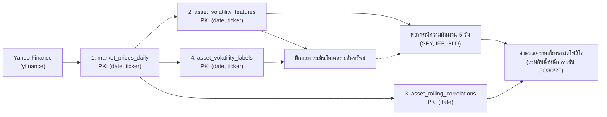

# สรุปภาพรวมระบบและสัญญาข้อมูล (Project & Contract Overview)

เอกสารสรุปสำหรับอ่านทบทวนและนำเสนอ ครอบคลุมแนวคิดหลักของระบบ วิวัฒนาการการออกแบบ และสรุปสาระสำคัญจาก Contract ทั้ง 4 ฉบับที่ได้ดำเนินการเสร็จสิ้นในปัจจุบัน

---

## 1. เป้าหมายและแนวคิดหลักของระบบ (Core Concept)

- **โจทย์หลัก**: ประมาณความเสี่ยงจากความผันผวนของพอร์ตโฟลิโอที่ประกอบด้วย ETF 3 สินทรัพย์ ได้แก่ **`SPY`** (หุ้นสหรัฐฯ), **`IEF`** (พันธบัตรรัฐบาลสหรัฐฯ 7–10 ปี) และ **`GLD`** (ทองคำ)
- **หลักการออกแบบ (Decoupled Architecture)**:
  1. **พยากรณ์แยกรายสินทรัพย์ (Asset-Level Forecasting)**: โมเดลทำนายความผันผวนจริงล่วงหน้า 5 วันทำการ (5-Day Forward Realized Volatility: $\hat{\sigma}_{\text{SPY},t}, \hat{\sigma}_{\text{IEF},t}, \hat{\sigma}_{\text{GLD},t}$) ของแต่ละสินทรัพย์แยกกัน
  2. **คำนวณความเสี่ยงพอร์ตในขั้น Downstream**: นำค่าความผันผวนที่พยากรณ์ได้ มาประกอบกับ **สหสัมพันธ์ย้อนหลัง 20 วัน (Historical Correlation Proxy)** และ **น้ำหนักพอร์ตที่ผู้ใช้กำหนด** (ค่าเริ่มต้นสาธิต **`50/30/20`**)
  3. **ปรับน้ำหนักได้โดยไม่ต้องฝึกโมเดลใหม่**: เมื่อผู้ใช้เปลี่ยนสัดส่วนน้ำหนักพอร์ต ระบบสามารถคำนวณความเสี่ยงพอร์ตโฟลิโอใหม่ได้ทันทีจากผลพยากรณ์ที่มีอยู่

---

## 2. สถานะปัจจุบันและพัฒนาการของการออกแบบ (Current Status & Key Decisions)

### 2.1 สถานะปัจจุบันของโปรเจกต์
- **สิ่งที่ทำเสร็จแล้ว**: กำหนดและสอบทานสัญญาข้อมูลครบทั้ง 4 ฉบับใน `docs/contract/` ได้แก่ [data_contract.md](./contract/data_contract.md), [datadict.md](./contract/datadict.md), [feature_contract.md](./contract/feature_contract.md) และ [target_contract.md](./contract/target_contract.md) พร้อมจัดเตรียมโครงสร้างโฟลเดอร์ตั้งต้น (`config/`, `data/`, `logs/`, `src/`)
- **ขั้นตอนถัดไป**: เริ่มพัฒนาโค้ด Daily Batch Pipeline ทีละส่วนตามสัญญาข้อมูลที่ล็อกไว้

### 2.2 จุดสำคัญที่ได้ปรับปรุงและล็อกสเปกจากช่วงออกแบบ Contract
1. **ปรับระดับหน่วยข้อมูล (Grain) เป็น `(date, ticker)` ทั้งระบบ**: เปลี่ยนจากการผูก Feature/Target เข้ากับพอร์ตน้ำหนักคงที่ (Equal Weight) มาเป็นระดับรายสินทรัพย์ เพื่อให้เปลี่ยนน้ำหนักพอร์ตได้อิสระ
2. **ล็อกมาตรฐานราคาและช่วงเวลา**: ดึงข้อมูลจาก `yfinance` ด้วย `auto_adjust=True` แล้วแปลงเป็นคอลัมน์มาตรฐาน `adjusted_close` ช่วงวิเคราะห์ตั้งต้นคือ `2021-09-27` ถึง `2026-09-25` (ดึงเผื่อช่วง Warm-up ล่วงหน้าอย่างน้อย 61 วันทำการ)
3. **แยกบทบาทของ Return**: ใช้ **Log Return** เป็นฐานคำนวณ Realized Volatility ทั้งใน Feature และ Target ส่วน **Simple Return** ใช้ตรวจค่ากระโดดผิดปกติ ($\pm 20\%$) และคำนวณผลตอบแทนพอร์ตย้อนหลัง
4. **แยก Data Dictionary เป็นแหล่งอ้างอิงกลาง**: รวมคำอธิบายคอลัมน์ ชนิดข้อมูล และเงื่อนไขค่าว่างไว้ที่ `datadict.md` ที่เดียว เพื่อลดความซ้ำซ้อนและป้องกัน Schema ขัดแย้งกัน

---

## 3. แผนภาพและตารางสรุปการไหลของข้อมูล (Data Lineage & Tables)

| ตาราง / ขั้นตอน | รับข้อมูลจาก | Grain & Primary Key | ข้อมูลสำคัญในตาราง | ส่งต่อไปที่ |
| :--- | :--- | :--- | :--- | :--- |
| **1. `market_prices_daily`** | Yahoo Finance (`yfinance`) | 1 สินทรัพย์ ต่อ 1 วันซื้อขาย **PK**: `(date, ticker)` | `adjusted_close`, `simple_return`, `log_return`, `is_anomaly_flagged` | Feature, Correlation และ Target Pipeline |
| **2. `asset_volatility_features`** | `market_prices_daily` (ข้อมูลถึงวัน $t$) | 1 สินทรัพย์ ณ สิ้นวัน $t$ **PK**: `(date, ticker)` | **Core 8 ตัว**: `ret_1d_t`, `ret_lag_1d`, `ret_lag_2d`, `ret_trailing_5d`, `ret_trailing_20d`, `rv_5d`, `rv_20d`, `rv_60d` **Experimental**: `rsi_14d`, `bb_width_20d` **Status**: `is_model_ready`, `is_warmup_buffer` | ฝึกโมเดล (Join กับ Labels) และทำนายผล ณ วันปัจจุบัน (Inference) |
| **3. `asset_rolling_correlations`** | `market_prices_daily` (`log_return` 20 วันล่าสุด) | 1 วันซื้อขาย ณ สิ้นวัน $t$ **PK**: `(date)` | `corr_spy_ief_20d`, `corr_spy_gld_20d`, `corr_ief_gld_20d` (Historical Proxy), `is_corr_ready` | ขั้นตอนคำนวณความเสี่ยงพอร์ตโฟลิโอ (Downstream) |
| **4. `asset_volatility_labels`** | `market_prices_daily` (ข้อมูลอนาคต $t+1$ ถึง $t+5$) | 1 สินทรัพย์ ณ วันอ้างอิง $t$ **PK**: `(date, ticker)` | `target_realized_vol_5d` (Target $y$), `target_obs_count`, `is_label_mature` | ฝึกและวัดผลโมเดล Machine Learning |
| **5. Portfolio Risk (Downstream)** | ค่าพยากรณ์ $\hat{\sigma}_{i,t}$ + ตาราง Correlation + น้ำหนัก $\mathbf{w}$ | 1 วันซื้อขาย ต่อชุดน้ำหนักพอร์ต | เมทริกซ์ความแปรปรวนร่วม $\hat{\boldsymbol{\Sigma}}_t$ และความผันผวนพอร์ต $\hat{\sigma}_{p,t}$ | รายงานผลและหน้า Dashboard |

---

## 4. สูตรคำนวณและกติกาสำคัญสำหรับนำเสนอ (Key Formulas & Rules)

### 4.1 สูตรคำนวณหลัก
1. **ผลตอบแทนรายวัน (Daily Returns)**:
   $$R_{i,t} = \frac{P_{i,t}^{\text{adj}}}{P_{i,t-1}^{\text{adj}}} - 1 \quad (\text{Simple Return}), \qquad r_{i,t} = \ln\left(\frac{P_{i,t}^{\text{adj}}}{P_{i,t-1}^{\text{adj}}}\right) \quad (\text{Log Return})$$
2. **ความผันผวนจริงย้อนหลัง (Historical RV Features — `rv_5d`, `rv_20d`, `rv_60d`)**:
   $$RV_{i,n,t} = \sqrt{\frac{252}{n} \sum_{j=0}^{n-1} r_{i,t-j}^{2}} \quad (\text{หน่วย: Annualized Decimal บนฐาน 252 วันทำการ})$$
3. **ความผันผวนจริงล่วงหน้า 5 วัน (Target — `target_realized_vol_5d`)**:
   $$y_{i,t} = \sqrt{\frac{252}{5} \sum_{k=1}^{5} r_{i,t+k}^{2}} \quad (\text{ใช้ผลตอบแทนอนาคต } t+1 \text{ ถึง } t+5 \text{ เท่านั้น})$$
4. **การรวมความผันผวนของพอร์ตโฟลิโอ (Downstream Portfolio Volatility)**:
   $$\hat{\sigma}_{p,t} = \sqrt{\mathbf{w}^\top \hat{\boldsymbol{\Sigma}}_t \mathbf{w}} = \sqrt{\sum_{i} w_i^2 \hat{\sigma}_{i,t}^2 + 2 \sum_{i < j} w_i w_j \hat{\sigma}_{i,t} \hat{\sigma}_{j,t} \rho_{ij,t}}$$

---

### 4.2 กฎการตรวจสอบคุณภาพและการป้องกัน Data Leakage
- **Point-in-Time & Purge Gap**: Feature ณ วัน $t$ ใช้ข้อมูลได้ไม่เกินสิ้นวัน $t$ การแบ่งชุดข้อมูล Train/Validation/Test ต้องเรียงตามเวลาและเว้นระยะ **Purge Gap อย่างน้อย 5 วันทำการ** เพื่อไม่ให้ช่วงเวลาของ Target ซ้อนทับกัน และต้อง `.fit()` ตัวปรับสเกล (Scaler) บนชุด Train เท่านั้น
- **การจัดการข้อมูลขาดหายและค่าผิดปกติ**:
  - ตรวจสอบวันซื้อขายเทียบกับปฏิทินตลาดสหรัฐฯ (NYSE/NASDAQ) **ห้ามทำ Forward-fill ข้ามวันโดยพลการ**
  - หากราคาเปลี่ยนแปลงเกิน $\pm 20\%$ ในวันเดียว (`abs(simple_return) > 0.20`) จะติดธงเตือน `is_anomaly_flagged = True` เพื่อตรวจสอบโดยไม่ตัดข้อมูลทิ้งทันที
  - ค่าว่างในช่วงเริ่มต้นที่ข้อมูลยังไม่ครบหน้าต่าง (เช่น 60 วันแรกของ `rv_60d`) ถือเป็น **Warm-up Null** ตามธรรมชาติ ห้ามเติม `0`
- **การแยกผลกระทบเมื่อข้อมูลมีปัญหา (Per-Ticker vs. Portfolio Policy)**:
  - **ระดับรายสินทรัพย์**: หากสินทรัพย์ใดไม่ผ่าน Validation จะถูกแยกเข้า Quarantine และหยุดเฉพาะสินทรัพย์นั้น ส่วนสินทรัพย์อื่นที่ผ่านเกณฑ์ยังสร้างคำพยากรณ์รายตัว ($\hat{\sigma}_{i,t}$) ได้ตามปกติ
  - **ระดับพอร์ตโฟลิโอ**: ต้องมีคำพยากรณ์ครบทั้ง 3 สินทรัพย์ และเมทริกซ์สหสัมพันธ์ต้องพร้อมใช้ (`is_corr_ready == True` คือคำนวณจาก 20 วันชุดเดียวกันและเป็น Symmetric & Positive Semidefinite) หากขาดตัวใดตัวหนึ่ง **ระบบจะระงับการคำนวณพอร์ต (`portfolio_vol = Null`, `status = 'INCOMPLETE_INPUTS'`) และแจ้งเตือนบน Dashboard โดยไม่แอบคำนวณจากสินทรัพย์ที่เหลือเพียงบางส่วน**
