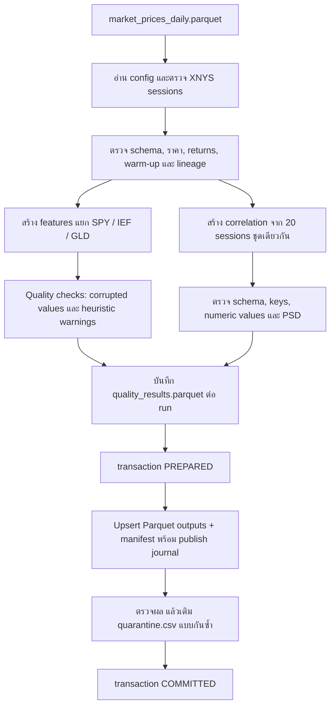

# Feature Engineering Pipeline

โมดูล `src/features/` อ่านตารางราคาที่ผ่าน Data Contract แล้วสร้างข้อมูล 2 ตาราง ได้แก่ `asset_volatility_features` และ `asset_rolling_correlations` โดยคำนวณจากข้อมูลที่มีถึงวันอ้างอิง `t` เท่านั้น โมดูลนี้ไม่สร้าง Target, ไม่ฝึกโมเดล และไม่คำนวณ Forecast หรือความเสี่ยงพอร์ต

สเปกหลักอยู่ใน [Feature Contract](../../docs/contract/feature_contract.md) ชนิดข้อมูลและ Nullable อยู่ใน [Data Dictionary](../../docs/contract/datadict.md) ส่วน input อ้างอิง [Data Contract](../../docs/contract/data_contract.md)

## ลำดับการทำงาน



การรันปกติทำผ่าน `run.py`; `pipeline.py` มีสูตรและการตรวจ input/output ส่วน `storage.py` ตรวจตาราง, ป้องกันการเขียนทับค่าธุรกิจที่เปลี่ยนโดยไม่ตั้งใจ และเผยแพร่ไฟล์ด้วย staging/rollback

## Input และ Config

รันคำสั่งจาก root ของ repository และตรวจช่วงวันที่ใน `config/features.yaml` ให้ตรงกับข้อมูลที่ต้องการ:

```bash
python -m src.features.run --config config/features.yaml
```

ค่าตั้งต้นใน config ปัจจุบันคือ:

| ค่า | หน้าที่ |
|---|---|
| `feature.start_date` / `end_date` | ช่วงวันที่วิเคราะห์; แถวก่อน `start_date` เป็น warm-up buffer |
| `feature.warmup_trading_days` | จำนวนวันซื้อขายที่ต้องมีให้ก่อนวันเริ่มวิเคราะห์; ต้องไม่น้อยกว่า 61 วัน |
| `feature.tickers` | ต้องเป็น `SPY`, `IEF`, `GLD` อย่างละหนึ่งครั้ง |
| `feature.feature_set_version` | เวอร์ชัน feature ที่เขียนลง output |
| `feature.expected_trading_days` | ใส่ลำดับวันที่คาดหวังได้สำหรับ isolated run; ยังต้องมีอย่างน้อย 61 sessions ก่อน `start_date`; ถ้าเว้นว่าง ระบบสร้างช่วงจากปฏิทิน `calendar.market` |
| `paths.input` | Parquet ของ `market_prices_daily` |
| `paths.features`, `paths.correlations` | ตำแหน่ง Parquet output สองตาราง |
| `paths.manifest_dir` | โฟลเดอร์เก็บ manifest แยกตาม `run_id` |
| `publish.overwrite_conflicts` | ค่าเริ่มต้น `false`; เปลี่ยนค่าธุรกิจของ key เดิมได้เมื่ออนุมัติอย่างชัดเจนเท่านั้น |

Input ต้องมี 13 คอลัมน์ตาม Data Dictionary รวม `open`, `high`, `low`, `adjusted_close`, returns, warm-up flag และ lineage metadata ระบบตรวจราคาเป็นค่าบวกและ finite, ลำดับ OHLC โดยยอมให้คลาดเคลื่อนแบบ absolute ได้ `1e-4` ในหน่วยราคาเดียวกับข้อมูลต้นทาง (ไม่ใช่ร้อยละ), primary key, warm-up flag, UTC ingestion timestamp และตรวจว่า `simple_return`/`log_return` คำนวณจาก `adjusted_close` ได้ตรงกัน

ระบบตรวจแต่ละ ticker ให้มีวันซื้อขายครบตาม XNYS รวม warm-up หากระบุ `expected_trading_days` จะใช้รายการนั้นตรวจทุก ticker โดยตรง ฟังก์ชัน `build_rolling_correlations()` ที่เรียกแยกต้องรับรายการ session ครบผ่าน `expected_trading_days` ด้วย

## Outputs

| Output | Grain / Key | จำนวนคอลัมน์ | ที่จัดเก็บตาม config ตั้งต้น |
|---|---|---:|---|
| `asset_volatility_features` | 1 แถวต่อ `(date, ticker)` | 18 | `data/curated/asset_volatility_features.parquet` |
| `asset_rolling_correlations` | 1 แถวต่อ `date` | 8 | `data/curated/asset_rolling_correlations.parquet` |

`asset_volatility_features` มีคอลัมน์ตามลำดับนี้:

```text
date, ticker,
ret_1d_t, ret_lag_1d, ret_lag_2d, ret_trailing_5d, ret_trailing_20d,
rv_5d, rv_20d, rv_60d, rsi_14d, bb_width_20d,
is_model_ready, is_warmup_buffer, feature_set_version, run_id,
source_batch_id, feature_as_of_utc
```

`asset_rolling_correlations` มีคอลัมน์:

```text
date, corr_spy_ief_20d, corr_spy_gld_20d, corr_ief_gld_20d,
is_corr_ready, run_id, source_batch_id, computed_at_utc
```

Timestamp ใน Parquet (`feature_as_of_utc`, `computed_at_utc`) เป็นชนิด timestamp ที่มี timezone UTC ไม่ใช่ string ส่วน `date` เป็น market date แบบ `DATE`

## สูตร Features

ให้ `P(t)` เป็น `adjusted_close` และ `r(t)` เป็น `log_return` ของ ticker เดียวกัน ทุก rolling window สิ้นสุดที่วัน `t` และไม่อ่านข้อมูลอนาคต

| กลุ่ม | คอลัมน์ | สูตร / ความหมาย |
|---|---|---|
| Core return | `ret_1d_t` | `r(t)` |
| Core return | `ret_lag_1d`, `ret_lag_2d` | `r(t-1)`, `r(t-2)` |
| Core return | `ret_trailing_5d`, `ret_trailing_20d` | `P(t) / P(t-n) - 1` |
| Core volatility | `rv_5d`, `rv_20d`, `rv_60d` | `sqrt(252 / n * sum(r²))` ในหน้าต่าง `n` วัน; Annualized Decimal และไม่หักค่าเฉลี่ย |
| Experimental | `rsi_14d` | RSI 14 วันด้วย Wilder's Smoothing จาก `adjusted_close` |
| Experimental | `bb_width_20d` | `4 * population_std(close_20) / mean(close_20)` |

Core Features 8 ตัวเป็น input ที่ downstream เลือกใช้ได้ ส่วน RSI และ Bollinger width อยู่ใน schema เพื่อการทดลองเท่านั้น `open`, `high`, `low` ใช้ตรวจคุณภาพราคาและไม่ถูกเพิ่มเป็น model features

### Warm-up และ Readiness

- ไม่มีการเติม Null ด้วยศูนย์, forward-fill, backward-fill หรือ interpolation
- `is_warmup_buffer` คัดลอกความหมายจาก input และต้องตรงกับ `date < start_date`
- `is_model_ready` เป็น `true` เมื่อ Core Features ทั้ง 8 มีค่าที่ finite เท่านั้น ไม่ขึ้นกับ Experimental Features หรือ warm-up flag
- แถว warm-up อาจยัง `is_model_ready=true`; downstream ต้องกรอง `is_warmup_buffer=false` เพิ่มเมื่อต้อง train/evaluate

## Rolling Correlations

ระบบจัด `log_return` ของ SPY, IEF และ GLD ให้ตรงกันตาม XNYS sessions แล้วใช้ 20 sessions เดียวกันคำนวณ Pearson correlation ทั้งสามคู่ หากข้อมูลไม่ครบหรือ ticker ใดมี variance เป็นศูนย์ ค่าทั้งสามคู่เป็น Null และ `is_corr_ready=false` เมทริกซ์ต้องมีค่าใน `[-1, 1]`, สมมาตร, มีแนวทแยงเป็น 1 และผ่าน PSD โดยใช้ tolerance ตาม Feature Contract

Correlation เป็น Historical Proxy จากข้อมูลถึง `t` สำหรับ Portfolio Risk เท่านั้น ไม่ใช่ค่าความสัมพันธ์ที่โมเดลพยากรณ์อนาคต

## Quality Checks และการจัดการผลผิดปกติ

### Hard failures

Input ที่ schema ไม่ครบ, มี key ซ้ำ, ราคา/return ไม่ถูกต้อง, warm-up ไม่ตรง หรือมีวันซื้อขายขาด/เกิน จะทำให้ Feature run หยุดก่อนเผยแพร่ output หากพบ expected market session ขาดจาก curated input ระบบ log ticker และวันที่, หยุดทั้ง run โดยไม่ publish output บางส่วน และไม่ append quarantine ซ้ำใน Feature stage กติกา per-ticker/quarantine ของ Data Contract §5.1 ใช้ใน Ingestion

ถ้าหลัง ticker เคยมี Core Features ครบแล้วพบ Core ค่า Null, NaN หรือ Inf ระบบจะ:

1. ทำเครื่องหมาย ticker นั้นว่ามีปัญหาใน run ปัจจุบัน
2. ตัด output feature ของ ticker นั้นออกจาก run นี้ โดยยังให้ ticker อื่นที่ผ่านทำงานต่อได้
3. บันทึกรายการตรวจพบไว้ใน `quality_results.parquet` ของ run ก่อนเผยแพร่ตารางหลัก
4. หลัง publish Feature outputs และ run manifest สำเร็จแล้ว จึงเติมเหตุการณ์ `CORRUPTED_FEATURE_NULL` ลง `logs/quarantine.csv` ตาม schema 7 คอลัมน์ที่ใช้ร่วมกับ ingestion
5. ตรวจผลที่เขียนและบันทึกสถานะ run เป็น `COMMITTED`; ถ้าเขียน quarantine ไม่สำเร็จ run จะค้างที่ `OUTPUTS_PUBLISHED` เพื่อกู้ต่อได้

ถ้าไม่มี ticker เหลือสำหรับเผยแพร่ ระบบจะหยุด run โดยไม่ publish feature output ชุดใหม่

### Non-blocking warnings

ช่วง heuristic ของ return และ realized volatility มาจาก Feature Contract §8.3 ระบบเก็บแต่ละเหตุการณ์ใน `quality.warnings` ของ run manifest พร้อมวันที่, ticker, feature, ค่า และขอบเขตที่ใช้ตรวจ การเตือนเหล่านี้ไม่ลบแถวและไม่บล็อกการ publish; ใช้สำหรับ review เท่านั้น และไม่ควรปรับ threshold ด้วยข้อมูล Test

## Lineage, Idempotency และ Reprocessing

แต่ละ run สร้างหลักฐานในโฟลเดอร์:

```text
data/audit/features/run_id=<run_id>/manifest.json
data/audit/features/run_id=<run_id>/quality_results.parquet
data/audit/features/run_id=<run_id>/transaction.json
data/audit/features/run_id=<run_id>/publish-transaction.json
```

Manifest บันทึก SHA-256 และ path ของ input/config, วันเริ่ม/สิ้นสุด, source batches แยก ticker, Raw Snapshot manifests/checksums ที่ตรวจสอบครบ, รายชื่อ output columns, quality warnings และ ticker ที่ quarantine ไฟล์นี้เป็น run metadata ไม่ใช่ตารางข้อมูลเพิ่ม `quality_results.parquet` เก็บ warning และ quarantine finding พร้อม `finding_id` เพื่อใช้ตรวจหรือกู้คืน; ไฟล์นี้เป็นหลักฐานตรวจสอบแยกตาม run ไม่ใช่ตารางที่ downstream นำไปใช้แทน output หลัก

`transaction.json` มีสถานะ `PREPARED`, `OUTPUTS_PUBLISHED`, `COMMITTED` หรือ `FAILED` ส่วน `publish-transaction.json` เก็บรายการไฟล์ชั่วคราว, ไฟล์สำรอง และ checksum ของการเผยแพร่ หากโปรเซสหยุดระหว่างแทนไฟล์ ระบบจะกู้ไฟล์เดิมกลับจาก journal ก่อนเริ่ม run ใหม่ หาก output เผยแพร่ครบแล้วแต่ quarantine ยังไม่ครบ ระบบจะตรวจ output กับ manifest แล้วเติมรายการที่ขาดจาก `quality_results.parquet` ก่อนเริ่ม run ใหม่ โดยไม่เพิ่มรายการเดิมซ้ำ

สถานะ `COMMITTED` หมายถึง output ทั้งสองตารางตรงกับ manifest และ quarantine finding ของ run ถูกตรวจครบแล้ว ถ้าหลักฐานอ่านไม่ได้หรือ checksum/count ไม่ตรง ระบบจะหยุดพร้อมระบุไฟล์ที่มีปัญหา เพื่อไม่ให้เริ่ม publish run ใหม่ทับข้อมูลที่ยังตรวจไม่ผ่าน

ก่อนเริ่ม Feature quality filtering และก่อนเขียน quarantine ทุก `source_batch_id` ที่อ้างจาก curated input ต้องมี `data/raw/<source_batch_id>/manifest.json` ที่อ่านได้และมี `source_batch_id` ตรงกัน, `raw_file_path` ซึ่งชี้ไปยังไฟล์ที่มีอยู่จริง และ `sha256` ที่เป็น hexadecimal 64 ตัวอักษร หากตรวจไม่ผ่าน run จะหยุดและไม่ publish Feature output; การตรวจนี้อ่านเฉพาะ manifest กับ metadata การมีอยู่ของ Raw file ไม่อ่านเนื้อหา Raw CSV และไม่คำนวณ checksum ของ Ingestion ซ้ำ

การเผยแพร่ทำ upsert ด้วย `(date, ticker)` และ `date` ตามลำดับ หาก key เดิมมีค่าเชิงธุรกิจเหมือนเดิมจะไม่สร้างแถวซ้ำ หากค่าต่างกัน run จะหยุดโดยปริยาย ให้ตรวจ input/source ก่อน แล้วค่อย rerun ด้วย:

```bash
python -m src.features.run --config config/features.yaml --overwrite-conflicts
```

ใช้ `--run-id <id>` เพื่อกำหนด run id เองสำหรับการตรวจสอบย้อนหลัง โดยใช้ตัวอักษร/ตัวเลขขึ้นต้น และใช้อักษร ตัวเลข `_`, `-`, `.` ได้ไม่เกิน 64 ตัว; ห้ามใช้ id ซ้ำกับ run ที่มี directory หรือ manifest อยู่แล้ว

## Tests และขอบเขต

รันทดสอบเฉพาะโมดูลจาก repository root:

```bash
python -m pytest src/features/test_feature_pipeline.py -v
```

ชุดทดสอบครอบคลุมสูตร/schema, point-in-time, การแยก ticker, warm-up/readiness, calendar gaps, returns/ราคาไม่ถูกต้อง, correlations, quality warning/quarantine, manifest, timestamp schema และ idempotency

โมดูลนี้สร้าง Features กับ Historical Correlations เท่านั้น การสร้าง `asset_volatility_labels`, การ train/validate model, การสร้าง predictions และการคำนวณ Portfolio Risk อยู่ในขั้น downstream ตาม Contract ที่เกี่ยวข้อง
